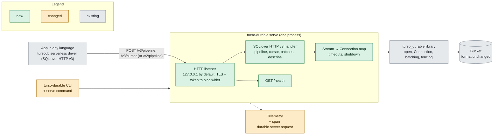
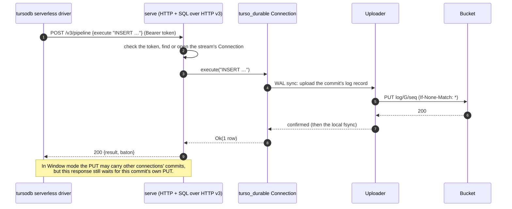
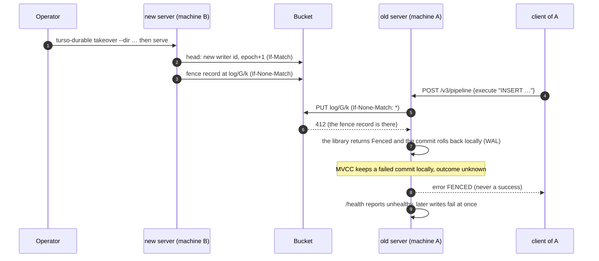

# turso-durable

Make a tursodb database durable in an S3 bucket. A Rust library (`turso_durable`) and a CLI (`turso-durable`).

Your app keeps a normal local database directory. Every commit is uploaded to the bucket before it returns, so the commit survives the loss of the machine. A new machine can restore the database from the bucket alone.

This is stage 4: one writer process at a time, with manual takeover (a fence record and an epoch in the head), lease self-fencing and garbage collection on the bucket's clock. It keeps stage 2's runtime batching setting and OpenTelemetry export. Stage 4 adds transport and encryption: HTTPS with a CA bundle you name (`DURABLE_CA_BUNDLE`) or the platform's trust store, and encryption of the database with a key from a local file (`DURABLE_ENCRYPTION_KEY_FILE`), so the bucket holds ciphertext. A server, `turso-durable serve`, serves the database over tursodb's SQL over HTTP v3 to tursodb's serverless drivers, so apps in other languages and several processes can use it (see Server). A database created new in MVCC mode (concurrent writers with `BEGIN CONCURRENT`) is durable too, with limits (see MVCC mode). It is tested against RustFS on a laptop, over plain HTTP and over HTTPS with encryption (not on AWS S3, see Not tested until real use).

## How it works

- **Commits.** Each commit writes WAL frames. With batching `Off` (the default), the library uploads the bytes written since the last fsync as one log object (`log/<generation>/<seq>`) before the WAL's fsync. With a `Window`, the commit is queued for the uploader, fsynced locally, and the call then waits while the commit shares one log object with other commits (see Batching). Either way, the commit returns `Ok` only when a log object holding it is in the bucket. In MVCC mode the commit point is the sync of the engine's logical log, `app.db-log`, not the WAL's (see MVCC mode).
- **Generations.** When the engine restarts its WAL after a checkpoint, the old WAL becomes a finished *generation*. The library then *seals* it. It first appends an empty *seal-start* log record and checks that `head` has not moved, so a writer that was taken over stops before it uploads anything. Then it uploads every page that changed in that generation (`pages/…`), then a manifest that maps each page to the generation holding its latest copy, then moves `head` to the next generation.
- **Transport and encryption.** `https://` endpoints use rustls (ring), verified against the platform's trust store or only against `DURABLE_CA_BUNDLE`; `http://` still works. With `DURABLE_ENCRYPTION_KEY_FILE`, turso's own page codec encrypts every page and WAL frame body before it reaches the files the library uploads, so seals, log records and lazy fetches carry ciphertext. The key stays on the machine (see Guarantees, Encryption).
- **Restore.** Restore reads `head`, the newest manifest and the current generation's log. It rebuilds the WAL from the log and fetches pages from the bucket only when the engine first reads them.
- **Takeover.** Another machine takes the database over by restoring it and writing the head with a new writer id at the next epoch, then a fence record in the log (`takeover`, see Guarantees). The old writer, if it still runs, is fenced: its next append, seal or lease check fails `Fenced`.
- **The lease.** A writer trusts its last look at the head for `lease` (30 s). Past it, the next append, and each page or manifest PUT of a seal, reads the head first.
- **GC.** Log objects, manifests and pages that the head no longer needs are deleted once the bucket's own clock says they have been unreferenced for longer than the trim grace (10 min). A writer runs GC on a background thread at open and after each seal; `gc` runs it from anywhere.

## Use

The library is not on crates.io. Add it by path or git:

```toml
[dependencies]
turso_durable = { path = "…/crates/turso_durable" }
```

```rust
use std::time::Duration;
use turso_durable::telemetry::{self, TelemetryConfig};
use turso_durable::{Batching, CheckpointMode, Config, Value};

fn main() -> turso_durable::Result<()> {
    // Optional: export spans and logs over OTLP when DURABLE_OTEL=1 (see Telemetry).
    // Keep the guard: dropping it flushes the export.
    let _telemetry = telemetry::init(TelemetryConfig::from_env()?)?;

    // Endpoint, bucket and keys from DURABLE_* (see Settings), or build one with Config::new.
    let config = Config::from_env("/var/lib/myapp/db")?;
    let db = turso_durable::open(config)?;
    let conn = db.connect()?; // one Connection per thread

    conn.execute(
        "CREATE TABLE IF NOT EXISTS notes(id INTEGER PRIMARY KEY, body TEXT)",
        &[],
    )?;
    // Returns once the commit is in the bucket.
    conn.execute("INSERT INTO notes(body) VALUES (?)", &[Value::from_text("hello")])?;

    // Several statements, one commit.
    conn.transaction(|tx| {
        tx.execute("INSERT INTO notes(body) VALUES (?)", &[Value::from_text("a")])?;
        tx.execute("INSERT INTO notes(body) VALUES (?)", &[Value::from_text("b")])?;
        Ok(())
    })?;

    // Batching (see Batching). Off unless DURABLE_BATCHING or set_batching says otherwise.
    let window = Batching::Window {
        max_wait: Duration::from_millis(10),
        max_commits: 64,
        max_bytes: 1 << 20,
    };
    db.set_batching(window)?; // every connection without its own setting, from its next commit
    conn.set_batching(Some(Batching::Off))?; // this connection only; None = the database's

    // One transaction with its own setting, whatever the connection's is.
    conn.transaction_with(window, |tx| {
        tx.execute("INSERT INTO notes(body) VALUES (?)", &[Value::from_text("c")])?;
        Ok(())
    })?;
    // The same with the PRAGMA, which works only inside a transaction.
    conn.transaction(|tx| {
        tx.execute("PRAGMA durable_batching = 'window 50ms 64 1MiB'", &[])?;
        tx.execute("INSERT INTO notes(body) VALUES (?)", &[Value::from_text("d")])?;
        Ok(())
    })?;
    let stats = db.upload_stats();
    println!("{} commits acked, {} log PUTs", stats.commits_acked, stats.log_puts);

    for row in conn.query("SELECT id, body FROM notes", &[])? {
        println!("{:?} {:?}", row[0].as_int(), row[1].to_text());
    }

    // Optional: end the generation now (uploads its pages). Errors are reported.
    conn.checkpoint(CheckpointMode::Truncate)?;

    conn.close()?; // close every connection first,
    db.close() // then the database
}
```

HTTPS and encryption are settings, not API calls. With the CLI or `Config::from_env`:

```sh
export DURABLE_ENDPOINT=https://s3.example.internal:9000      # https: TLS 1.2+, rustls
export DURABLE_CA_BUNDLE=/etc/myapp/ca.pem                   # a private CA: this bundle replaces the system store, it does not add to it
export DURABLE_ENCRYPTION_KEY_FILE=/etc/myapp/db.key        # 64 hex digits (32 bytes); default cipher aegis256
turso-durable sql --dir /var/lib/myapp/db "SELECT count(*) FROM notes"
```

Or in code, `Config { ca_bundle: Some("/etc/myapp/ca.pem".into()), encryption_key_file: Some("/etc/myapp/db.key".into()), ..Config::from_env(dir)? }`. The key and the cipher belong to the database for its life: an unencrypted database cannot be opened with a key, and an encrypted one cannot be opened without it (`Encryption`). `restore` copies bytes and needs no key. See Settings and Guarantees, Encryption.

The API:

| Item | What it does |
|---|---|
| `open(Config) -> Result<Database>` | Opens `config.dir` as the database's one writer (see the table below). On an empty or restored directory it takes the database over, as `takeover` does (see the warning below). |
| `Config::journal_mode` (`JournalMode::{Wal, Mvcc}`) | `Wal` by default (`DURABLE_JOURNAL_MODE`). `Mvcc` creates a new database in MVCC mode. It is also needed to open, restore, take over or read an existing MVCC database: a `Wal` config is refused for one (see MVCC mode). |
| `is_claimed(dir) -> Result<bool>` | `true` when `dir` already holds a writer's own database, so `open` continues it. `false` for a missing or empty directory, one restored and never opened, or one whose takeover was interrupted, where `open` would take the database over. It reads only local files. |
| `takeover(Config) -> Result<TakeoverReport>` | Restores the database into `config.dir`, which must be missing or empty (a `durable.lock` alone counts as empty; `Config` otherwise, before any request), then takes it over there: the head names a new writer id at the next epoch, and a fence record follows in the log. A writer still running elsewhere is fenced for good. No engine opens; `open` of `config.dir` continues as the new writer. See Guarantees. |
| `TakeoverReport` | `generation` (the head's), `epoch` (the head's now, one above the old writer's), `fence_seq` (the fence record's seq in `log/<generation>`), `writer_id` (the new one), `restore` (the last restore's `RestoreReport`), `quiet` (the takeover quiet, `Duration::ZERO` for none) and `elapsed`. |
| `gc(&Config) -> Result<GcReport>` | One GC pass on the bucket alone (`config.dir` is ignored): deletes what an old enough head no longer reaches (see Guarantees). It sends only GETs, HEADs, LISTs and DELETEs, and is safe beside a running writer and restores. It does not retry a failed bucket call: it fails with `Bucket`. |
| `GcReport` | `generation` (the head's, 0 when the prefix holds no database), `trimmed_against` (`Option<u64>`, the manifest it trimmed against), `age` (`Option<Duration>`: that manifest's age by the bucket's clock, or, when none was old enough, the oldest one it asked about), `deleted`, `outcome` and `elapsed`. |
| `GcOutcome` | `Trimmed` (it trimmed against an old enough manifest, possibly deleting nothing), `TooYoung` (every manifest of the head is younger than the minimum age) or `Nothing` (no head, or no manifest yet). `as_str()` gives `trimmed`, `too_young` or `nothing`. |
| `Database::connect() -> Result<Connection>` | A new connection. Open one per thread. |
| `Database::generation()` | The generation the bucket's head is at, as this writer last saw it. |
| `Database::bucket_stats()` | PUTs, GETs, LISTs, DELETEs and bytes sent so far (`store::StatsSnap`). A HEAD (a seal's or GC's stat of an object) counts as a GET. |
| `Database::upload_stats() -> UploadStats` | How many commits each log PUT carried and how long acks waited, since open (fields below). |
| `Database::set_batching(Batching) -> Result<()>` | The setting of every connection that has none of its own, from its next commit. It starts as `Config::batching`. `Config` when the setting is invalid. |
| `Database::batching() -> Batching` | The database's setting. |
| `Database::close()` | Waits for pending uploads, waits for a GC pass in progress and stops the GC thread, releases the directory. It fails with `Config` while a connection is open. A close-time seal of a generation under a takeover quiet waits out the quiet first (see Guarantees). Dropping the last handle and connection also closes it; if a maintenance run is in progress then, the close finishes on the maintenance thread shortly after the drop returns, so call `close()` when you reopen the directory in the same process at once. |
| `Connection::execute(sql, params) -> Result<u64>` | Runs one statement and returns the number of changed rows. `sql` must hold exactly one statement. |
| `Connection::execute_batch(sql)` | Runs several statements, with no parameters. If the guard refuses any statement, none of them runs. |
| `Connection::query(sql, params) -> Result<Vec<Vec<Value>>>` | Runs one statement and collects its rows. |
| `Connection::run(sql, args, named) -> Result<StmtOutput>` | Runs one statement and returns its columns, rows, changed-row count and last inserted rowid. `args` bind parameters 1..=n in order, then `named` bind the rest by name (`:a`, `@b`, `$c`, `?4`, or bare, which tries `:`, `@`, `$` in that order); every parameter must be bound exactly once (`Config` otherwise). The same guard, gate and ack wait as `execute`, in MVCC mode too: it returns only after its commit is in the bucket. |
| `Connection::is_autocommit() -> bool` | `true` when no transaction is open, also after the engine rolled one back or an upload failure did. In MVCC mode a `COMMIT` whose upload failed also leaves it `true`, but the commit is not rolled back: it stays in the local database (see MVCC mode, After a failed upload). |
| `StmtOutput` | What `run` returns: `columns` (`Vec<Column>`), `rows` (`Vec<Vec<Value>>`), `changes` (`u64`) and `last_insert_rowid` (`i64`). |
| `Column` | A result column of `run`: `name` and `decltype` (`Option<String>`, the declared type of the table column; `None` for an expression). |
| `Connection::transaction(\|tx\| …)` | `BEGIN`, your closure (`tx.execute`, `tx.query`), then `COMMIT`. It runs `ROLLBACK` if the closure or the commit fails. It begins with a plain `BEGIN`: for `BEGIN CONCURRENT` (MVCC) use `execute`. In MVCC mode a failed commit is not rolled back (see MVCC mode). |
| `Connection::transaction_with(Batching, \|tx\| …)` | `transaction`, committing with this setting whatever the connection's and the database's are. The next statement or transaction is back to them. `Config` when the setting is invalid, before anything runs. |
| `Connection::set_batching(Option<Batching>) -> Result<()>` | This connection's own setting, from its next commit. `None` falls back to the database's. `Config` when the setting is invalid. |
| `Connection::batching() -> Option<Batching>` | This connection's own setting (`PRAGMA durable_batching` reads the effective one). |
| `Connection::checkpoint(CheckpointMode)` | `Passive`, `Full`, `Restart` or `Truncate`. `Truncate` ends the generation inside the call: its pages upload (a seal), and an upload failure is returned as an error. `Restart` only resets the WAL in memory, so the seal happens in the next commit, which also gets any upload error. |
| `Connection::close()` | Closes the connection. The writer's last connection runs a TRUNCATE checkpoint, which seals. Dropping a connection also closes it. |
| `restore(&Config, dir) -> Result<RestoreReport>` | Restores the bucket's current state into `dir`, which must hold no database. It writes nothing to the bucket. `config.dir` is ignored; `dir` is used. An MVCC bucket needs `config.journal_mode = Mvcc`: a `Wal` config is refused and nothing is written. |
| `Value` | `turso_core::Value`, re-exported. |
| `Batching` | `Off` or `Window { max_wait: Duration, max_commits: u32, max_bytes: u64 }` (see Batching). It parses from and prints as the PRAGMA's text (`FromStr`, `Display`). `validate()` refuses a `max_commits` or `max_bytes` of 0, and a `max_wait` above 60 s. |
| `UploadStats` | The snapshot `Database::upload_stats` returns (fields below). |
| `telemetry::TelemetryConfig` | `enabled`, `endpoint`, `level` (`tracing::Level`), `test_run_id`. `Default` is disabled; `TelemetryConfig::from_env()` reads the `DURABLE_OTEL*` variables (see Settings). |
| `telemetry::init(TelemetryConfig) -> Result<TelemetryGuard>` | Installs the OTLP export as the process's global `tracing` subscriber (see Telemetry). Disabled, it installs nothing and returns an empty guard. `Config` when a global subscriber is already set, or the endpoint is not `http://`. |
| `telemetry::TelemetryGuard` | Keeps the export running. Dropping it, or `shutdown()`, flushes and stops the export, for at most 2 s. |

`UploadStats` fields (counters since open):

| Field | What it counts |
|---|---|
| `commits_acked` | Commits whose ack returned `Ok`. The acks of one call (`execute_batch` can make several commits) are counted only when every ack of that call succeeded. |
| `commits_uploaded` | Commits in log records confirmed in the bucket. |
| `log_puts` | Log records confirmed in the bucket that carry at least one commit. Fence, seal-start and reconcile catch-up records carry none and are not counted. |
| `log_put_bytes` | The encoded size of those records. |
| `commits_per_log_put` | `commits_uploaded / log_puts`, 0.0 when `log_puts` is 0. |
| `bytes_per_log_put` | `log_put_bytes / log_puts`, 0.0 when `log_puts` is 0. |
| `ack_wait_p50`, `ack_wait_p95`, `ack_wait_p99` | `Duration` quantiles of how long acks waited for the bucket. Each is the upper edge of its histogram sub-bucket, at most 6.25 % above the true value. |

The WAL-header record that a WAL restart ships (after a checkpoint, and at a close or `Truncate` checkpoint) counts as a commit in these counters. So a run of N commits can show a few more than N.

After an ambiguous log PUT (its reply was lost, so the record may have landed), `commits_uploaded`, `log_puts` and `log_put_bytes` undercount. That record's commits get an error ack at once. When the record is later settled at its log position, it is in the bucket, but these counters never count it.

What `open` does depends on the directory:

| Local directory | Bucket prefix | `open` |
|---|---|---|
| empty or missing | no `head` | Creates a new database with a new writer id. The head starts at generation 1. |
| empty or missing | has a `head` | Restores into the directory, then takes it over, as `takeover` does (see Guarantees). |
| restored by `restore`, never opened | — | Takes it over, then continues. |
| an interrupted takeover (its claim id is set) | — | Resumes the takeover under the same claim id, then continues. |
| this library's directory | — | Continues it. It first raises the head's epoch (one head PUT) and, when the generation's last log record is another writer's, appends a fence record. Then it reconciles the local WAL with the bucket (D9). |
| an `app.db` this library did not create | — | `Error::Config`. An existing SQLite or tursodb file cannot be adopted. |

**Warning: opening a restored or empty directory as the writer takes the database over.** `open` takes the database over under a new writer id, and the old writer, if it is still running anywhere, is fenced for good: its next commit fails with `Fenced`. Open such a directory only on purpose, for example to move the database to a new machine. To read the database without taking it over, use `verify` (CLI). Call `is_claimed(dir)` first to tell the cases apart. The takeover persists its claim id in the directory before it writes anything, so a takeover interrupted by a crash, or one that failed after its head write, resumes at the next `open` of that directory.

The files in the directory:

| File | What it is |
|---|---|
| `app.db`, `app.db-wal` | The database and its WAL. After a restore, `app.db` fills in lazily as pages are read. |
| `app.db-log` | MVCC databases only: the engine's logical log, the commit point of an MVCC database (see MVCC mode). |
| `app.db-durable` | Local state as JSON: writer id, generation, whether every page is local, the claim, the epoch and the takeover quiet (see Bucket format). |
| `app.db-dirty` | Page numbers checkpointed since the last seal, fsynced before `app.db` is. |
| `durable.lock` | The exclusive lock held by the open process. |
| `app.db-restoring` (inside the directory) and `.<dir>.restore-*` (staging directories next to it) | Exist only while a restore runs. Open or restore cleans up after an interrupted restore. |

Errors are `turso_durable::Error`:

| Variant | When |
|---|---|
| `Fenced` | Another writer took the database over: the head names another writer id (or an epoch below this directory's), or a log position this writer needed holds another writer's record or fence. A fenced writer stays fenced. Also a takeover whose restored generation is no longer the head's: the old writer sealed since the restore (`… restore again`; `takeover` restores again by itself, up to 3 times in all). |
| `Timeout` | A bucket operation kept failing transiently for the whole retry deadline. In WAL mode an `Off` commit that fails this way is rolled back locally. A `Window` commit, and any commit in MVCC mode, stays in the local database (see Batching and MVCC mode). |
| `UploadFailed` | The bucket refused an upload permanently, or the uploader stopped. |
| `NotFound` | A key that must exist is missing: no database at this prefix (restore, read-only open), or a page the manifest names. |
| `Unsupported` | A refused feature: the MVCC refusals (see MVCC mode, Refusals), `journal_mode other than WAL`, `synchronous below FULL`, `ATTACH`, `encryption PRAGMAs (use DURABLE_ENCRYPTION_KEY_FILE)` (`PRAGMA hexkey` or `PRAGMA cipher` set to a value). |
| `Locked` | Another process has the directory open. |
| `AlreadyOpen` | This process already has the directory open. |
| `Corrupt` | A bucket object or local file failed its checks. |
| `Bucket` | A permanent S3 error outside an upload, such as 403 on a GET. |
| `Engine` | An error from turso_core, such as an SQL error. |
| `Io` | A local file error. |
| `Config` | Bad settings (an invalid batching setting or `PRAGMA durable_batching` misused included), a closed database, or connections still open at `close`. |
| `Encryption` | The encryption setting does not fit the database: a key on a plaintext database, no key on an encrypted one, another cipher, or a key that does not decrypt page 1 (a wrong key, or a damaged page 1). Checked on page 1 by a writer open before its claim and by `takeover` before its head write, so nothing is written to the bucket, and again by every engine open (`verify` included). The message names the file or the cipher, never the key (see Guarantees, Encryption). |

## Batching

The setting:

```rust
pub enum Batching {
    Off,
    Window { max_wait: Duration, max_commits: u32, max_bytes: u64 },
}
```

- `Off` (the default): each commit is its own upload, made inside the WAL sync.
- `Window`: commits waiting to upload share one PUT. It is sent when the first limit is reached: `max_wait` since the first commit in the batch, `max_commits` commits, or `max_bytes` bytes. Both counts must be at least 1, and `max_wait` at most 60 s (`MAX_BATCH_WAIT` in `mod defaults`); a longer one fails with `Config`. Window is refused in MVCC mode (see MVCC mode, Refusals): MVCC's own group commit shares one upload between concurrent commits instead.

**Where it is set.** All of these work at runtime, with no reopen:
- `Config::batching` (`DURABLE_BATCHING`): the database's setting at open.
- `Database::set_batching(b)`: the setting of every connection that has none of its own.
- `Connection::set_batching(Some(b))`: this connection's own setting. `None` falls back to the database's.
- For one transaction: `Connection::transaction_with(b, |tx| …)`, or `PRAGMA durable_batching` run inside the transaction.

**Which setting a commit uses:** the transaction's, else the connection's, else the database's. A change takes effect from the next commit. It never changes a commit already waiting.

**`PRAGMA durable_batching`.** The wrapper runs it itself; the engine never sees it.
- `PRAGMA durable_batching = off`, `PRAGMA durable_batching = 'window 50ms 64 1MiB'`, or the call form `PRAGMA durable_batching('…')`.
- Setting it works only inside a transaction (`BEGIN` … `COMMIT`), and lasts until that transaction ends. Outside a transaction it fails with `Config`; use `Connection::set_batching` there.
- Reading it (`PRAGMA durable_batching`, anywhere) returns one row: the effective setting as text, for example `off` or `window 50ms 64 1MiB`.
- `main.` only: `temp.durable_batching` or any other schema is refused with `Config`. `EXPLAIN` of it is refused too.
- In `execute` and `query` it must be the only statement, with no parameters. `execute_batch` runs it in place among other statements.
- The text, also used by `DURABLE_BATCHING` and the CLI's `--batching`: `off` or `window <max_wait> <max_commits> <max_bytes>`.
  - The keywords `off` and `window` are case-insensitive.
  - The unit suffixes are case-sensitive. `max_wait` is an integer with `us`, `ms` or `s`. `max_bytes` is an integer with no suffix, or `B`, `KiB`, `MiB` or `GiB`.

**What each setting guarantees.**
- Every ack waits for that commit's own data in the bucket, in every mode. The log is uploaded in order, so an acked commit also means every earlier commit is durable.
- **Off:** as stage 1. The commit holds the WAL write lock until its PUT returns, so each commit is its own upload when every connection is Off. If Window commits are still waiting when an Off commit syncs, its PUT carries them too, and the log stays in commit order.
- **Window:** the WAL sync completes after the local fsync, so the write lock is released and the next commit can start while this one's upload is pending. The call (`execute`, `COMMIT`, …) returns only once the uploader confirms a log object that contains the commit.
- **Window's trade-off:** other connections in the same process can read a batched commit up to one window before it is durable. If the machine is lost in that gap, the commit is lost, but nobody was told it succeeded. A reader that passes such data on to the outside world could pass on data that is then lost. In WAL mode, Off has no such gap. In MVCC mode every setting has one: a read inside a transaction can see another connection's commit while its upload is in flight (see MVCC mode, Limits).
- **A single connection gains nothing from a window.** Its next commit cannot start until this one is acked, so each PUT still carries one commit, and every commit also waits out the window. Sharing needs several connections committing at once (see Costs).
- **How long an ack can wait.** A Window commit's window starts when the uploader takes the commit off its queue, and the commit's own upload is then retried for at most `retry_deadline` (30 s by default) after its window closes. During an outage, the commit can also queue behind an upload that is already retrying, for up to another `retry_deadline`. So an ack can wait up to about `max_wait` + 2 × `retry_deadline`. The same applies to an Off commit (and to a Window commit on the Off path): queued behind a retrying upload, it waits for that one first, then retries its own for up to `retry_deadline`.
- **Checkpoints:** before a seal uploads pages, the uploader uploads the waiting commits. If they cannot be uploaded, the seal fails with their error rather than seal over them. Closing the database also uploads what waits.

**A failed upload in Window mode.**
- Every waiting commit's ack returns an error (`Timeout` or `UploadFailed`; `Fenced` when another writer took over).
- Those commits are in the local database, and other connections can read them. They are not rolled back.
- The uploader keeps retrying them in order. Later commits queue behind them, as Off commits do while the bucket fails, so nothing is acked out of order. The exception is `Fenced`: a fenced writer never uploads again, so the waiting commits are dropped and never become durable from this writer.
- While the uploader is degraded, a Window commit takes the blocking Off path: it uploads inside its own WAL sync, behind the commits still owed. The uploader is degraded while the writer is fenced, a record is in doubt, a seal's head write is unresolved, or unsent Window commits are owed. So during a bucket outage, Window commits fail and roll back like Off ones, instead of piling up.
- An error after a Window `COMMIT` means "outcome unknown": the row is visible locally, and it may later become durable (the next upload that succeeds carries it). Retrying the same write can apply it twice. Make retried writes idempotent, for example with your own key and `INSERT OR REPLACE` or `ON CONFLICT DO NOTHING`, or read before you retry. In WAL mode a failed Off commit is rolled back locally, but its upload may still have landed (see Guarantees), so the same advice applies. In MVCC mode a failed commit is not rolled back at all: it stays in the local database and the next commit ships it (see MVCC mode, After a failed upload).

**Seeing it take effect.**
- `Database::upload_stats()`: `commits_per_log_put` is 1.0 when every commit is Off, and above 1 when commits share windows. The CLI's `stats` prints it.
- Each `durable.upload` span carries the number of commits and bytes that PUT held (see Telemetry).
- `soak --batching-file` changes the setting of a running process, and `--stats-every` prints the stats as it goes (see CLI).

### Maintenance checkpoint

**Why it exists.** A generation ends, and the restore it costs stops growing, only when the WAL restarts: the seal then uploads its pages, and a restore reads only the new generation's log. turso_core 0.8.3 restarts the WAL only when the next writer finds it fully backfilled with no reader on it (`storage/wal.rs:5289-5316`). Window releases the write lock before the upload, so under sustained commits from several connections the commits overlap and that moment never comes. Before this checkpoint was added, the final review's runs with 8 Window connections sealed 0 times in 6000–20000 commits at 1–10 ms windows, the WAL grew to 68–229 MB, and a restore needed about one GET per 2.8 commits. The engine does restart it at times, more often at longer windows (see the figures below). A writer open now seals such a generation itself. Measured on a laptop with 8 connections under `window 1ms 64 1MiB` (`results/batching-knob.txt`): in 6000 commits, a generation held 1888–1945 log objects without it and at most 1005 with it; in the system test, a soak killed after 3000 acks restored 936–973 log objects without it and 1 with it (threshold 200, killed right after a maintenance seal).

**What a run does.** Every writer open with maintenance on runs a background thread, `turso-durable-maintenance`; a read-only open never does. When the current generation is due, the thread:
1. closes the gate (below) and waits for the statements in flight to leave;
2. runs `checkpoint(TRUNCATE)` on its own engine connection, which seals the generation exactly as `Connection::checkpoint(CheckpointMode::Truncate)` does: it uploads the waiting Window commits first, then the pages, the manifest and the head;
3. opens the gate again.

**When a generation is due.** Either measure can trigger a run. 0 turns a measure off, and both 0 turn maintenance off.
- Its log holds at least `maintenance_log_objects` objects (default 1000, `DURABLE_MAINTENANCE_LOG_OBJECTS`). This bounds a restore to about 3 + 1000 GETs, plus the few objects that land while a run drains and seals.
- The local `-wal` has reached `maintenance_wal_bytes` (default 64 MiB, `DURABLE_MAINTENANCE_WAL_MIB`, in MiB). In MVCC mode this measure is the `app.db-log`'s high-water mark in bytes (the highest offset plus length written, or its size at open), because the `-wal` stays near 0 there.
- Every `Connection` call checks this when it ends (a few atomic loads), and wakes the thread when the generation is due.

**The gate.**
- Every public `Connection` call (`execute`, `query`, `execute_batch`, `transaction`, `transaction_with`, `checkpoint`, `close`) passes the gate around its engine work only. A Window commit's ack wait runs outside it, so an ack wait never holds maintenance up.
- An open explicit transaction counts as in flight until it commits or rolls back: `transaction()`, `transaction_with()`, or `BEGIN` through `execute`, `query` or `execute_batch`. Statements inside a transaction that is already open pass a closed gate. Only new transactions and autocommit statements wait.
- The drain waits at most `maintenance_gate_wait` (default 500 ms, `DURABLE_MAINTENANCE_GATE_WAIT_MS`). `Config` refuses 0 while maintenance is on. If anything is still in flight then (a transaction open longer than that, say), the gate reopens and the run is skipped as `gate_timeout`.
- **The hold bound.** A run holds new statements back for at most `maintenance_gate_wait` while it drains, plus the seal's duration (its page, manifest and head uploads). Only if the seal itself runs into a new outage can the seal take up to `retry_deadline` (30 s by default).

**When it does not run, and retries.**
- No run starts while the bucket is degraded or its last operation failed. The run is skipped as `bucket degraded` or `last bucket operation failed`, with no `MaintenanceStarted`, and the gate stays open. A failed operation is cleared by the next one that succeeds; on an idle database the uploader probes the bucket every 2 s (`MAX_BACKOFF`) with one head GET, which writes nothing, until it answers.
- No run starts during a takeover quiet either (see Guarantees), since its seal would wait out the quiet with the gate closed. The run is skipped as `takeover quiet`, the same way, and retried once the quiet has passed.
- After a skipped run the next waits at least 1 s (`MAINTENANCE_RETRY`). Gate timeouts and busy refusals in a row double that: 1, 2, 4, 8, 16, then 30 s (`MAINTENANCE_RETRY_MAX`). A seal resets it. After a failed run (`error: …`) the next waits 1 s, or runs sooner once the generation has grown by one more threshold. Both values are fixed, in `mod defaults`.
- `busy` means the engine refused the TRUNCATE: engine work outside the gate (a new connection being opened by `Database::connect`, or the prefetch) held the WAL.

**When a maintenance seal fails.** Maintenance never returns an error to a caller; it logs a warning and retries later. But a failed maintenance seal passes its error to the next commit, as a failed `checkpoint(Truncate)` has done since stage 1. The engine restarts the WAL in memory before the seal runs at `truncate(0)`, so the next commit must seal first, and while page PUTs still fail it gets the seal's error. An outage that also fails log PUTs fails commits either way; only an outage that fails page PUTs alone turns into commit failures. Nothing acked is lost.

**It applies in every mode.** Under Off the engine usually restarts the WAL by itself, so the trigger rarely fires (see the figures below).

**Seeing it.**
- Events (`#[doc(hidden)]`, like the others; see Guarantees): `MaintenanceStarted { generation, log_objects, wal_bytes }`; `MaintenanceFinished { generation, gate_wait, elapsed }`, which means the run sealed (`gate_wait` is the drain, `elapsed` the whole run with its seal); `MaintenanceSkipped { generation, reason }`, where `reason` is `bucket degraded`, `last bucket operation failed`, `takeover quiet`, `gate_timeout`, `busy`, `closed` (the database was closing), `panic` or `error: <message>`.
- The `durable.maintenance` span, one per run (see Telemetry), with outcome `sealed`, `bucket_failing`, `takeover_quiet`, `gate_timeout`, `busy`, `closed` or `error`. A failed or panicked run logs a WARN record; routine skips log at INFO.
- `soak` prints the events as lines and `bench` counts them (see CLI).

**What it costs.** Laptop figures (Apple M4 Max, RustFS in podman on the same Mac), from `results/batching-knob.txt`: 6000 commits of 1 KB on 8 connections. The table shows the two final rounds as "a / b"; the file also holds two earlier rounds of the same code, run before `bench` retried busy commits (their Off runs mostly stopped at a busy refusal), which the notes below include. "on" is the defaults, "off" sets both thresholds to 0, and "200" sets `maintenance_log_objects` to 200. With the defaults, `window 50ms` never ran maintenance and Off ran it at most twice.

| Batching | Maintenance | Runs | Max gate wait | Commit p99 | Slowest commit | Most log objects in a generation |
|---|---|---|---|---|---|---|
| `off` | on | 1 / 0 | 82 ms / – | 4.6 / 2.2 ms | 7.5 / 8.9 s | 1009 / 999 |
| `off` | off | 0 / 0 | – | 3.3 / 2.9 ms | 8.2 / 9.3 s | 1488 / 2000 |
| `off` | 200 | 26 / 29 | 437 / 365 ms | 565 / 601 ms | 2212 / 954 ms | 988 / 209 |
| `window 1ms 64 1MiB` | on | 1 / 1 | 31 / 14 ms | 71.3 / 64.9 ms | 382 / 464 ms | 1005 / 1005 |
| `window 1ms 64 1MiB` | off | 0 / 0 | – | 65.6 / 50.3 ms | 230 / 269 ms | 1945 / 1889 |
| `window 10ms 64 1MiB` | on | 1 / 0 | 15 ms / – | 72.8 / 81.1 ms | 528 / 478 ms | 956 / 350 |
| `window 10ms 64 1MiB` | off | 0 / 0 | – | 68.0 / 79.8 ms | 566 / 398 ms | 699 / 354 |
| `window 50ms 64 1MiB` | on | 0 / 0 | – | 74.9 / 110.9 ms | 631 / 466 ms | 447 / 401 |
| `window 50ms 64 1MiB` | off | 0 / 0 | – | 76.8 / 79.0 ms | 425 / 410 ms | 358 / 265 |
| `window 50ms 64 1MiB` | 200 | 1 / 2 | 24 / 41 ms | 120.9 / 119.2 ms | 319 / 248 ms | 202 / 202 |

- Under Window a run holds statements for its gate wait (10.5–41 ms over every round) plus its seal, and the seal grows with the generation.
  - At 1 ms (seal 243–286 ms for about 1150 pages), commit p99 rose by 6–16 ms and the slowest commit by 103–196 ms over four rounds.
  - At 10 ms (seal 467–475 ms for about 2060 pages), the slowest commit rose by about 300 ms in the two earlier rounds (562 and 615 ms against 282 and 239 ms), which fits the seal. In final round a the run without maintenance had its own 566 ms commit. p99 moved by less than 5 ms.
  - At 50 ms (threshold 200) the slowest commit did not rise. p99 was 119–123 ms against 76–79 ms, but runs with the defaults and no maintenance run reached 110.9 ms (final round) and 120.8 ms (the earlier w50-on round, `maintenance_runs=0`), so p99 does not separate them there.
- The engine still restarts the WAL by itself at times under Window (at 10 and 50 ms here), and then maintenance has nothing to do.
- Under Off the defaults ran 0–2 times per 6000 commits, with gate waits of 82 and 203 ms and commit p99 of 2.2–6.4 ms (2.9–3.3 ms without maintenance). Every final Off run's slowest commit (7.5–9.3 s, among the first 8 commits, with or without maintenance) probably includes `bench`'s busy retries (its latency runs from the first attempt; inferred, since the runs report only a `busy_retries` count, not which commits retried) and is start-up lock contention in the engine (inferred).
- Under Off a low threshold is expensive: statements in flight wait in the engine's busy handler while they hold the gate, so each drain took up to 365–437 ms, commit p99 rose to 565–647 ms and throughput fell from 640–667 to 371–407 commits/s. The default threshold keeps runs rare under Off.
- With 8 Off connections the engine also refuses a commit as `database is busy (locked)` now and then, with or without maintenance (3–7 per 6000 commits here). `bench` retries those after a 10 ms pause, for up to 10 s per commit (`busy_retries`); an application has to retry them too.

## MVCC mode

MVCC is turso's concurrent-writes mode: several connections write at once, each with `BEGIN CONCURRENT`. A database **created new** in MVCC mode is durable on the same terms as a WAL one: a commit returns `Ok` only when it is in the bucket, and deleting the local machine state and restoring brings back every acked commit. Batching `Off`, encryption, fencing, takeover, GC, trim, restore and verify work. The finding and the design are in `docs/mvcc-recon.md` (with `docs/mvcc-recon-probes/`), and the parts are in `docs/architecture.md`.

What it is not: an existing WAL database cannot be switched to MVCC, an MVCC database cannot be switched back, and Window batching is refused (see Refusals). It has limits that WAL mode does not (see Limits).

### Creating one

| Where | How |
|---|---|
| Library | `Config { journal_mode: JournalMode::Mvcc, ..config }`. `JournalMode::Wal` is the default. |
| Environment | `DURABLE_JOURNAL_MODE=mvcc` (`Config::from_env` reads it). |
| CLI | `--journal-mode mvcc` on `sql`, `stats`, `soak`, `bench`, `serve` and `takeover`. The flag wins over `DURABLE_JOURNAL_MODE`. |

- A new database is created when the directory is empty or missing and the prefix holds no `head`. It is built locally, then published as a seal: `pages/1/*` and `manifest/1` with plain PUTs, then the `head` (format 2, generation 2 naming manifest 1, epoch 1, `"journal_mode":"mvcc"`) with `If-None-Match`. The empty database the tests create costs 4 PUTs. A crash at any step leaves no head without its manifest and pages, and the next open starts again (`create_crash_at_each_step`).
- **An existing MVCC database must be opened in MVCC mode.** The library does not look at the head: `Config.journal_mode` must be `Mvcc` for `open`, `takeover`, `restore` and `open_read_only`, or they are refused with `MVCC: switching back to WAL` and write nothing.
- **The CLI follows the head.** With neither `--journal-mode` nor `DURABLE_JOURNAL_MODE`, `sql`, `stats`, `serve`, `takeover`, `soak` and `bench` use an existing bucket's mode (and `wal` for a prefix with no head). This costs one head GET per command. An explicit flag or variable that disagrees with the bucket is refused. `restore` and `verify` always follow the head and ignore `DURABLE_JOURNAL_MODE` (`mvcc_refusals_cli`).

### Writing: use `BEGIN CONCURRENT` for every write

- Run each write transaction as `BEGIN CONCURRENT` … `COMMIT` through `execute` (or `run`). `Connection::transaction` begins with a plain `BEGIN`.
- Two concurrent transactions that write the same row conflict: the later `COMMIT` or write fails with `engine error: Write-write conflict`. Roll back and run the transaction again (`soak --concurrent` does).
- A plain `BEGIN` or an autocommit write works, but it makes `BEGIN CONCURRENT` writers fail at once while its commit waits for the upload (limit 3 below).
- `Connection::run`, `describe` and `is_autocommit` share the guard, the maintenance gate and the ack path with `execute` and `query` (`begin_concurrent_via_run_and_execute`).
- 8 threads on `BEGIN CONCURRENT`, and 8 threads mixing `BEGIN` and `BEGIN CONCURRENT`, lose no acked commit (`mvcc_8_threads_begin_concurrent`, `mvcc_8_threads_mixed_begin_and_concurrent`).

### Limits

The five limits, as accepted with the stage-2 spec. Each of the first four is pinned by a test in `crates/turso_durable/tests/mvcc_limits.rs`.

1. **Reads inside a transaction can see a commit before it is acked.** A read inside `BEGIN` or `BEGIN CONCURRENT` can see another connection's commit while its upload is still in flight (MVCC's speculative reads). So can a read of a commit whose upload failed. Ordinary autocommit reads wait out the upload, and that wait has no timeout. No transaction that read such a row can commit before it. Pinned by `speculative_read_inside_begin_sees_unacked_commit` and `autocommit_read_waits_out_the_upload`.
2. **A failed upload does not undo the commit.** The app gets an error, but the commit stays in the local database and is uploaded with the next sync: outcome unknown. It is lost only if the disk is lost, the writer is fenced, or the process stops before anything in its generation is confirmed. An acknowledged commit is never lost. Pinned by `failed_upload_keeps_the_commit_locally_outcome_unknown`.
3. **One upload at a time per database.** A slow upload stalls every writer. While an ordinary commit waits, `BEGIN CONCURRENT` writers fail at once. **In MVCC mode, use `BEGIN CONCURRENT` for every write**, so writers wait rather than fail. Pinned by `slow_upload_stalls_writers_and_begin_concurrent_waits`: `BEGIN CONCURRENT` behind a parked plain commit failed in about 1.3 ms with `Write-write conflict`, and behind a parked `BEGIN CONCURRENT` it waited and succeeded after the release.
4. **A checkpoint briefly stops every transaction, reads included.** The checkpoint's upload runs inside that window, so a slow upload can fail readers with `Busy` after the 5 s busy timeout (`BUSY_TIMEOUT`, fixed). Pinned by `checkpoint_stops_readers_with_busy_after_timeout_on_slow_seal` (a reader got `database is busy (locked)` after 5.39 s while the seal PUT was parked).
5. **Four WAL promises about batching Off do not hold in MVCC mode:** that a failed Off commit is rolled back locally, that an Off error means rolled back locally, that a `Timeout` on an Off commit is rolled back locally, and that Off has no read-before-durable gap. Each is rewritten where it stands (Errors, Batching, Guarantees).

### Refusals

The error text is the `Display` of `Error::Unsupported`: the feature, then ` is not supported yet by turso_durable`.

| What | Error |
|---|---|
| `PRAGMA journal_mode = mvcc` or `experimental_mvcc` on a WAL database. Opening, restoring or taking over a WAL bucket with `journal_mode = Mvcc`. | `MVCC: switching an existing WAL database is not supported yet by turso_durable` |
| `PRAGMA journal_mode = wal` on an MVCC database. Opening, restoring, taking over or verifying an MVCC bucket or directory with `journal_mode = Wal`. | `MVCC: switching back to WAL is not supported yet by turso_durable` |
| Window batching in MVCC mode: `Config::batching`, `DURABLE_BATCHING`, `set_batching` (database and connection), `transaction_with`, `PRAGMA durable_batching`. | `MVCC: Window batching is not supported yet by turso_durable` |
| A WAL bucket or directory whose page 1 carries the MVCC header (bytes 18/19 are 255), opened as WAL. | `MVCC is not supported yet by turso_durable` |
| `PRAGMA wal_checkpoint(PASSIVE)` in MVCC mode. | The engine's: `PASSIVE checkpoint requires experimental_mvcc_passive_checkpoint`. The library never sets that flag (`passive_checkpoint_flag_never_set`). |

`Connection::checkpoint(mode)` of any mode runs as a blocking `TRUNCATE` in MVCC mode (the engine's rule) and seals. Every refusal happens before anything is written to the bucket (`refuse_mode_mismatch_table`, `mvcc_bucket_opened_as_wal_is_refused`, `wal_bucket_opened_as_mvcc_is_refused`).

### How a commit and a seal work

- **The commit point** is the sync of `app.db-log`, as the WAL's was. The engine writes a commit as one frame to the log, then syncs. The library wraps the log file (`LogShippingFile`) and records every write as an op.
- **The confirmed-sync rule.** A sync returns `Ok` only when every op recorded so far is confirmed in the bucket. It first settles any in-doubt record, then uploads the ops not yet confirmed as one kind 3 record (`log/<generation>/<seq>`, `If-None-Match: *`), and only then fsyncs locally. Ops that were never sent are kept in order and ship with the next sync. A sync with nothing new is no early `Ok` while anything is unconfirmed, which is what a group commit's follower makes.
- **Group commit.** The engine's lead takes every queued commit, writes their frames and syncs once, so concurrent commits share one upload. Each commit is counted and acked (`stats_count_one_commit_per_record_in_group_commit`: 8 threads, fewer log PUTs than commits).
- **The seal** (the end-of-generation upload) runs in the `truncate` of a `DurableStorage` wrapper (`LogDurableStorage`), before the engine cuts the log: seal-start record, pages, manifest, then the head with `If-Match`. A failed seal returns an error before anything is cut, so the log and the `-wal` keep their frames and the next checkpoint retries. The `-wal` file never seals in MVCC mode: it ships the checkpoint's frames as kind 1 records that carry no commit.
- **A seal whose head write had an unknown result** is adopted by the next commit's sync before it appends, so commits do not stall for good (`head_stored_reply_lost_next_commit_adopts_and_is_acked`).
- **A failure after a successful seal poisons the database.** If a checkpoint fails after its seal (the log truncate, its fsync or the `-wal` truncate), the engine may hold the new salt while the file keeps the old frames. Writes, checkpoints and seals then fail with `a checkpoint failed after its seal (…): the local log no longer matches the engine's, so writes are refused: reopen the database`, until the database is reopened (`local_truncate_failure_after_seal_poisons_until_reopen`). The open repairs and reconciles.
- **Restore** replays a generation's kind 1 records into `app.db-wal` and its kind 3 records into `app.db-log`, with the same writer-run and fence rules. A restore of a bucket that was created and never written writes an empty `app.db-log`. When it leaves `-wal` frames next to a log shorter than its 56-byte header, it writes the engine's fresh header, because the engine refuses that directory otherwise (`wal_frames_with_empty_log_is_repaired_and_opens`).
- **The first commit after each open and each generation change ships the whole local `app.db-log`** (the image must equal the file). That is one extra PUT per open, and a memory use of about 2 to 3 times the log's size once. The log is kept under `maintenance_wal_bytes` by maintenance.

### After a failed upload

- `COMMIT` (or an autocommit write) returns `Err` (`UploadFailed`, `Timeout` or `Fenced`). That error means **outcome unknown**, not rolled back.
- The commit stays in the local database. Every connection sees it, including a fresh one. It is not counted as acked.
- The next sync ships it: a later commit's upload carries the unsent ops first, and that later commit is acked only when they are all confirmed. A restore then has it (`failed_upload_keeps_the_commit_locally_outcome_unknown`: rows 1, 2 and 3 restore).
- It is lost only if the local disk is lost, the writer is fenced, or the process stops before any record of its generation is confirmed.
- `Connection::run("COMMIT")` returns `Err` and `Connection::is_autocommit()` is `true` afterwards: the engine ended the transaction and kept the commit. In WAL mode with Off the failed commit is rolled back instead (`run_commit_failure_returns_err_and_is_autocommit_tracks_it`).
- `Connection::transaction` runs `ROLLBACK` after a failed commit, which finds nothing to roll back. Retrying the same write can apply it twice: make it idempotent (see Batching).
- A fenced writer fails every commit for good, requeues nothing, and its unacked local commits never become durable from it.

### Maintenance in MVCC

- The trigger is the `app.db-log`'s byte high-water mark against `maintenance_wal_bytes`, or the log's object count against `maintenance_log_objects` (kind 1 and kind 3 records count alike) (`maintenance_checkpoints_mvcc_when_log_bytes_exceed_threshold`).
- A run is a `TRUNCATE` checkpoint, so it seals through the wrapper: the generation advances, the new generation's log image is empty and the local log is cut.
- A pending seal does not starve maintenance (`pending_seal_does_not_starve_maintenance`). An open `BEGIN CONCURRENT` keeps the drain from finishing, so the run is skipped as `gate_timeout` and other connections keep committing (`open_begin_concurrent_makes_the_run_time_out_at_the_gate`).
- **Log growth.** The log is cut only by a checkpoint (maintenance, an explicit `Truncate`, or the last connection's close). With maintenance off (both thresholds 0) or slow, it keeps growing, and so does the whole-log ship at the next open.

### Takeover of an MVCC writer

- Takeover works as for WAL (see Guarantees): the head names a new writer id at the next epoch, then a fence record follows in the log. It restores both images (`takeover_of_mvcc_restores_log_claims_fences_reconciles`). The old writer fails every later commit with `Fenced` (`mvcc_writer_fenced_by_takeover_fails_commits_forever`).
- **Known limit: a takeover of a writer committing flat out can time out.** A fence record steps over at most 64 log positions (`FENCE_MAX_STEPS`), and an MVCC writer committing as fast as it can (4 connections, no pause) kept appending past all of them in 4 of 5 runs (`mvcc_takeover_fences_a_running_soak`; the fifth took over, and the old writer was fenced after 349 acks; see `results/mvcc-durability.txt`, "Coordinator rejection fixes", and the raw output in `results/mvcc-takeover-5-runs.log`): `takeover: the old writer kept appending past 64 log positions`. The head's epoch is already raised, so the old writer is fenced at its next head check (its next seal, or its next lease check). Every ack it printed was in the restore (2000 to 2001 acks in the four timed-out runs, 349 in the fifth, all present), so nothing acked is lost. Retry the takeover (`sql --claim --dir DIR 'SELECT 1'` resumes it), or pause the writer first (`mvcc_takeover_cli` stops it with SIGSTOP). The library's takeover limits were not changed.

### CLI and server

- The CLI flags are `--journal-mode wal|mvcc` and `soak --concurrent [all|mixed]` (see CLI).
- `serve --journal-mode mvcc` serves an MVCC database: pipelines of `BEGIN CONCURRENT` / `INSERT` / `COMMIT` on several streams, a kill, the loss of the disk and a restore lose no acked commit (`mvcc_serve_begin_concurrent`). Only the repo's own test client ran against an MVCC server (see Not tested until real use).

## CLI

`turso-durable <command> --dir DIR …` (`gc` takes no `--dir`). S3 settings come from the `DURABLE_*` variables. Build it with `cargo build --release --locked -p turso-durable-cli`.

| Command | What it does |
|---|---|
| `restore --dir DIR` | Restores into an empty `DIR`, in the journal mode the bucket's head records (no flag needed). It prints `restored generation=… log_objects=… gets=… lists=… bytes=… ms=…`. |
| `takeover --dir DIR [--journal-mode wal\|mvcc]` | `takeover`: restores into the missing or empty `DIR` and takes the database over there. It prints `took over generation=… epoch=… fence_seq=… writer_id=… quiet_ms=… ms=…`. `sql --dir DIR` then continues as the new writer. |
| `gc` | One GC pass (`gc`) on the bucket prefix, with no directory (`--dir` is a usage error). It prints `gc generation=… trimmed_against=… age_ms=… deleted=… outcome=… ms=…`, with `-` for a missing `trimmed_against` or `age_ms`, and `outcome` `trimmed`, `too_young` or `nothing`. |
| `verify --dir DIR [--acked FILE]` | Opens `DIR` read-only and runs `PRAGMA integrity_check`. With `--acked`, it checks that every id in FILE (lines `ack <id>` or `<id>`) is in table `soak`, and fails if an id was acked twice. `DIR` may be empty, in which case it restores first. It follows the bucket head's journal mode. Verify never claims, never seals and never writes to the bucket. It may write the local directory, and those writes stay local and are never uploaded. On an MVCC database they are the engine's own recovery writes (backfill into `app.db`, a cut of `-wal`). On either kind, when the local `-wal` (or `app.db-log`) is behind the bucket's image, reconcile replaces it with the image and records `complete=false` in `app.db-durable` before the engine opens, and a local file ahead of the bucket is refused, not uploaded. A read-only open never creates `app.db-log`. |
| `sql --dir DIR [--claim] [--batching SPEC] [--journal-mode wal\|mvcc] SQL…` | Opens `DIR` as the writer, runs each SQL argument, and prints rows tab-separated. Without `--claim`, it runs only on a directory that already holds a writer's own database. For any other directory (missing, empty, restored and never opened, or holding an interrupted takeover) it exits 1 without touching the bucket, because opening it would restore or create the database and take it over from any running writer. It suggests `verify` or `--claim`. With `--claim`, such a directory is taken over exactly as `takeover` does it (or created, when the prefix holds no database), and an interrupted takeover resumes. There is no read-only fallback; use `verify` to read. |
| `stats --dir DIR [--claim] [--batching SPEC] [--journal-mode wal\|mvcc] SQL…` | Opens `DIR` as the writer like `sql` (the same `--claim` rule), runs each SQL argument as its own `execute`, then prints `Database::upload_stats()` as `key=value` lines: `commits_acked`, `commits_uploaded`, `log_puts`, `log_put_bytes`, `commits_per_log_put`, `bytes_per_log_put`, `ack_wait_p50_ms`, `ack_wait_p95_ms`, `ack_wait_p99_ms`. |
| `soak --dir DIR [--checkpoint passive\|full\|restart\|truncate\|reopen] [--every N] [--start ID] [--count N] [--page-put-delay-ms N] [--connections N] [--batching SPEC] [--batching-file PATH] [--stats-every N] [--journal-mode wal\|mvcc] [--concurrent [all\|mixed]]` | Commits one 1 KB row at a time into table `soak` and prints `ack <id>` after each acked commit. With `--checkpoint`, it checkpoints (or closes and reopens) every N commits (`--every`, default 100); without it, it never checkpoints itself. Ids start at 1 by default. It runs until killed unless `--count` is given. It retries on errors, printing `error <message>`. More below. |
| `serve --dir DIR [--listen IP:PORT] [--claim] [--batching SPEC] [--journal-mode wal\|mvcc]` | Serves the database over tursodb's SQL over HTTP v3 until SIGTERM or SIGINT, as the writer (the same `--claim` rule as `sql`). It reads `DURABLE_SERVE_*` too, and prints `serve listening …`, `serve ready …` and `serve stopped …` lines (see Server). |
| `bench --dir DIR --commits N [--connections N] [--batching SPEC] [--journal-mode wal\|mvcc]` | Runs N single-row commits of 1 KB, shared by `--connections` threads (default 1), and prints `key=value` lines: commit p50/p95/p99/max, `busy_retries` (commits the engine refused as `database is busy`, each retried after 10 ms for up to 10 s, after which bench fails with the error; latency runs from the first attempt), commits/s, the `stats` keys for the run, `log_puts_per_commit`, `bucket_puts`, `page_puts`, each seal's ms and page count, then the maintenance checkpoint's `maintenance_runs` (runs started), `maintenance_sealed`, `maintenance_skipped`, `maintenance_gate_wait_max_ms` (the longest drain of a run that sealed), and `generation_log_objects_max` (the highest log seq seen before the close: the most log objects a generation held, which a restore of it reads). |

`--journal-mode` is the mode a new database is created in (see MVCC mode, Creating one). `soak --concurrent` (bare, or `all`) runs every write as `BEGIN CONCURRENT` … `COMMIT`, retrying a write conflict; `mixed` has even-numbered threads use a plain `BEGIN` and odd-numbered ones `BEGIN CONCURRENT`. `ack <id>` is printed only after the `COMMIT` returned `Ok`.

`SPEC` is the PRAGMA's text, `off` or `window <max_wait> <max_commits> <max_bytes>` (for example `'window 10ms 64 1MiB'`). `--batching` sets it with `Database::set_batching` after open; without it, `DURABLE_BATCHING` applies.

`soak`'s other options and lines:
- `--connections N`: N threads, one connection each. Thread `i` commits ids `start + i + k·N`.
- `--batching-file PATH`: re-read before each commit when the file's mtime or length changed. A valid setting is set on the database and printed as `batching <setting>`. An unreadable file or a bad setting prints one `error: …` line on stderr and keeps the current setting.
- `--stats-every N`: every N acks, prints the upload stats as `stats <key>=<value>` lines (the `stats` keys), taken while no commit runs.
- It prints `event seal-started` and `event seal-finished` around each seal, and `event checkpoint <mode>` after each `--checkpoint` call (`passive`, `full`, `restart`, `truncate` or `reopen`). With `--batching` or `--batching-file` it also prints:
  - `event batch-waiting <n>` when a Window commit joins a batch of n, and `event log-uploaded <commits>` (commit numbers such as `4,5,6`, or `-` for none) when a log record is confirmed;
  - for the maintenance checkpoint, `event maintenance-started log_objects=<n> wal_bytes=<n>`, `event maintenance-finished gate_wait_ms=<ms> ms=<ms>` (it sealed; the drain and the whole run, 3 decimals) and `event maintenance-skipped <reason>`.

Every command exports telemetry when `DURABLE_OTEL=1` (see Telemetry). If the export cannot start, it prints `warning: telemetry off: …` on stderr and runs without it.

Exit codes: 0 on success, 1 on an error (one `error: …` line on stderr), 2 on bad arguments. `serve` exits 1 also when its stop was not clean or it was fenced (see Server).

**Warning:** `takeover`, and `sql --claim` on a restored or empty directory, take the database over. The old writer is fenced, and its next commit fails. `soak` and `bench` always open as the writer, so run them only on their own prefix.

## Server

`turso-durable serve` runs one process that owns the database: it is the single writer, holds the lease and talks to the bucket. Apps in other languages, or several app processes on the machine, connect to it with one of tursodb's serverless drivers instead of embedding the library. The server sends a result only after the library call returned, so a client hears success only once the commit is in the bucket, as with the library.

**Protocol.** The server speaks tursodb's "SQL over HTTP v3": `serverless/PROTOCOL.md` in the turso repo at commit `0b2bec917`. Its clients are tursodb's serverless drivers: `@tursodatabase/serverless` (TypeScript), `turso_serverless` (Rust), `tursogo-serverless` (Go) and `turso_serverless` (Python). `/v2/pipeline` is still accepted, as PROTOCOL.md section 2 allows. tursodb's own conformance suite and the Go driver passed against it at eb101d9, and again at 10e62fb, the final code; the TypeScript and Python drivers were not run (see Clients run and not run below). The protocol descends from libSQL's Hrana, and the server still parses the request shapes libSQL's clients send, but no libSQL client library was run against it.

```sh
eval "$(scripts/rustfs.sh env)"     # or your own DURABLE_* settings (see Settings)
turso-durable serve --dir /var/lib/myapp/db [--listen 127.0.0.1:9295] [--claim] [--batching SPEC]
```

A driver then uses the URL `http://127.0.0.1:9295` (with its auth token when the server has one). `--claim` and `--batching` work as in `sql`: without `--claim`, a directory that holds no database this writer owns is refused with `sql`'s message, before the port is bound or the bucket is touched.

It prints three lines on stdout:
- `serve listening addr=<ip:port> tls=<bool> auth=<bool>`, once the port is bound (the real port when `--listen` asks for port 0). `/health` answers `starting` from here on.
- `serve ready generation=<n>`, once the database is open (any takeover quiet has started by then).
- `serve stopped clean=<bool> fenced=<bool> in_flight_failed=<n> streams_closed=<n>`, at the end (see Shutdown below).



**Settings.** `serve` reads the library's `DURABLE_*` variables (see Settings) and these. An empty value counts as unset. Each number must be an integer of at least 1.

| Variable | Default | Notes |
|---|---|---|
| `DURABLE_SERVE_LISTEN` | `127.0.0.1:9295` | `IP:PORT`, no host names. `--listen` wins over it. A non-loopback IP (anything but 127.0.0.0/8 and `::1`) needs TLS and a token (see Security below). |
| `DURABLE_SERVE_TLS_CERT` | unset | The PEM certificate chain. Set, the server speaks HTTPS only. Needs `DURABLE_SERVE_TLS_KEY`. |
| `DURABLE_SERVE_TLS_KEY` | unset | The PEM private key. Needs `DURABLE_SERVE_TLS_CERT`. |
| `DURABLE_SERVE_TOKEN_FILE` | unset (no auth) | A local file holding the bearer token. Set, both pipelines and the cursor need it. |
| `DURABLE_SERVE_STREAM_TIMEOUT_MS` | 10000 | A stream idle this long is closed. |
| `DURABLE_SERVE_SHUTDOWN_MS` | 45000 | How long shutdown waits for in-flight requests: the retry deadline (30 s) + the request timeout (10 s) + 5 s. |
| `DURABLE_SERVE_BUSY_TIMEOUT_MS` | 5000 | `PRAGMA busy_timeout` of each stream's connection. |
| `DURABLE_SERVE_MAX_STREAMS` | 256 | The most streams open at once, idle and busy together. One more gets 503 `TOO_MANY_STREAMS`. |
| `DURABLE_SERVE_WORKERS` | 32 | The most pipelines running at once. Each runs on a blocking thread; the rest wait. |

Fixed limits: a request body of at most 16 MiB (413 `PAYLOAD_TOO_LARGE`, sent once the server has read past the limit, so a client still sending the rest may see its connection reset instead), read within 30 s (408 `PROTO_ERROR`, and the connection is closed); at most 1024 connections at once; a TLS handshake within 10 s; at most 1024 stored SQL texts per stream (`SQL_INPUT_ERROR` past it). The server's async runtime has 2 threads, which only do I/O.

**Memory.** Results are buffered in memory, and the cursor is not streamed: a very large `SELECT` result is held whole before it is sent, so page large reads with `LIMIT` and `OFFSET`. Up to 1024 connections may each hold a request body of up to 16 MiB at the same time.

**Startup.** Before `serve ready`, while requests still get 503 `NOT_READY`, the server reads `PRAGMA page_count` on the anchor connection (see Streams). When it is 0 (a fresh database), and only then, it runs `BEGIN IMMEDIATE; ROLLBACK` there once, which allocates page 1 and commits nothing. That avoids a turso_core 0.8.3 race (storage/pager.rs:5648 `! self.db_initialized()`) that otherwise turned concurrent first writes on several streams into HTTP 500 in 7 of 20 runs. It adds no commit, with or without encryption and under any `--batching`. On a database that is not fresh the check is one library call, so a seal that is already due at open can move from the first request to startup. Other embedders (the CLI's `sql` command, library users with several connections) are still exposed to that race until the library or upstream fixes it. Two more side effects are under Guarantees and limits, Server limits.

**Endpoints.**

| Endpoint | Token | What it does |
|---|---|---|
| `GET /health` | no | The server's state as JSON (see Health below). |
| `GET /v2`, `GET /v3` | no | Version probes: 200 `{}`. |
| `POST /v3/pipeline` | when set | The pipeline (PROTOCOL.md section 5), JSON. |
| `POST /v3/cursor` | when set | The cursor (section 7): one batch, answered as NDJSON (`application/x-ndjson`): the baton line, then `step_begin`, `row`, `step_end` and `step_error` entries, then `{"type":"replication_index","replication_index":null}` once the batch has run. |
| `POST /v2/pipeline` | when set | The same pipeline for older clients (section 2), without `get_autocommit` and the `is_autocommit` condition. |

Any other path or method, `GET /v3-protobuf` included, gets 404 `NOT_FOUND`. (libSQL's hrana-client probes `GET /v3-protobuf` and, from its source, falls back to `/v2/pipeline` on the 404.)

**Protocol coverage.**
- Served: the endpoints above, and the requests `execute`, `batch` (all six conditions: `ok`, `error`, `not`, `and`, `or`, `is_autocommit`), `sequence`, `describe`, `store_sql`, `close_sql`, `close`, and on `/v3` `get_autocommit`. A statement takes `sql` or `sql_id`, `args`, `named_args` and `want_rows`; unknown fields are ignored (libSQL's Rust crate sends `replication_index`).
- Named arguments (section 8.1) match with one leading `:`, `@` or `$` stripped, so `"x"`, `":x"`, `"@x"` and `"$x"` each bind whichever of `:x`, `@x` and `$x` the statement has. The Python driver sends a bare dict key `k` as `":k"`, which therefore binds `$k` too. Until 10e62fb a prefixed name had to match exactly, and `SELECT $x` with the name `":x"` failed with `SQL_INPUT_ERROR` ("the statement has no parameter named \":x\""). A statement holding two of `:x`, `@x` and `$x` (two parameters) cannot be bound by name: the names strip to the same `x`, so one parameter is bound twice or the other is left unbound, and the statement fails with `SQL_INPUT_ERROR`. Before 10e62fb, when names matched exactly, the names `":x"` and `"$x"` bound both. A `?N` name is not stripped and binds that numbered parameter.
- `describe` (section 6.4), by `sql` or `sql_id`, on both pipelines, answers `params` (a name without its `:`, `@` or `$`, and `null` for a positional one), `cols`, `is_explain` and `is_readonly`. It runs the library's `Connection::describe`: the SQL guard first, the sync-mode check after the engine's prepare, and it never steps, so nothing commits. Setter PRAGMAs that turso_core applies at prepare (for example `query_only`, `foreign_keys`) take effect on describe, as on execute; the durability ones are refused by the guard. An `EXPLAIN` describes as read-only. A describe of `PRAGMA durable_batching` gives a fixed description and changes no setting.
- The `error` condition is the negation of `ok`: it is true when the step failed or was skipped (section 6.2.1). This differs from libSQL's Hrana, where `error` is true only for a step that failed.
- Values (section 8.2): a non-finite float result is sent as `{"type":"float","value":null}`. Blobs go out as standard base64 without padding; padded and unpadded are both accepted. A client must not send a non-finite float: `{"type":"float","value":null}` as an argument fails its request with `PROTO_ERROR`.
- Statement results (section 8.4):
  - `last_insert_rowid` is `null` unless the statement inserted a row. It is a decimal string in pipeline results and a JSON number in the cursor's `step_end`. The server decides from the statement: an `INSERT` or `REPLACE` (parsed with turso_parser) that changed at least one row inserted one. With an `ON CONFLICT … DO UPDATE` a changed row may be an update, so it counts only if the connection's last rowid moved (read with one extra `SELECT 1` before the statement). The one known gap: such an upsert that inserts a new row whose rowid equals the connection's previous last rowid (possible only after that row was deleted) reports `null`.
  - `rows_written` is the statement's changed-row count, `rows_read` is always 0, `query_duration_ms` is measured, and `base_url` is always null.
- These fail the whole request with 400 `PROTO_ERROR`, before anything in it runs, and close a stream the baton names, rolling back any transaction left open on it (section 5.3): a `close` that is not the last request of the pipeline, and a batch condition that refers to its own step or a later one, at any depth (pipeline and cursor; on the cursor, before the baton line). A body that is not a pipeline or cursor request at all also gets 400 `PROTO_ERROR`.
- A malformed request in a pipeline fails alone with `PROTO_ERROR`, and an unknown request type with `UNSUPPORTED`; the other requests still run. A statement with non-empty `args` and non-empty `named_args` fails alone with `SQL_INPUT_ERROR` (an empty array counts as omitted). `get_autocommit` and the `is_autocommit` condition on `/v2/pipeline` fail alone with `UNSUPPORTED` (see Remaining differences).
- Not served: the WebSocket transport, `/v3-protobuf`, and what lies outside the protocol: sqld's v1 HTTP (`/v1/execute`, `/v1/batch`, `POST /`), `/version`, namespaces, dump and replication.

**Remaining differences from PROTOCOL.md.**
- An expired or unknown baton gets 400 `STREAM_EXPIRED`, where the protocol says "typically 404" (section 4.5). The conformance suite accepts any non-200.
- Section 5.3 says every protocol-level failure closes the stream and rolls back its transaction. This server closes the stream a baton names only for a `close` that is not the last request and for a batch condition on its own or a later step. A 400 for a malformed body, a 408 (body not read in time), a 413, a 401, or 400 `ENCRYPTION_KEY_NOT_ACCEPTED` leaves that stream, and any transaction open on it, as it was, until it is reaped (`DURABLE_SERVE_STREAM_TIMEOUT_MS`) or used again with its baton.
- Section 2 lets a server reject `get_autocommit` and the `is_autocommit` condition on `/v2` as a protocol-level failure (the whole HTTP request). This server refuses them per request instead, in-band with `UNSUPPORTED`, and the pipeline's other requests still run.
- There is no WebSocket transport, and `/v3-protobuf` gets 404.
- `base_url` is always null (section 4.6).
- The cursor is buffered, not streamed (section 7): the whole batch runs before the first line is sent (see Memory).
- A non-200 response's body is `{"message":…,"code":…}`, with no `error` field (section 9.3 asks for one, and also tells clients not to rely on the shape). No error carries an `extended_code` (optional, section 9.1).

**Error codes.** A library error becomes an error object (section 9.1) whose `code` is stable and whose `message` is the error's text.

| Source | `code` |
|---|---|
| `Error::Fenced` | `FENCED` |
| `Error::Timeout` | `TIMEOUT` |
| `Error::UploadFailed` | `UPLOAD_FAILED` |
| `Error::Unsupported` | `UNSUPPORTED` |
| `Error::Engine` whose message contains "constraint failed" (any case) | `SQLITE_CONSTRAINT` (a substring match, so a message that only quotes the words matches too) |
| `Error::Engine` whose whole message is one of turso_core's busy messages, "Database is busy" or the stale snapshot's "Database snapshot is stale. You must rollback and retry the whole transaction.", or the library's "database is busy (locked)" | `SQLITE_BUSY` (matched exactly: "no such table: busy_jobs" is `SQLITE_ERROR`) |
| other `Error::Engine` | `SQLITE_ERROR` |
| `Error::Config` | `SQL_INPUT_ERROR` |
| `Error::Bucket` / `Io` / `Corrupt` / `Encryption` | `BUCKET_ERROR` / `IO_ERROR` / `CORRUPT` / `ENCRYPTION_ERROR` |
| `NotFound` / `Locked` / `AlreadyOpen` | `INTERNAL_ERROR` |
| a panic, or a worker job that failed (HTTP 500) | `INTERNAL_ERROR` |
| an unknown path or method (HTTP 404) | `NOT_FOUND` |
| a malformed request (the body, or one request) | `PROTO_ERROR` (the body: HTTP 400) |
| a `close` that is not the last request; a batch condition on its own or a later step | `PROTO_ERROR` (HTTP 400, the whole request, before anything runs) |
| an unknown, expired, closed, in-use or replayed baton | `STREAM_EXPIRED` (HTTP 400) |
| an unknown `sql_id`; both or neither of `sql` and `sql_id`; non-empty `args` with non-empty `named_args` | `SQL_INPUT_ERROR` |
| a v3-only request or condition on `/v2/pipeline`; an unknown request type | `UNSUPPORTED` |
| an `x-turso-encryption-key` header, after the token check | `ENCRYPTION_KEY_NOT_ACCEPTED` (HTTP 400) |
| a missing or wrong token | `UNAUTHORIZED` (HTTP 401) |
| a body over 16 MiB | `PAYLOAD_TOO_LARGE` (HTTP 413) |
| before ready / during shutdown / at the stream cap | `NOT_READY` / `SHUTTING_DOWN` / `TOO_MANY_STREAMS` (HTTP 503) |
| a new stream whose connection cannot be opened | the library error's code (HTTP 503) |

**Streams.**
- Each stream (section 4) owns one `turso_durable::Connection`, opened on the stream's first request with `PRAGMA busy_timeout` set. So transactions, the SQL guard and `PRAGMA durable_batching` work as in the library.
- The baton is `<id>.<secret>`, random, and it changes on every response. A null baton means the stream is closed. A baton used twice, or one for a stream another request holds, gets 400 `STREAM_EXPIRED`.
- A stale snapshot is `SQLITE_BUSY`: a transaction that read, then tries to write after another stream committed, gets turso_core's stale-snapshot error. The client must roll back and retry the whole transaction.
- A stream is checked out of the registry for the whole pipeline, and the blocking task gives it back, so a client that drops its connection mid-request never leaks the stream.
- A reaper closes streams idle past `DURABLE_SERVE_STREAM_TIMEOUT_MS`, checking every `min(timeout / 2, 1 s)`. Closing rolls back any open transaction and frees the write lock. A stream in use is never reaped.
- Pipelines run on blocking threads behind `DURABLE_SERVE_WORKERS` permits.
- **The anchor connection.** The server holds one extra connection from open until shutdown. The last connection to close runs a TRUNCATE checkpoint, which seals; with the anchor, a stream's close is never the last, so closing a stream never seals. Generations still end at the engine's own checkpoints and the maintenance checkpoint, and the anchor's close at shutdown seals the last one.

**Batching.** The levels of Batching, through the protocol:
- Per transaction: `BEGIN`, then `PRAGMA durable_batching = '<spec>'` on the stream, as in the library. It lasts until the transaction ends.
- Per stream: the same PRAGMA as its own statement while the stream is in autocommit. The library refuses that; the server catches it in an `execute` or a batch step, without arguments, and calls `Connection::set_batching(Some(b))`, so the setting lasts for the stream's life. It does not catch it in a `sequence`, where the library's refusal comes back as `SQL_INPUT_ERROR`.
- Reading: `PRAGMA durable_batching` with no value returns the stream's effective setting.
- Database-wide: `DURABLE_BATCHING`, or `serve --batching`.



**Health.** `GET /health` needs no token.

| State | HTTP | When |
|---|---|---|
| `{"status":"starting"}` | 503 | From the bind until the database is open. |
| `{"status":"ready"}` | 200 | The database is open. |
| `{"status":"fenced"}` | 503 | A library call returned `Fenced`. From then on every request in a pipeline, and every statement that runs in a cursor batch, on every stream gets `FENCED` without calling the library, and its stream closes. An empty pipeline or empty cursor batch, which holds none, still gets 200. |
| `{"status":"shutting_down"}` | 503 | Shutdown has begun (this wins over `fenced`). |

**Limit: an idle fenced server reports `ready` until a write hits the fence.** The server learns it is fenced only from a library call that returns `Fenced`. Check `/health` after a write, or watch for `FENCED` errors.



**Shutdown.** On SIGTERM or SIGINT, in this order:
1. Health turns `shutting_down`, and new pipelines get 503 `SHUTTING_DOWN`.
2. Accepting stops.
3. In-flight pipelines get up to `DURABLE_SERVE_SHUTDOWN_MS` to finish.
4. Past the bound, their connections are aborted. A response not yet written is never sent, so nothing is acked without its upload. Each one counts in `in_flight_failed`.
5. Idle streams, then the anchor, close. `Database::close` (which drains the uploader) runs only when no request still holds a connection.

`DURABLE_SERVE_SHUTDOWN_MS` bounds only step 3, the in-flight drain. Step 5 runs after it with no bound: closing the streams, the anchor's close-time seal and `Database::close` (which can wait out a takeover quiet). Set a supervisor's grace period (for example systemd's `TimeoutStopSec` or Kubernetes' `terminationGracePeriodSeconds`) above the bound plus that time. The data is safe either way: a kill during step 5 loses nothing that was acked.

Past the bound, a library call still running cannot be cancelled: it keeps running detached on its blocking thread, and the process exits without `Database::close` (`clean=false`). Its commit, unacked, may or may not be in the bucket. A signal while the database is still opening waits for the open, then shuts down at once.

The stop line's `clean` is true when every request finished, no stream's or the anchor's close returned an error, and `Database::close` ran. A close error makes it false, and a `Fenced` close error also makes `fenced` true. With the current library these close errors are not expected in practice: a close does not report a failed close-time seal or a takeover, and `Database::close` does not report a failed final upload. So `clean=true` does not prove the seal or the final upload reached the bucket. Acked commits are in the bucket either way. `fenced` is true when a library call returned `Fenced` during the run, so it stays false for a server that was taken over but never wrote again.

| Exit | When |
|---|---|
| 0 | A clean stop, not fenced. |
| 1 | A directory refused without `--claim`; a TLS file or token file that cannot be loaded; the port in use; an error opening the database; a stop that was not clean; or a fenced server. One `error: …` line on stderr. |
| 2 | Bad arguments or settings, or a non-loopback listen without TLS and a token. Nothing is opened or bound. |

**Security.**
- **Bind rule.** The default is loopback only, with no authentication. A non-loopback IP is refused with exit 2, before any file is read or the database opens, unless both TLS and a token are configured.
- **TLS.** rustls with the ring provider (the stack the library already uses), TLS 1.2 and 1.3, ALPN `http/1.1`. A missing, unreadable or mismatched certificate or key fails at start. With TLS set, the port speaks HTTPS only.
- **Token.** Read once from `DURABLE_SERVE_TOKEN_FILE`, with ASCII whitespace around it trimmed. It must be at least 16 bytes of visible ASCII (0x21-0x7E). It is kept only as its SHA-256 and compared in constant time, so neither its content nor its length leaks. It is never logged; errors name the file, never its content. Clients send `Authorization: Bearer <token>` (the scheme in any case). Missing or wrong: 401 `UNAUTHORIZED` with `WWW-Authenticate: Bearer`.
- **Open routes.** `GET /health`, `GET /v2` and `GET /v3` need no token (libSQL's hrana-client probes them without the header). Both pipelines and the cursor need it.
- **Client encryption keys.** A request to either pipeline or the cursor that carries `x-turso-encryption-key` (the name in any case, any value) gets 400 `ENCRYPTION_KEY_NOT_ACCEPTED`. It is checked after the token, so a request without a valid token still gets 401 first. Nothing runs and no stream is created or touched, and the header's value is never read, logged or echoed. tursodb's header is for Turso Cloud's customer-managed keys (section 3.1). This server encrypts the database with its own key file (`DURABLE_ENCRYPTION_KEY_FILE`, see Guarantees, Encryption) and never takes a key from a client.
- No span or log carries SQL text, arguments, a baton, the token or a client's encryption key.

**Telemetry.** One `durable.server.request` span per pipeline or cursor request (see Telemetry). The library's `durable.commit` spans of that request are its children.

### Clients run and not run

Run against `turso-durable serve` at commit eb101d9, and again at c5ad4c5 and at 10e62fb (the final code, after the named-argument fix above) with the same results, over plain HTTP on 127.0.0.1 with a bearer token, on RustFS:

| Client | Result | Before this round (2ebcaf5) |
|---|---|---|
| tursodb's conformance suite, `serverless/rust/conformance` at 0b2bec917: 24 raw-HTTP protocol tests (`tests/protocol.rs`) and 35 driver tests (`tests/driver.rs`) through the Rust driver `turso_serverless` 0.1.3 | All 59 pass, both with tests in parallel (the suite's default, as upstream CI runs it) and with `--test-threads=1`; no test printed `skipping` | 46/59 with tests run serially; 34/59 in parallel (most of those from `SQLITE_BUSY`, which a failed describe caused by leaving a write transaction open) |
| The Go driver `tursogo-serverless` (`serverless/go` at 0b2bec917, stdlib only, Go 1.24.3): its 36 tests (`go test ./...`), 24 of which reach the server (the other 12 are offline encode, decode and DSN tests, and an encryption-header test against its own stub server) | All 36 pass, none skipped (with `-v` at c5ad4c5 and 10e62fb) | 33/36 |

The repo's own test client (`crates/turso-durable-hrana-client`) still runs in both passes of `./scripts/test.sh` (plain HTTP, then HTTPS with a token and encryption).

Not run:
- `@tursodatabase/serverless` (TypeScript) and the Python `turso_serverless`.
- Upstream's differential suites: they need the embedded drivers and Turso Cloud.
- No real driver was run over HTTPS. The Rust conformance build has no TLS stack, and the Go run used plain HTTP.
- No real libSQL client library was run: not `@libsql/client`, the `libsql` Rust crate or Python package, and not `libsql-client-go`. The server still parses the request shapes those clients send (unit fixtures copy them), because the protocol descends from libSQL's Hrana, but that is unproven against the real libraries.

How the suite was run:
- It was built in a scratch Cargo workspace outside this repo, with its own lock (sha256 `b4695b5cd6b77b6a4a8434c3d553d18a113852f94307f4504f681d427e38e9ca`), approved by the rust-supply-chain-auditor.
- reqwest has no default features, so there is no TLS: plain HTTP only.
- It has two crates that this repo's audited lock does not: futures 0.3.34, and wasm-streams 0.5.0 (wasm-only, never compiled).
- The audit's conditions: plain HTTP on loopback, a dummy token, no proxy, `--locked`, and never in this repo's lock.
- The Go driver needed no download (stdlib only; `GOTOOLCHAIN=local GOPROXY=off`).

### Reproducing the conformance run

1. Export upstream's serverless tree at the run's commit from a turso checkout, into a scratch directory outside this repo:
   ```sh
   git -C /path/to/turso archive 0b2bec917 serverless | tar -x -C "$SCRATCH"
   ```
2. Make a scratch Cargo workspace (`$SCRATCH/ws`) with two members: `turso_serverless`, the files of `serverless/rust`, and `conformance`, the files of `serverless/rust/conformance` (`turso_serverless_conformance`). Upstream's manifests inherit from turso's workspace, so spell out every `*.workspace = true` key (`version`, `authors`, `edition`, `license`, `repository`, and each `workspace = true` dependency). Give reqwest `default-features = false`, with features `["json","stream"]` for `turso_serverless` and `["json"]` for the conformance crate, and point the conformance crate's `turso_serverless` dependency at `../turso_serverless`.
3. Have the resolved `Cargo.lock` audited (rust-supply-chain-auditor) before building anything. It is not kept in this repo; the run's lock had the sha256 above.
4. Start `serve` with a token file on 127.0.0.1, on its own prefix:
   ```sh
   eval "$(scripts/rustfs.sh env)"
   export DURABLE_PREFIX=conformance-$(date +%s) DURABLE_SERVE_TOKEN_FILE=/path/to/token   # 16+ visible ASCII bytes
   turso-durable serve --dir "$SCRATCH/db" --listen 127.0.0.1:0 --claim   # the port is in the `serve listening` line
   ```
5. With no proxy variables set, run the suite and the Go driver against it:
   ```sh
   export TURSO_DATABASE_URL=http://127.0.0.1:<port> TURSO_AUTH_TOKEN=<token>
   (cd "$SCRATCH/ws" && cargo test --locked -p turso_serverless_conformance -- --nocapture)   # and again with --test-threads=1
   (cd "$SCRATCH/serverless/go" && GOTOOLCHAIN=local GOPROXY=off go test -v ./...)
   ```
6. Check that the tests really reached the server. **Both suites skip every test and still report ok when the variables are unset:** each Rust conformance test prints `skipping: set TURSO_DATABASE_URL and TURSO_AUTH_TOKEN …` and returns (it needs both variables), and each Go test that reaches the server (24 of the 36) calls `t.Skip` when `TURSO_DATABASE_URL` is empty. So no line may contain `skipping` in the cargo output (with `--nocapture`), and no `--- SKIP` may appear in the `go test -v` output.

## Settings

`Config::from_env(dir)` reads these variables. `Config::new(dir, endpoint, bucket, access_key, secret_key)` uses the same defaults, and every `Config` field is public.

| Variable | `Config` field | Default | Notes |
|---|---|---|---|
| `DURABLE_ENDPOINT` | `endpoint` | required | `http(s)://host[:port]`, with no path; an IPv6 host in brackets (`http://[::1]:9000`), a port from 1 to 65535. The scheme and host are case-insensitive. The host is signed as the HTTP client sends it: in lower case, with a default port (`:443` for https, `:80` for http) dropped. |
| `DURABLE_CA_BUNDLE` | `ca_bundle` | unset (empty = unset) | A PEM file of the CA certificates that sign the endpoint's certificate. They replace the system trust store, so the endpoint's certificate must chain to one of them. Refused with an `http://` endpoint (`Config`), and when the file is missing or holds no certificate. Unset, the platform's verifier and trust store are used. |
| `DURABLE_BUCKET` | `bucket` | required | |
| `DURABLE_ACCESS_KEY` | `access_key` | required | |
| `DURABLE_SECRET_KEY` | `secret_key` | required | Redacted from `Debug`. |
| `DURABLE_REGION` | `region` | `us-east-1` | Used for SigV4. |
| `DURABLE_PATH_STYLE` | `path_style` | `true` | `endpoint/bucket/key`. Set it to `false` for virtual-hosted style. Accepts `0`/`1`, `true`/`false` or `on`/`off`. |
| `DURABLE_PREFIX` | `prefix` | `""` (bucket root) | Every key goes under `<prefix>/`. Use one prefix per database. Only `A-Z a-z 0-9 . _ - /` are allowed, with no leading or trailing `/`, no `//` and no `.` or `..` segment; anything else fails with `Config`. |
| `DURABLE_RETRY_DEADLINE_MS` | `retry_deadline` | 30 s | How long one bucket job may keep retrying transient errors: a commit's log upload, a seal, or a page fetch. |
| `DURABLE_REQUEST_TIMEOUT_MS` | `request_timeout` | 10 s | One HTTP request. |
| `DURABLE_UPLOAD_CONCURRENCY` | `upload_concurrency` | 16 | Parallel page PUTs in a seal, and parallel log GETs in a restore. Must be at least 1. |
| `DURABLE_TRIM_GRACE_SECS` | `trim_grace` | 10 min | How long an unreferenced object stays before GC deletes it. GC trims against a manifest only once the bucket's own clock says it is `trim_grace` + `retry_deadline` + `request_timeout` + 1 s old (10 min 41 s with the defaults; see Guarantees).<br>• It must exceed `lease` + `retry_deadline` + `request_timeout` (70 s with the defaults). `Config` refuses a smaller or equal value, `0` included.<br>• Against another process's old writer, it protects only if it also exceeds that process's `lease` + `retry_deadline` + `request_timeout`. The same settings on every process satisfy this; nothing in the bucket records another process's settings, so nothing enforces it. |
| `DURABLE_LEASE_MS` | `lease` | 30 s | How long a writer trusts its last confirmation that the head is still its own. Past it, on the monotonic or the wall clock, whichever is further, the next append, and each page or manifest PUT attempt of a seal, GETs the head first (see Guarantees). The takeover quiet is `lease` + `request_timeout`, and that sum may be at most a day (`MAX_SEAL_QUIET`; more fails with `Config`). `0` checks before every append and every round of page PUTs (tests). |
| `DURABLE_GC_AFTER_SEAL` | `gc_after_seal` | `true` | A writer open runs GC itself, on its own thread (`turso-durable-trimmer`): at open, after each seal and when the next manifest comes of age. Off, only `gc` deletes anything. Accepts `0`/`1`, `true`/`false` or `on`/`off`. |
| `DURABLE_PREFETCH` | `prefetch` | `false` | After open, fetch every sealed page in the background. Accepts `0`/`1`, `true`/`false` or `on`/`off`. |
| `DURABLE_BATCHING` | `batching` | `off` | The database's batching setting at open, in the PRAGMA's text: `off` or `window <max_wait> <max_commits> <max_bytes>` (see Batching). A bad value fails with `Config`. |
| `DURABLE_JOURNAL_MODE` | `journal_mode` | `wal` | `wal` or `mvcc`; anything else fails with `Config`. The mode a new database is created in, and the mode an existing database must be opened in (see MVCC mode). The CLI's `--journal-mode` wins over it. `restore` and `verify` ignore it and follow the bucket head. |
| `DURABLE_MAINTENANCE_LOG_OBJECTS` | `maintenance_log_objects` | 1000 | A maintenance checkpoint seals the generation once its log holds this many objects (see "Maintenance checkpoint"). 0 turns this measure off. |
| `DURABLE_MAINTENANCE_WAL_MIB` | `maintenance_wal_bytes` | 64 MiB | … or once the local `-wal` reaches this size. The variable is in MiB; the field is in bytes. 0 turns this measure off; with both 0, maintenance is off. |
| `DURABLE_MAINTENANCE_GATE_WAIT_MS` | `maintenance_gate_wait` | 500 ms | The longest a maintenance run holds new statements back while it waits for those in flight (and open transactions) to end; then it reopens the gate and retries later. `Config` refuses 0 while maintenance is on. |
| `DURABLE_ENCRYPTION_KEY_FILE` | `encryption_key_file` | unset (empty = unset) | A local file holding the database's encryption key as hex, either case, with whitespace around it ignored: 32 bytes (64 hex digits), or 16 bytes (32 digits) for `aes128gcm` and the `aegis128*` ciphers. Set, the database is encrypted (see Guarantees, Encryption). Read at open, never uploaded or logged. A file that cannot be read, or holds anything else, fails `open` with `Config`, which names the file and never its content. The setting must match the database: a key on an unencrypted one, or none on an encrypted one, fails `open` with `Encryption`. |
| `DURABLE_ENCRYPTION_CIPHER` | `encryption_cipher` | `aegis256` (empty = default) | Any cipher name turso accepts: `aegis256`, `aegis256x2`, `aegis256x4`, `aegis128l`, `aegis128x2`, `aegis128x4`, `aes256gcm` or `aes128gcm`, any case, also with `-` or `_` (`aes-256-gcm`). Anything else fails with `Config`, and so does a value other than the default without a key file. It must be the cipher the database was created with (`Encryption` otherwise). |

`TelemetryConfig::from_env()` reads the telemetry variables (`Config::from_env` does not):

| Variable | `TelemetryConfig` field | Default | Notes |
|---|---|---|---|
| `DURABLE_OTEL` | `enabled` | off | Export spans and log records. Accepts `0`/`1`, `true`/`false` or `on`/`off`. `./scripts/test.sh` turns it on. |
| `DURABLE_OTEL_ENDPOINT` | `endpoint` | `http://localhost:4317` | The OTLP/gRPC collector. Only `http://` (no TLS); anything else fails with `Config`. Set in code, so `OTEL_EXPORTER_OTLP_*ENDPOINT` cannot redirect it, but `OTEL_EXPORTER_OTLP_*HEADERS` are still sent. |
| `DURABLE_OTEL_LEVEL` | `level` | `info` | The least severe log record exported: `trace`, `debug`, `info`, `warn` or `error`. Spans are always INFO. |
| `DURABLE_TEST_RUN_ID` | `test_run_id` | unset | Added as the `test_run_id` attribute to every span and log record. An empty value counts as unset. |

`serve` also reads the `DURABLE_SERVE_*` variables (see Server).

Where the defaults live:
- `crates/turso_durable/src/config.rs`, `mod defaults`, holds every default above.
- The retry backoff is fixed and cannot be configured. It starts at 50 ms (`FIRST_BACKOFF`), doubles, and is capped at 2 s (`MAX_BACKOFF`). Both are in `mod defaults` too. `RetryPolicy::default` in `crates/turso_durable/src/store/retry.rs` takes all three retry values from there.
- The batching default, `Off`, is `BATCHING` in `mod defaults`. It stays `Off` until there are numbers from real S3. The 60 s cap on a window's `max_wait` is `MAX_BATCH_WAIT`, there too; it cannot be configured. The telemetry defaults are there too (`OTEL`, `OTEL_ENDPOINT`, `OTEL_LEVEL`), with the fixed export limits: one export times out after 1 s (`OTEL_EXPORT_TIMEOUT`), shutdown waits at most 2 s (`OTEL_SHUTDOWN`), and each queue holds 2048 spans or log records (`OTEL_QUEUE`).
- The maintenance defaults are `MAINTENANCE_LOG_OBJECTS`, `MAINTENANCE_WAL_BYTES` and `MAINTENANCE_GATE_WAIT` in `mod defaults`, with the fixed retry delays: 1 s after a skipped or failed run (`MAINTENANCE_RETRY`), doubled for gate timeouts and busy refusals in a row up to 30 s (`MAINTENANCE_RETRY_MAX`).
- The lease, trim grace and GC defaults are `LEASE`, `TRIM_GRACE` and `GC_AFTER_SEAL` in `mod defaults`, with two fixed limits: a takeover's fence record steps over at most 64 log positions (`FENCE_MAX_STEPS`), and a seal goes on past its retry deadline for at most 3 rounds in a row in which the store only answered (412s and HEADs) without storing anything (`MAX_ANSWER_ONLY_ROUNDS`). A failed GC pass on a writer's thread is retried at the next seal or after 30 s (`MAINTENANCE_RETRY_MAX`).
- The longest `seal_quiet_ms` a local state may carry is one day (`MAX_SEAL_QUIET` in `mod defaults`); it cannot be configured. A larger value makes `open` fail with `Corrupt`, so a `lease` + `request_timeout` over it fails with `Config` before any request.
- The encryption cipher default is `ENCRYPTION_CIPHER` in `mod defaults`.
- Every boolean variable (`DURABLE_PATH_STYLE`, `DURABLE_PREFETCH`, `DURABLE_GC_AFTER_SEAL`, `DURABLE_OTEL`) accepts `0`/`1`, `true`/`false` or `on`/`off`, case-insensitive; anything else fails with `Config`.
- The busy timeout between connections is fixed at 5 s. It lives in `crates/turso_durable/src/conn.rs` (`BUSY_TIMEOUT`).

## Telemetry

The library reports only through `tracing`. `telemetry::init(TelemetryConfig)` exports it over OTLP/gRPC to `endpoint` (`http://localhost:4317` by default), with `service.name = turso-durable`, through a global `tracing` subscriber. It is off unless `enabled` (`DURABLE_OTEL=1`). The CLI calls it at start.

**Spans.** These names and attributes are a contract: the HyperDX searches depend on them. Every span is INFO, with target `turso_durable` (`turso_durable::server` for `durable.server.request`).

| Span | Parent | Attributes |
|---|---|---|
| `durable.commit` | the caller's span | `durable.batching` (the setting's text), `durable.commit_no`, `durable.bytes`, `durable.outcome` (`ok` or `error`) |
| `durable.local_write` | `durable.commit` | |
| `durable.local_fsync` | `durable.commit` | |
| `durable.ack_wait` | `durable.commit` | The wait for the commit's log record: inside the WAL sync for an Off commit (or a Window commit on the Off path), after the engine returns for a Window commit. |
| `durable.upload` | the first commit's `durable.commit` | One per log PUT: `durable.commits`, `durable.bytes`, `durable.generation`, `durable.seq`, `durable.retries`, `s3.status` |
| `durable.checkpoint_upload` | the caller's span | One per seal: `durable.generation`, `durable.seq` (the seal-start record's), `durable.pages`, `durable.retries`, `s3.status` |
| `durable.restore` | the caller's span | `durable.generation`, `durable.seq` (the highest log seq replayed, 0 when the log is empty), `durable.log_objects`, `durable.gets`, `durable.bytes`, `durable.retries`, `s3.status` |
| `durable.maintenance` | none (the maintenance thread) | One per maintenance run: `durable.generation`, `durable.log_objects`, `durable.wal_bytes` (the measures that made it due), `durable.gate_wait_ms` (the drain; absent when the run did not start), `durable.outcome` (`sealed`, `bucket_failing`, `takeover_quiet`, `gate_timeout`, `busy`, `closed` or `error`). The seal's `durable.checkpoint_upload` is its descendant. |
| `durable.takeover` | the caller's span (`takeover`, or the `open` that takes a directory over) | One per takeover, around its head write, attach and fence record (the restore before it has its own `durable.restore`), and one around the fence of a takeover an `open` resumes (its head write landed, its fence did not): `durable.generation` (the restored generation), `durable.epoch` (the new epoch, recorded once the head write has landed, so a takeover that fails after it still shows it), `durable.seq` (the fence record's), `durable.retries`, `s3.status`, `durable.outcome` (`ok` or `error`) |
| `durable.fence` | the caller's span (`durable.takeover`, or the writer open that appends one) | One per fence record: `durable.generation`, `durable.seq`, `durable.epoch`, `durable.retries`, `s3.status` |
| `durable.server.request` | none (one per pipeline or cursor request to `serve`) | `http.route`, `http.status`, `durable.stream` (the stream's numeric id, never the baton), `durable.statements` (one per `execute` or `sequence`, a batch's steps), `durable.outcome` (`ok`, `error`, `fenced`, `unauthorized`, `bad_request`, `stream_expired`, `not_ready`, `shutting_down` or `too_many_streams`). No SQL text, arguments, baton or token. The request's `durable.commit` spans are its children. |
| `durable.gc` | the caller's span for `gc`; none on a writer's GC thread | One per GC pass: `durable.generation` (the head's), `durable.manifest` (the manifest trimmed against; absent otherwise), `durable.age_ms` (as `GcReport::age`), `durable.deleted`, `durable.outcome` (`trimmed`, `too_young`, `nothing` or `error`) |

Every span and log record also carries `test_run_id` when one is set (`DURABLE_TEST_RUN_ID`).

**Log records** have the target `turso_durable`: `database opened`, `seal finished` and `restore finished` (INFO), `log upload failed` (WARN) and `writer fenced` (ERROR). A takeover logs `took over` (INFO, with `generation`, `epoch`, `fence_seq` and `writer_id`), and `takeover quiet: the old writer's seal may still be uploading` (INFO) when it sets a quiet; an open that finds a quiet still pending logs `takeover quiet: pending at open, waited again in full` (INFO, with `generation` and `ms`); a seal that waits one out logs `seal waits out the takeover quiet` (INFO). An open that finds its own earlier process's seal landed logs `a seal of an earlier process landed during the open; attaching again` (INFO). A failed GC pass on a writer's thread logs `gc pass failed` (WARN). Maintenance logs `maintenance checkpoint not started; retrying later` and `maintenance checkpoint skipped; retrying later` (INFO), and `maintenance checkpoint failed; retrying later` and `maintenance checkpoint panicked; retrying later` (WARN). The server logs, with target `turso_durable::server`, `shutdown bound reached; in-flight requests aborted`, `shutdown bound reached; exiting without draining`, `database close failed` and `cannot install the SIGTERM handler; only Ctrl-C stops the server` (WARN), and `request panicked; its stream is closed` (ERROR).
- Each record keeps its own time. Without one it gets its observed time, and without that the current time.
- Log records carry no trace or span ids. Adding them would need an experimental OpenTelemetry feature.

**What is exported.** Only targets that start with `turso_durable`: spans at INFO and above, and log records at `level` and above. turso_core's own `tracing` output is never exported, and neither is the exporter's own stack (`opentelemetry*`, `tonic`, `h2`, `hyper`, `tower`, `reqwest`).

**A collector that is down, slow or missing never slows or fails a commit.**
- Export runs on background threads, through bounded queues (2048 spans, 2048 log records) that drop when full. Each export times out after 1 s.
- No connect timeout is set on the exporter. A collector that drops SYNs can hold one export longer than 1 s. Commits are unaffected, and the queues drop when full.
- Dropping the `TelemetryGuard` (or `shutdown()`) flushes and stops the export, and returns within 2 s even when the collector does not answer.
- The system test `telemetry_collector_down_and_blackhole` runs with a collector that refuses connections and one that accepts them and never answers.

**Subscribers.**
- `init` sets the global subscriber, and fails with `Config` if one is already set.
- A process that instead uses only scoped subscribers (`tracing::subscriber::with_default`) can lose spans to tracing's callsite cache: a callsite first hit on a thread with no subscriber is cached as disabled for every thread. `init`'s global subscriber avoids this.

**The ClickHouse check.** `scripts/otel-check.sh RUN_ID` checks that one run's telemetry reached the observability stack.
- It runs read-only `SELECT`s, as the stack's read-only ClickHouse user, on `otel.otel_traces` and `otel.otel_logs`, for `ServiceName = 'turso-durable'` and that `test_run_id`.
- It passes when every span name above except `durable.maintenance` (its short workload never makes a generation due) has at least one span, `durable.server.request` included (the `serve` system tests export it), at least one log record is dated today, and no log record is dated before 2000-01-01. It polls for up to 60 s.
- Settings: `DURABLE_CH_URL` (default `http://localhost:8123`), `DURABLE_CH_USER` (default `hyperdx_ro`) and `DURABLE_CH_PASSWORD`. Without `DURABLE_CH_PASSWORD`, it reads the password at run time from the stack's users SQL file (`~/Dev/p/sre/stack/clickhouse/00_database_users.sql`). The password reaches curl only on stdin; it is never printed, written to a file or put on a command line.
- It prints one line: `otel check PASSED: …` (exit 0), `otel check FAILED: …` (exit 1), or, when ClickHouse or the collector port 4317 does not answer, `otel check SKIPPED: observability stack not running` (exit 0). A missing `nc` is `otel check FAILED: nc not found`.

## Bucket format v1

Everything lives under `<prefix>/`. With an empty prefix, keys have no leading `/`.

| Key | Holds |
|---|---|
| `head` | Where the database is now. |
| `log/<generation:010>/<seq:020>` | One log object per upload: one WAL fsync when Off, several when commits share a window. Or a fence record. `seq` starts at 1 and has no gaps within a generation. |
| `pages/<generation:010>/<page:010>` | One page, as sealed at the end of `generation`. |
| `manifest/<generation:010>` | Page map written when `generation` was sealed. |

**Log object.** All integers are little-endian.
- The magic `b"TDLOG\0\0\x01"`.
- `kind: u8`: 1 = WAL extents, 2 = fence (below). Stages 1 and 2 read a fence as `Fenced`.
- `writer_id`: a `u8` length, then ASCII.
- `sync_count: u32`. A log object holds one or more syncs: one per commit when Off, several when commits share a window. The seal-start record (see Guarantees) is the exception: it holds zero syncs, so it adds nothing to the generation's WAL image. Stage 2's claim record was one too.
- For each sync, `op_count: u32`, then the ops:
  - tag 1, a write: `[u64 offset][u32 len][bytes]`;
  - tag 2, a truncate: `[u64 len]`.
- A trailing `sha256` of all preceding bytes. Nothing may follow the last op: trailing bytes are `Corrupt`.

**Fence record** (kind 2). A takeover appends one at the next free seq of the head's generation.
- The magic, `kind = 2`, then the writer id as above (the new writer's).
- `sync_count: u32 = 0`.
- `epoch: u64`: the head's epoch that the takeover wrote.
- The trailing `sha256`. A fence with a non-zero sync count, without its epoch, or with trailing bytes is `Corrupt`.

Restore replays a generation's records under one rule. Before the first fence, each writer's records form one run, and no other writer's record follows one of the head's writer (logs from stages 1 and 2 hold no fence and follow only this). After a fence by writer `w` at epoch `k`, every Extents record must be `w`'s. A later fence needs an epoch above `k`, or `k` again from `w` (a resumed takeover). Anything else is `Fenced`. A fence adds nothing to the image.

**Manifest.**
- The magic `b"TDMAN\0\0\x01"`.
- `page_size: u32`, `page_count: u32`.
- `run_count: u32`, then runs of `[first_page u32][count u32][generation u64]`, sorted and non-overlapping.
- A trailing `sha256`.

Reading a page inside `1..=page_count` that no run covers fails with `Corrupt`.

**Head.** Flat JSON with keys in this order. Unknown keys are ignored when it is read.

```json
{"format":1,"generation":3,"manifest":"manifest/0000000002","writer_id":"<32 hex>","epoch":4}
```

`manifest` is `null` until the first seal. Restore takes pages from `manifest` and replays `log/<generation>/*`.

**The epoch.** A head without `epoch` (written by stages 1 and 2) reads as epoch 0.
- A new database starts at epoch 1.
- A takeover writes the head with the new writer id at the epoch above the one it read.
- Every other writer open raises the epoch by one and keeps its writer id (one head PUT per writer open; a read-only open never writes). So does a writer whose seal's head write had no definite answer, once a head GET shows the write has not landed.
- The raise is a `PUT` with `If-Match` on the head's ETag, so a head PUT an earlier process (or an earlier attempt) still had in flight carries the old ETag and gets 412 instead of landing.
- A writer open is refused with `Fenced` while the head names another writer id, or an epoch below the one the directory holds.

**Local state `<dir>/app.db-durable`.**

```json
{"format":1,"writer_id":"…","generation":3,"complete":true,"claimed":true,"head_etag":"…","epoch":4,"claim_id":"","seal_not_before_ms":0,"seal_quiet_ms":0}
```

- It is written to a temp file, fsynced, renamed, and then the directory is fsynced.
- `complete=false` means pages not yet read since this process opened come from the bucket. Only a finished prefetch in a writer open writes `complete=true`, at once; a seal also writes the current value. A read-only open's prefetch keeps it in memory only, because a read-only open never checkpoints its WAL into `app.db`. Taking in a newer generation on a directory no writer has claimed sets `complete=false`.
- `claimed=false` with `head_etag` marks a restored directory that no writer has opened yet. An older file without these two keys reads as `claimed=true` with an empty `head_etag`. `head_etag` is kept, but a takeover checks the restored generation, not this ETag (see Guarantees).
- `epoch`: the head's epoch as this directory last wrote or restored it. Written after the head, so it never exceeds the head's.
- `claim_id`: the new writer id of a takeover in progress, persisted before its head write and emptied once the takeover is recorded. While it is set, the next writer open resumes the takeover under it.
- `seal_not_before_ms`: the end of the takeover quiet in unix ms (see Guarantees), 0 for none. Only whether it is 0 counts at a reopen: the reopen waits the quiet's full length again. A seal of the generation writes 0.
- `seal_quiet_ms`: the takeover quiet's length in ms, 0 for none. A seal of the generation writes 0.
- A file without `epoch`, `claim_id`, `seal_not_before_ms` or `seal_quiet_ms` reads them as 0, `""`, 0 and 0. A pending quiet (`seal_not_before_ms` not 0) without `seal_quiet_ms` lasts the reopening process's `lease` + `request_timeout`.

**Writer id.** 16 random bytes in hex. A new database and every takeover get a new id.

## Bucket format v2

Used only for MVCC buckets. The keys are v1's (`head`, `log/…`, `pages/…`, `manifest/…`), and only these differ:

- **Head.** `"format":2` and a trailing `"journal_mode"`. The library writes `mvcc`. A format 2 head without a `journal_mode` of `wal` or `mvcc` is `Corrupt`.

```json
{"format":2,"generation":3,"manifest":"manifest/0000000002","writer_id":"<32 hex>","epoch":4,"journal_mode":"mvcc"}
```

- **Log record kind 3** holds `app.db-log` extents. Its body is kind 1's (magic `b"TDLOG\0\0\x01"`, `kind: u8`, `writer_id`, `sync_count`, the syncs of ops, the trailing `sha256`), but its ops apply to `app.db-log`, not `app.db-wal`. A generation's `log/<generation>/` can hold kind 1 (the checkpoint's `-wal` frames), kind 2 (fences) and kind 3 records. Restore replays them in seq order, kind 1 into `app.db-wal` and kind 3 into `app.db-log`, under the writer-run and fence rules of v1. A kind 3 record in a format 1 bucket is refused (`MVCC: a .db-log record in a WAL bucket` for a writer, `Corrupt` for a restore: `kind3_record_is_refused_in_a_format1_bucket`).
- **Local state** `app.db-durable` has `"format":2`. A local state of format 2 means an MVCC directory.
- **A new database** starts at generation 2 with manifest 1 (see MVCC mode, Creating one), and its first log records go to `log/<generation>` of that generation.
- **WAL buckets are byte-identical v1**: a head with no `journal_mode`, only kind 1 and kind 2 records (`v1_head_bytes_are_unchanged`, `restore_wal_bucket_bytes_identical_to_before`, `wal_bucket_stays_format_1_under_the_same_operations`).
- **A v1 binary refuses a v2 head** (`head: unsupported format 2`, `Corrupt`), so an older build never writes to, seals, restores or trims an MVCC bucket. There is nothing to migrate: no MVCC bucket existed before.
- **GC and trim** read a format 2 head and keep the current sealed generation's manifest, pages and log, kind 3 included (`trim_reads_format_2_head`, `gc_and_trim_across_mvcc_generations_keep_only_sealed_manifest_pages_and_log`).

## S3 features needed

| Feature | Used for |
|---|---|
| AWS Signature V4 (header auth, signed payload hash) | Every request. |
| Path-style addressing (the default) or virtual-hosted style | `DURABLE_PATH_STYLE`. |
| `PUT` with `If-None-Match: *` (412 when the key exists) | Log objects and fence records. This is what fences a second writer. Also the first PUT of each page and manifest in a seal. |
| `PUT` with `If-Match: <etag>` (412 when the ETag changed) | `head` (seals, epoch raises, takeovers), and a page or manifest PUT over an object of a known ETag (this process's own, or one a HEAD read). A 404 whose error code is `NoSuchKey` also counts as a failed precondition, because RustFS answers that way for a missing key. A 404 `NoSuchBucket` is a permanent error that names the bucket, and so is a 404 with no recognisable code (a proxy or a wrong endpoint is no evidence that the key is gone); neither is reported as `Fenced`. A 409 is retried. |
| `ETag` on every PUT response and GET | Checking `head` before moving it, and the condition of the next PUT of a page or manifest. |
| `HEAD` with `ETag`, `Last-Modified` and `Date` | The ETag of a leftover page or manifest, and GC's age of a manifest by the bucket's clock (`Date` − `Last-Modified`, 1 s resolution). |
| `GET` | Restore, lazy page reads. |
| `ListObjectsV2` (`list-type=2`, continuation tokens) | Listing a generation's log, and trimming. |
| `DELETE` | Trimming. |
| HTTPS (TLS 1.2+, rustls/ring) or plain HTTP | `https://` verifies the endpoint's certificate against the system store, or only against `DURABLE_CA_BUNDLE`. A certificate failure is `Permanent` (the error names `DURABLE_CA_BUNDLE`), so `open` fails at once instead of retrying to the deadline. Redirects are never followed: a 3xx is a permanent error naming the status (`Bucket`, or `UploadFailed` for an upload), so a body or a signature never goes to another server or in clear, and no redirect target's answer is taken as the store's (`redirects_are_not_followed`; over HTTPS, `tls_redirect_to_plain_http_is_not_followed`). |

Stores known to support both conditional PUTs (`If-None-Match: *` and `If-Match`): AWS S3 (`If-None-Match` since August 2024, `If-Match` since November 2024), and RustFS 1.0.0, which passed this repo's gate (`results/rustfs-gate.txt`). Fencing depends on them, so check any other store with the gate first.

`scripts/s3-gate.sh` checks the conditional-PUT behaviour, and (check 5, `head_dates`) that HEAD returns the PUT's ETag with `Last-Modified` and `Date`, against the local RustFS. Its results for RustFS 1.0.0 are in `results/rustfs-gate.txt`, and all checks passed.

## Guarantees and limits

**What an ack means.**
- When `execute`, `execute_batch`, `transaction`, `transaction_with` or `COMMIT` returns `Ok`, the commit is in the bucket and in the local fsynced WAL, under every batching setting. A restore on another machine includes it.
- `synchronous` is FULL only. `PRAGMA synchronous` set to `OFF`, `NORMAL`, `0` or `1` is refused with `Unsupported("synchronous below FULL")`. A connection whose mode drops anyway has its statement refused, and FULL is put back.
- A commit that returns an error was not acknowledged. In WAL mode with `Off` (or a Window commit that took the Off path), it is rolled back locally and the connection stays usable; a Window commit whose ack failed stays in the local database instead (see Batching). In MVCC mode no failed commit is rolled back: it stays in the local database, and the next commit ships it (see MVCC mode, After a failed upload). Its upload may still have landed, though, because a request can succeed after its reply is lost. Such a record is settled at the same log position before anything else is written, so the log never forks. Treat an error as "outcome unknown", as with any remote database.
- Through `serve`, the same: a success from the server (a 200 with an `ok` result) means the commit is in the bucket, because the server answers only after the library call returned.
- The server never retries a request. A response lost on the way (a dropped connection, or one aborted past the shutdown bound) leaves the outcome unknown, and a client's retry is a new statement, which can apply a write twice. Make retried writes idempotent (see Batching).

**What is refused.** The `Connection` wrapper parses every SQL string with `turso_parser` and refuses these before the engine sees them (D5, D7, D16):

| Statement | Error |
|---|---|
| `PRAGMA journal_mode` set to `mvcc` or `experimental_mvcc`, on a WAL database | `Unsupported("MVCC: switching an existing WAL database")` |
| `PRAGMA journal_mode` set to `wal`, on an MVCC database | `Unsupported("MVCC: switching back to WAL")` |
| `PRAGMA journal_mode` set to anything else | `Unsupported("journal_mode other than WAL")` |
| `PRAGMA durable_batching` set to a Window, on an MVCC database | `Unsupported("MVCC: Window batching")` |
| `PRAGMA synchronous` below FULL | `Unsupported("synchronous below FULL")` |
| `ATTACH` | `Unsupported("ATTACH")`. Writes to an attached database would not be uploaded. |
| `PRAGMA hexkey` or `PRAGMA cipher` set to a value | `Unsupported("encryption PRAGMAs (use DURABLE_ENCRYPTION_KEY_FILE)")`. The engine would swap the connection's key or cipher (translate/pragma.rs:644-655). Reading them is allowed. |

An existing WAL database is never switched to MVCC, and an MVCC database never back to WAL. Both are refused at open and restore, from the head's mode and the local state's format, and from bytes 18/19 of a local `app.db` or of the manifest's page 1, and from `Database::mvcc_enabled()` (see MVCC mode, Refusals). A WAL database refuses to open an MVCC log file (`*.db-log`) at the IO layer as a backstop; an MVCC database opens it only through its wrapper.

**Encryption (D16).** With `DURABLE_ENCRYPTION_KEY_FILE` set, turso's own page codec encrypts the database with an authenticated cipher (AEGIS or AES-GCM).
- What is encrypted: every page the engine writes to `app.db` (storage/database.rs:279-330) and every WAL frame body (storage/wal.rs:3204-3260). A seal uploads `app.db`'s bytes and a log record carries the `-wal`'s, so every page and every WAL frame body in the bucket is ciphertext. A test searches every object of an encrypted bucket (Off and Window commits, an index, a seal, a takeover, GC) for the rows, `CREATE TABLE`, the SQLite header and the key, and finds none (`encrypted_bucket_has_no_plaintext`); without encryption the same search finds the rows and the schema (`plaintext_bucket_shows_the_schema`).
- What stays in clear: the WAL header and each frame's 24-byte header (page number, database size, salts, checksums); page 1's bytes 16-99, the database header (page size, page count, schema cookie, the MVCC bytes 18/19), which the cipher authenticates but does not encrypt, while bytes 0-15 become `Turso`, a version byte and the cipher id (storage/encryption.rs:668-682, 819-865); and everything turso_durable writes itself: the head, the manifests, the log records' framing (writer ids, offsets, lengths), fence records, the key names (generations, seqs and page numbers), object sizes and the timing of uploads.
- The key never leaves the machine. It is read from the local file at open, held as turso's `EncryptionKey` (redacted from `Debug`, zeroed on drop: storage/encryption.rs:143-170), and never uploaded or logged; errors name the file or the cipher, never the key. A lost key loses the database: nothing in the bucket recovers it.
- No rekey. The key and the cipher are the database's for its life, and `PRAGMA hexkey` and `PRAGMA cipher` are refused (above). To change them, copy the data into a new database under a new prefix.
- An existing plaintext database cannot be encrypted in place. turso takes an existing database's reserved bytes from its header (database.rs:3119-3180), and a plaintext one has none for the nonce and tag, so opening it with a key is refused with `Encryption`. Use a new prefix and copy the data.
- The check, before anything is written to the bucket: a writer open compares page 1 with the setting before its claim, epoch raise or fence, and refuses with `Encryption` a plaintext page 1 with a key, an encrypted one without a key, another cipher, or a key that does not decrypt page 1 (`EncryptionContext::decrypt_page`). Page 1 comes from the local files, or from what the open's own restore fetched (no extra GET); only the first writer open of a directory restored earlier (by `restore` or `takeover`) whose page 1 is only in the bucket GETs it (head, manifest, page 1: 3 GETs), encrypted or not. The engine open checks again, on page 1 as the engine reads it.
- `restore` needs no key: it copies bytes, and seeds `app.db` with the WAL's encrypted page-1 frame. `open`, `verify`, `sql` and `takeover` need it.
- `takeover` checks the setting the same way before its head write, on the page 1 its restore fetched or seeded (no extra GET), with or without a key: a missing or wrong key, another cipher, or a key on a plaintext database fails with `Encryption`, nothing is written to the bucket, the restored files are removed, and the running writer is not fenced.
- A damaged page now fails authentication when it is read (`Engine("Decryption failed for page=…")`) instead of reading as garbage, and a damaged page 1 is refused at open like a wrong key.
- Confidentiality, not protection against tampering in the bucket. Every page but page 1 is encrypted without associated data (`encrypt_page` → `encrypt_raw`, `AD = b""`: storage/encryption.rs:729-775, 940-943; WAL frames take the same path, storage/page_transform.rs:171-181), so a page's ciphertext is bound neither to its page number nor to a version. Only page 1 authenticates its header as associated data (storage/encryption.rs:819-865). Someone who can write to the bucket can swap one page's ciphertext for another's, or put back an older version of a page or a log record, and it decrypts without an error; turso_durable's own objects (head, manifests, log framing) are not authenticated either. Trust everyone with write access to the bucket.
- A torn write of page 1 in an encrypted local directory (a crash while a checkpoint writes `app.db`'s page 1) leaves the directory unopenable: page 1 fails authentication and the open is refused with `Encryption` ("… or page 1 is damaged"); turso's own open, past that check, fails the same way (`Decryption failed for page=1`), because it reads the header from `app.db`. A plaintext directory recovers from the WAL's copy of page 1. Nothing acked is lost: a restore into a new directory has every acknowledged commit (`encrypted_torn_page_one_is_unopenable_but_restores`). This is a turso limit.
- An encrypted page or frame is the size of a plaintext one: the nonce and tag take reserved bytes inside the page. Batching, the maintenance checkpoint, seals, lazy fetches, prefetch, GC and the MVCC refusals work as before; the unit tests run encrypted variants of them. In an MVCC database the `app.db-log` frames are encrypted by turso's codec too, but each frame's header stays in clear (commit timestamps, op counts and sizes), and so does the log's 56-byte file header (`docs/mvcc-recon.md`, Encryption). The system test `mvcc_encrypted` finds no row text in the bucket.

**One writer.**
- A second process that opens the same directory gets `Locked`. A second open in the same process gets `AlreadyOpen`. Readers in another process are not supported (D4).
- The bucket allows one writer per prefix. A writer whose log position or head was taken by another writer gets `Fenced` and stays fenced.

**Takeover, the lease and GC.**

*Restore.*
- `restore` is read-only on the bucket. It costs `3 + log_objects` GETs when a manifest exists (head, manifest, page 1 for the MVCC check, then the log), or `1 + log_objects` for a prefix never sealed (page 1 is seeded from the WAL), plus one LIST. Pages are fetched later, on first read, or in the background with `prefetch`. The first writer open of a directory restored this way whose page 1 is only in the bucket GETs the head, the manifest and page 1 again before it takes over, for the encryption check (see Encryption); an open or `takeover` that restores by itself reuses its restore's page 1.
- A restored directory is *unclaimed* until the first writer open takes it over.
- `verify` (and the hidden `open_read_only`) never takes over, never seals and never writes to the bucket. It may write the local directory (see CLI, `verify`).
- When the bucket holds no manifest yet, restore seeds `app.db` with the WAL's first page-1 frame. turso treats a zero-size database file as new and would delete its WAL (database.rs:738-760, 2223-2246).

*Takeover (D11).* One mechanism serves `takeover` (library and CLI), a writer `open` (or `sql --claim`) of an empty directory whose prefix holds a database, and the first writer `open` of a restored directory. After the restore:
1. A new writer id, the claim id, is persisted in the directory before anything is sent.
2. The head is read. One that already names the claim id is this takeover, landed before a crash: it resumes. One of another generation than the restored one means the old writer sealed since the restore: `Fenced("… restore again")`, and nothing is written. Otherwise the head is written with the claim id at the next epoch, with `If-Match` on the ETag just read. A 412 reads it again under the same rules, within one retry deadline.
3. The directory records the new writer id and epoch.
4. A fence record goes to the generation's next free seq (`If-None-Match: *`). A seq the old writer took first, or a fence of a lower epoch (a takeover that lost the head), is stepped over, at most 64 times (`FENCE_MAX_STEPS`) and within the retry deadline. Past that the takeover fails with `Timeout`. The head already names the new writer, and the error says to open the directory to resume: ``open this directory to resume the takeover (`open`, or `turso-durable sql --claim --dir DIR 'SELECT 1'`)``.
5. The takeover quiet, when another writer's last record before the fence is a seal-start record (below).
6. Reconcile, after the fence: what the old writer acked between the restore and the fence comes into the directory.

More on takeover:
- `takeover` restores first. If the old writer sealed in between (step 2's "restore again"), it removes the restored files and restores again, at most 3 times in all. A directory that holds only the `durable.lock` of a failed takeover counts as empty.
- The head is written first, then the fence. Only one of two racing takeovers wins an epoch's `If-Match`, so a fence is only ever written by its epoch's winner, and restore can check fences strictly. Two takeovers can still both succeed, one after the other, at distinct epochs; the lower one's directory then fails `Fenced` at open.
- Step 2 checks the restored *generation*, not the restore's ETag: every writer open raises the epoch, so the ETag also changes when the old writer merely restarts. A head of the same generation still has the restored generation's log, and reconcile takes in what was acked since.
- A writer open of its own directory also appends a fence when the generation's last record is another writer's (a takeover whose fence never landed).
- A writer open whose epoch raise finds the head of its own crashed process's seal (that seal's head PUT landed during the open) attaches again once, at the sealed generation.

*What the old writer sees.* After a takeover, nothing the old writer sends is acked or published, except the residual below (a seal PUT sent after a pause between its lease check and its send):
- Its next append collides with the fence record (or a later record of the new writer's) and fences it. If `log/G` was trimmed meanwhile, its lease check reads the moved head first and fences it (below).
- Its next seal starts with an empty *seal-start* record at its next seq (`If-None-Match: *`, one extra log PUT per seal), then a GET of `head` (one extra GET per seal). The record collides with the fence, or the head check sees the new writer, and it is fenced before it uploads a page. A seal-start record whose upload is ambiguous is settled at the same seq, like any other in-doubt record, before anything else is written.
- A seal already past that gate sends each page and manifest request only inside its lease, and each PUT is conditional (below). The new writer does not seal the generation until such a seal's requests have ended (the takeover quiet, below), also when the writer left mid-seal is several takeovers back.
- After a restart, it is fenced at open: the head names another writer id.
- Its records before the fence stay in `log/G`. Restore accepts "the old writer's records, the fence, the new writer's records" (see Bucket format), and reconcile takes them into the new writer's directory, so nothing it acked is lost.

*The lease (D13).* A writer trusts its last confirmation that the head is its own for `lease` (30 s, `DURABLE_LEASE_MS`).
- A confirmation is a confirmed log record or head write, open's head read, or a head GET that found its own head. A failed or ambiguous request confirms nothing.
- Its age is the larger of the monotonic and the wall clock's: a machine that slept (the monotonic clock stands still) re-reads the head on waking, and a wall clock stepped back never makes it younger.
- Past the lease, the next append GETs the head first. Its own head renews the lease; anything else is `Fenced`, and nothing is written. The cost: one GET on the first commit after `lease` of idle (see Costs).
- In a seal, every page and manifest PUT attempt, retries included, is sent only inside the lease. At a lapse the workers stop, the head is read (renewing the lease, or fencing the writer), and the pages not yet uploaded resume. So no seal request goes out more than `lease` after the writer last saw its own head, unless the writer is paused between a request's lease check and its send. Such a late PUT fails its condition (below), except in the residual below. A lapsed lease before the head PUT also GETs the head first, but that costs one GET and guards nothing the head's `If-Match` does not already refuse: a writer paused anywhere between its manifest PUT landing and its head PUT's send can publish its head late (see GC below).
- A record that lands more than `lease` + `retry_deadline` after the last confirmation (its writer was paused between its lease check and its PUT) counts only after a head GET finds the head still the writer's own. Before this rule, a paused old writer got 400 commits acked into a log that GC had deleted (found by the system test `paused_old_writer_is_fenced_after_resume`).

*Conditional seal PUTs.* Each page and manifest PUT has a condition:
- a key this seal has not written: `If-None-Match: *`;
- a key it wrote: `If-Match` on the ETag its PUT got back. A 412 there means someone wrote the key after it, so the head is read: a moved head fences the writer, and its own head lets the seal go on;
- after a 412 on a key it never wrote (a leftover of an earlier attempt, a crashed process or the old writer): a HEAD for the current ETag, then `If-Match` on it.

So once a new writer has written a key, a stale writer's late PUT fails its condition, except in the residual below. The normal path sends the same requests as plain PUTs.

*The takeover quiet.* When the fence lands, the new writer reads every record of the generation before it. When any other writer's last record there is an empty record (a seal-start record: a writer appends nothing once its seal has started), or a record cannot be read, that writer's seal may still be uploading. The new writer then does not seal that generation until `lease` + `request_timeout` after its fence (40 s with the defaults). The old writer sent its last request within `lease` of its last head check, which came before the takeover, and that request ends within `request_timeout`.
- Every writer counts, not only the one just before the fence: in `[A's seal-start, B's fence, B's commits, C's fence]`, A's seal may still be uploading when C takes over, so C waits too.
- The quiet is persisted with its length (`seal_not_before_ms`, `seal_quiet_ms`), so a reopen keeps it. A reopen (the CLI's `sql` or `open` after `takeover` is one, and so is a restart after a crash) that finds it still pending, with no seal of the generation since, waits its full persisted length again from the open, on the monotonic clock. It never trusts the wall-clock remainder: a wall clock stepped forward since cannot shorten the quiet, one stepped back cannot stretch it, and a reopen configured with a shorter `lease` cannot cut it. Within a process it runs on the monotonic clock only, so a wall clock step changes neither the seal's wait nor maintenance's view of it. `TakeoverReport::quiet` and the CLI's `quiet_ms` show it.
- A seal of that generation waits it out (`seal waits out the takeover quiet`). So does a close-time seal, so a close can take that long. Maintenance does not start a run meanwhile (`takeover quiet`).
- Commits can stall for what is left of the quiet, up to 40 s with the defaults: any seal of that generation waits, including the one in the commit that crosses the engine's automatic checkpoint (see "Known cost: the commit that crosses a generation boundary"). With a 2.5 s quiet, a commit after a takeover stalled 2.36 s. After a reopen the stall can be the full persisted length, since the reopen waits it again in full. A local state whose `seal_quiet_ms` is over a day (24 h, `MAX_SEAL_QUIET`, fixed) is refused at open as `Corrupt`.
- It assumes the old writer's `lease` and `request_timeout` are no larger than the new writer's. Nothing in the bucket records another process's settings.
- The cost: a takeover of a writer that crashed or was killed mid-seal holds the new writer's first seal back by up to 40 s with the defaults. Deciding it costs a LIST and one GET per log object of the generation before the fence, at each takeover (reconcile then reads them again).

*The epoch (D12).* Every writer open raises it (see Bucket format). A head PUT that a crashed process still had in flight carries the ETag from before the raise, so it gets 412 instead of publishing a generation without the commits acked since the restart.

*GC (D14).* A pass works on the bucket's own clock:
1. It GETs the head and LISTs `manifest/`.
2. It HEADs the manifests up to the head's, newest first, until one is old enough: at least `trim_grace` + `retry_deadline` + `request_timeout` + 1 s (10 min 41 s with the defaults), measured as the HEAD's `Date` − `Last-Modified`. A manifest that is gone by then (HEAD 404) is skipped. A HEAD without `Last-Modified` or `Date`, or with one it cannot parse, fails the pass with `Bucket`.
3. With manifest `m` chosen, it deletes what the head `(m + 1, m)` no longer reaches: the logs of generations up to `m`, the manifests below `m`, and the pages below `m` that manifest `m` does not map to.

More on GC:
- Why it is safe: what that head no longer reaches has been unreferenced since the head after `manifest/m` was published, within `retry_deadline` + `request_timeout` of the manifest's write; the 1 s covers the dates' resolution. So each object has been unreferenced for longer than `trim_grace`, which exceeds an old writer's `lease` + `retry_deadline` + `request_timeout` (`Config` enforces it for this process's settings). A restore of any head of the last `trim_grace` finds what it reads, with one exception. A writer paused anywhere between its manifest PUT landing and its head PUT's send can publish its head late; GC (in any process) may then at once trim what the replaced head referenced. No acked data is lost, since the new head references every sealed page, but a restore or lazy read of the just-replaced head can get `NotFound`.
- Only manifests are aged, so head rewrites (epoch raises) do not reset the clock.
- It runs in `gc` (library and CLI), and, with `gc_after_seal` (on by default), on the writer's GC thread: at open, after each seal (seals that queue up make one pass) and when the next manifest comes of age. So a process of any lifetime that opens a database sealed long ago trims it at open.
- On the writer's thread, a pass whose chosen manifest is the one it last trimmed against stops there, before the manifest GET and the LISTs of the trim. A closing writer skips the pass for its last seal; the next open or `gc` trims it.
- Against another process's old writer, the grace protects only if this process's `trim_grace` also exceeds that writer's `lease` + `retry_deadline` + `request_timeout`. The same settings on every process satisfy it; nothing enforces it.

**The limits stage 2 listed, closed or not.** The bucket format stays v1: the head gains `epoch` and the log may hold fence records, and nothing else changes.

Stage-2 binaries must not run against a prefix a stage-3 writer has touched. A stage-2 writer has no `confirm_landed` (a record that lands late counts without a head GET), and a stage-2 restore refuses fence records.

| Stage-2 limit | Now |
|---|---|
| An old writer's page PUTs still in flight during a takeover | Closed by the lease (every page and manifest request is sent inside it), the takeover quiet and conditional PUTs, except the residual below. |
| A suspended or paused old writer | Closed, except the residual below (a seal PUT sent after a pause between its lease check and its send): the lease runs on two clocks, every request is lease-checked, and a record landing late counts only after a head GET. Tested with SIGSTOP (`paused_old_writer_is_fenced_after_resume`). |
| A crash between the claim's head write and the local-state write | Closed: the claim id is persisted before the head write, and the next open resumes the takeover. |
| Short-lived processes never trim | Closed: GC on the bucket's clock at open, after seals, and in `gc`. |
| A head PUT in flight at a crash | Closed by the epoch: every writer open raises it, so the late PUT's `If-Match` gets 412. |
| Between the restore and the claim record, the old writer can win a seq race | Closed: the fence record steps over the old writer's records, and reconcile takes them in. |

**The residual (known, accepted).** On S3 and RustFS a single-part PUT's ETag is the MD5 of its body, so equal bytes get equal ETags. A late PUT of old writer A lands over new writer B's object when:
- A was paused for longer than the takeover quiet, between its lease check and the send of a `put_if_match` on an ETag it already held;
- and B's page (or manifest) is byte-identical to what A conditioned on.

A is fenced at its next request, but the object it overwrote stays. A possible future fix: a takeover could seal into a generation number the old writer never used, so B never writes keys under A's generation G, and A's late conditional PUTs cannot touch anything B references. It needs a change to how generations are numbered at takeover, which is not in this stage.

**Test and diagnostics hooks.** `Config::on_event`, `turso_durable::Event` and `turso_durable::EventHook` are `#[doc(hidden)]`. They exist for the tests and for the CLI's `soak` event lines, and are not part of the supported API: they may change without notice.

**Known cost: the commit that crosses a generation boundary.**
- Pages are uploaded at the generation boundary (D6): the write that restarts the WAL. After an automatic checkpoint, or a `Passive`, `Full` or `Restart` checkpoint, that write happens in the next commit, which waits for the whole generation's page upload, the manifest and the head. `CheckpointMode::Truncate` and close seal inside the checkpoint instead.
- Stage 1: with turso's automatic checkpoint (every 1000 WAL frames), the bench crossed a boundary about every 500 commits of 1 KB.
- Stage 1: in the 5000-commit bench, the commit p50 was 1.33 ms, while the slowest commit took 69.8 ms. That commit is most likely the one that crossed the first boundary (bench does not record which commit triggered a seal), whose seal took 39.4 ms for 169 pages.
- Stage 1: each in-run seal took 37–44 ms for 169–172 pages.
- You can move this wait off a latency-sensitive path by calling `Connection::checkpoint(CheckpointMode::Truncate)` at a quiet moment.
- A maintenance checkpoint seals inside its own TRUNCATE too. No commit carries that seal; new statements wait at the gate while it runs instead (see "Maintenance checkpoint" for the bound).

**Limits.**
- Without `prefetch`, a restored database fetches pages lazily in every process that opens it, until a prefetch completes. Each process fetches each page it reads once. Only a finished prefetch in a writer open marks the directory `complete`.
- `close` waits for a GC pass in progress. A short-lived process that opens a database with a large backlog starts a long pass at open (5095 deletes took 7.0 s on the laptop, see Costs), and its close waits for it. Set `gc_after_seal` off for such processes and run `gc` elsewhere.
- `gc` does not retry a failed bucket call; run it again. A writer's GC thread retries a failed pass at its next seal or after 30 s.
- Memory use grows with the WAL. A seal reads the whole local `-wal` into memory and holds every dirty page of the generation while it uploads them. A WAL that grows large makes the seal large too. The maintenance checkpoint seals once the `-wal` reaches `maintenance_wal_bytes` (64 MiB by default), but a transaction held open past `maintenance_gate_wait` keeps it from running (it retries with backoff). `CheckpointMode::Truncate` at quiet moments keeps generations small.
- Never copy a live database directory (`cp -r`, a VM or disk clone). The copy has the same writer id, so fencing cannot tell the two processes apart. Restore into a new directory instead.

**Server limits.** `serve` adds these (and see Server, Memory and Remaining differences from PROTOCOL.md):
- A client that dies inside a transaction holds the write lock until its stream is reaped: `DURABLE_SERVE_STREAM_TIMEOUT_MS` (10 s) plus up to 1 s. Writers on other streams wait only `DURABLE_SERVE_BUSY_TIMEOUT_MS` (5 s), then get `SQLITE_BUSY`. Follow-up: an idle timeout below the busy timeout for streams in a transaction.
- A BUSY wait in a `sequence` spins one core for the whole wait when `Connection::execute_batch` runs the SQL as one engine call (turso_core's `run_ignore_rows` ignores the sleep time). It steps statement by statement instead, and sleeps, in three cases: the SQL mentions `durable_batching`, the open is read-only, or a transaction with its own batching setting is open. `execute` sleeps. Follow-up in the library or upstream.
- There is no time limit on a running statement.
- After a fence, every request in a pipeline and every statement that runs in a cursor batch gets `FENCED` (a step whose condition is then false is skipped), but an empty pipeline or empty cursor batch, which holds none, still gets 200.
- The per-stream batching PRAGMA is caught through `execute` (and batch steps) but not through `sequence`.
- During startup or shutdown, an unauthenticated request can get 503 before 401.
- Once a fresh database is initialised at startup (see Server, Startup), `PRAGMA page_size = N` is silently ignored, because the page size is fixed when page 1 is created.
- A fresh database that is stopped without any request may upload page 1 when it closes.

**Edge cases.**
- `PRAGMA wal_checkpoint` reports an upload failure as a busy row, not as an error (vdbe/execute.rs:796-803). Use `Connection::checkpoint` to get the error.
- `close` ignores a failed close-time checkpoint (pager.rs:5458-5472). Nothing acked is lost: the log already holds every acked commit, and the next open or restore replays it.
- If the local fsync fails, the engine panics (pager.rs:4723-4733). This is a local disk failure. For an Off commit the upload was already confirmed, so the commit is in the bucket; restore the database elsewhere. A Window commit is queued before its fsync, so its upload may not have happened yet: after a restore elsewhere it may or may not be there, and it was never acked.
- VACUUM is untested.
- The figures here are from RustFS on a laptop; nothing has been measured on real S3.
- Closing during a bucket outage can block for up to the retry deadline.

## Not tested until real use

The tests cannot show these. Treat each as unproven until it has run in real use.

- **Power loss.** The tests model a process crash: SIGKILL, or a copy of the directory taken at an op boundary, with every completed write kept. No test loses unsynced local writes, tears a sector or reorders writes, so the order "upload, then local fsync" and the engine's recovery of a torn `app.db-log` or `-wal` tail are unproven against a real power cut. Encrypted torn page 1 is the one torn write that is tested (see Guarantees, Encryption).
- **Real AWS S3, and its latency.** Every test runs against local RustFS (plain HTTP and HTTPS), on one laptop. S3's conditional PUTs are documented but not exercised here. In MVCC mode one upload at a time stalls every writer and a checkpoint's seal stops every transaction, so S3 latency matters more than for WAL, and no MVCC throughput or latency figure exists on S3 (or in Costs).
- **Kills exactly between the seal, the log truncate and the `-wal` truncate.** The system tests kill at `seal-started` and `seal-finished`, which lands near those boundaries, not on them. The exact points are reached only by library tests that copy the directory inside the engine's calls (`crash_between_seal_and_log_truncate_reconciles_new_generation`, `crash_between_log_truncate_and_wal_truncate_opens`) and by the fault-schedule tests in `crates/turso_durable/tests/mvcc_fencing.rs`. A failed put under group commit, a put that stores then fails before a takeover, and a seal failure then retry then crash have no CLI test: the CLI cannot inject faults.
- **Takeover of a writer committing flat out.** It hits the 64 fence-probe limit (4 of 5 runs, the fifth took over; `results/mvcc-durability.txt`) and needs a retry or a pause (see MVCC mode, Takeover). No takeover has been tried against a real busy writer on another machine.
- **Drivers and clients against an MVCC server.** Only the repo's own test client has run against `serve` on an MVCC database. The TypeScript and Python drivers and every libSQL client were never run, as for WAL, and tursodb's conformance suite and the Go driver were not re-run against an MVCC database.
- **Long-running use.** The tests run for seconds to minutes. A multi-day soak, the growth of `app.db-log` when maintenance is off or slow, GC over many MVCC generations beyond the 10 the tests make (`mvcc_gc_across_generations`), and more than 8 concurrent writers are untried.
- **The whole-log ship's memory.** The first commit after an open or a generation change reads the whole local `app.db-log` into one buffer, about 2 to 3 times its size. With the default 64 MiB maintenance threshold that is bounded, but a log that grew past it (maintenance off or failing) was not measured.
- **Async IO backends.** The wrappers return a failed upload as a synchronous error and read the local file right after the engine's writes at a generation change. Tests ran only the platform IO on macOS. Linux, and an asynchronous backend such as io_uring, may complete writes later and were not tried.
- **Plaintext in an encrypted MVCC bucket.** The log frames' payload is encrypted, but each frame's header (commit timestamps, op counts, sizes) and the log's file header are in clear, and so is the timing of uploads. The scan finds no row text, but it does not look for these.
- **Multi-process MVCC readers.** One process owns the directory (D4). Several processes reading an MVCC database stay out of scope.
- **Peak object-store size on a small podman disk.** The MVCC tests held 66 to 84 MB in RustFS (targeted runs, each test deleting its prefix). The full `./scripts/test.sh` peak with the MVCC tests in it is 722 MB (plain) and 764 MB (https+encryption) (see Test command), and the podman disk is shared with another stack.
- **VACUUM** is untested, as before.

## Costs (measured)

### Stage 4: HTTPS and encryption

Source: `results/durable-transport.txt`. These are laptop figures (Apple M4 Max, RustFS in podman on the same Mac over loopback, release build), not S3 and not production numbers, with telemetry off. Each row is one `bench --commits 1000` run on one connection (one run per row, so small differences are noise), on an emptied RustFS: (a) plain HTTP, (b) HTTPS with a test CA, (c) HTTPS and encryption (aegis256).

| Setup | Batching | Commit p50 / p95 / p99 | Commits/s | Log PUTs per acked commit |
|---|---|---|---|---|
| (a) HTTP | `off` | 1.27 / 1.84 / 2.68 ms | 663 | 1.003 |
| (b) HTTPS | `off` | 1.20 / 1.73 / 2.31 ms | 704 | 1.003 |
| (c) HTTPS + encryption | `off` | 1.21 / 1.68 / 2.29 ms | 702 | 1.003 |
| (a) HTTP | `window 10ms 64 1MiB` | 16.7 / 19.9 / 21.1 ms | 60.0 | 1.001 |
| (b) HTTPS | `window 10ms 64 1MiB` | 16.7 / 19.7 / 20.5 ms | 60.6 | 1.001 |
| (c) HTTPS + encryption | `window 10ms 64 1MiB` | 16.6 / 20.0 / 21.4 ms | 60.8 | 1.001 |

- HTTPS and encryption showed no cost at this size: the three setups' latencies are within the run-to-run noise (stage 2 measured 1.19 ms p50 for 2000 Off commits; stage 3, 1.20 and 1.29 ms for 5000). Loopback TLS and a 1 KB commit are not what a real network or S3 will show; this says only that the CPU cost of rustls and of the page cipher is small next to the request on this machine.
- Seals took 44-66 ms for 169-170 pages under Off and 53-68 ms under the window, in all three setups (the setup close's 2-page seal 6.5-7.5 ms in (b) and (c); setup (a)'s, the first run after the build, took 22 ms, not investigated).
- Restore of the 1000-commit database (generation 4): 4 GETs (`3 + 1` log object), 1 LIST and 4404 bytes, 21-23 ms, with and without encryption. An encrypted page is the size of a plaintext one.
- The first writer open of a directory restored by `restore` or `takeover` is where stage 4 added requests: the encryption check needs page 1, and a directory that holds none GETs the head, the manifest and page 1 first (this happens without a key too). Opening the restored 1000-commit directory made 2 PUTs, 11 GETs and 3 LISTs (37-73 ms), the same with and without a key. The stage-3 row below, re-measured with its request lines, shows the same 3 extra GETs on the first open after a takeover.
- The full test command (see Test command) is the largest cost: a whole run (both passes, the scans and the telemetry check) took 11.7 min (`real 703.27` s, 11:43), and the larger pass held 708 MB in RustFS at its peak (the canonical final run, at b4afb8f; the earlier run at 5215309 took 11.5 min and peaked at 711 MB). With the server's tests it took 12.3 min (12:15, round 3's run at eda0d1d) and peaked at 751 MB (`results/durable-server.txt`). With the MVCC tests, the run at 9ab3403 took 14:34 (874 s) and peaked at 764 MB (see Test command).

### Stage 3: takeover, lease and GC

Source: `results/writer-lease.txt`. These are laptop figures (Apple M4 Max, RustFS in podman on the same Mac, release build), not production numbers, with telemetry off. The file holds two runs of the same code: this table quotes run 2, and run 1 (an earlier round) is kept raw beside it; each measure ran once per run. The database is the 5000-commit bench database of stage 1's workload (generation 13 at the takeover). Request counts come from `crates/turso-durable-cli/examples/stage3_costs.rs`, which wraps the S3 store in a counter.

| Measure | Result |
|---|---|
| Takeover (`takeover`, into an empty directory) | 67 ms in all, of which the restore took 18 ms with 4 GETs (`3 + 1` log object) and 1 LIST. 2 PUTs in all: the head (`If-Match`) and the fence record (`If-None-Match: *`). 10 GETs and 3 LISTs in all: the restore's, then one head GET before the head write, the attach (head, manifest, LIST), the record before the fence (for the quiet), and reconcile's LIST and log GETs. Measured before the final fix wave, which reads every record before the fence for the quiet: one LIST more here, and one GET per log object of the generation in general. `quiet_ms=0`: the record before the fence was the bench's last log record, not a seal-start record. A second takeover, through the CLI, also took 67 ms. |
| Writer open of the taken-over directory | 1 PUT (the epoch raise), 7 GETs and 2 LISTs, 16–17 ms, with `DURABLE_GC_AFTER_SEAL=off` so the GC thread's requests are not counted. Only the raise is new: stage 2's open code made the same GETs and LISTs (not measured). **Stage 4 re-measured** (`results/durable-transport.txt`, plain RustFS, same 5000-commit workload): the first open after a takeover made 1 PUT, 9 GETs and 2 LISTs (18 ms), the 3 extra GETs being the head, the manifest and page 1 that the page-1 check fetches first for a directory holding no page 1 (also without a key; the open then writes page 1 into `app.db`, so the second open does not repeat them); the second open made 1 PUT, 6 GETs and 2 LISTs (17 ms). Its one GET less than stage 3's 7 is a log GET: stage 3's directory had been taken over twice, so its generation held three log records and the open read three; this one was taken over once and held two. The request lines are in the results file. The takeover itself made 2 PUTs, 11 GETs and 4 LISTs (74 ms), against 10 GETs and 3 LISTs here (67 ms). |
| A commit right after another | 1 PUT (its log record), no GET. |
| A commit after a 31 s pause (default 30 s lease) | 1 PUT and 1 GET: exactly one extra head GET. |
| `gc` with the defaults, right after | `outcome=too_young` (the oldest manifest was 39 s old), 6 ms. |
| `gc` after 10 s, with `DURABLE_TRIM_GRACE_SECS=5`, `DURABLE_LEASE_MS=1000`, `DURABLE_RETRY_DEADLINE_MS=1000`, `DURABLE_REQUEST_TIMEOUT_MS=1000` (minimum age 8 s) | Trimmed against manifest 13: `deleted=5095` in 7035 ms, one DELETE at a time. A second pass deleted 0 in 165 ms. Afterwards a fresh restore passed `verify` (`PRAGMA integrity_check`), and `sql` on the writer's own directory counted 5000 rows in `bench`. |
| The 5000-commit bench itself | Commit p50 / p99 1.29 / 2.09 ms, 679 commits/s, 6772 PUTs in all of which 1720 page PUTs. Each in-run seal of 170–172 pages took 44–54 ms (stage 1: 37–44 ms). Its page and manifest PUTs are now conditional; in the normal path they are the same requests as plain PUTs, with a condition header. An earlier round of the same code measured 1.20 / 1.76 ms, 724 commits/s and 44–50 ms per seal. |

- The takeover quiet was not exercised here. When it applies (the old writer's last record is a seal-start record), it holds the new writer's first seal of that generation back for `lease` + `request_timeout`, 40 s with the defaults.
- GC's request count grows with the bucket: per pass one head GET, one LIST of `manifest/`, one HEAD per manifest it ages, then the manifest GET, the LISTs of `log/`, `manifest/` and `pages/`, and one DELETE per object.

### Stage 2: batching

The maintenance checkpoint's costs are under Batching, "Maintenance checkpoint".

Source: `results/batching-knob.txt`. These are laptop figures (Apple M4 Max, RustFS in podman on the same Mac), not production numbers. Each run made 2000 commits of `INSERT OR REPLACE` with a 1 KB blob, on 1 or 8 connections, with telemetry off (`DURABLE_OTEL` unset). There was one run per row, so small differences are noise.

| Connections | Batching | Commit p50 / p95 / p99 | Commits/s | Log PUTs per acked commit | `commits_per_log_put` | Ack wait p50 / p95 / p99 |
|---|---|---|---|---|---|---|
| 1 | `off` | 1.19 / 1.60 / 2.39 ms | 721 | 1.002 | 1.000 | 1.15 / 1.34 / 1.66 ms |
| 1 | `window 1ms 64 1MiB` | 2.59 / 3.04 / 3.35 ms | 363 | 1.000 | 1.002 | 2.56 / 3.07 / 3.33 ms |
| 1 | `window 10ms 64 1MiB` | 16.8 / 19.6 / 20.7 ms | 60 | 1.000 | 1.002 | 17.4 / 20.5 / 21.5 ms |
| 1 | `window 50ms 64 1MiB` | 63.0 / 67.8 / 69.1 ms | 16 | 1.000 | 1.002 | 63.5 / 69.6 / 69.6 ms |
| 8 | `off` | 1.32 / 1.75 / 3.45 ms | 631 | 1.002 | 1.000 | 1.28 / 1.47 / 1.73 ms |
| 8 | `window 1ms 64 1MiB` | 5.02 / 15.0 / 49.1 ms | 1038 | 0.323 | 3.10 | 3.20 / 4.35 / 4.86 ms |
| 8 | `window 10ms 64 1MiB` | 15.3 / 33.7 / 74.1 ms | 394 | 0.166 | 6.03 | 12.8 / 19.5 / 21.5 ms |
| 8 | `window 50ms 64 1MiB` | 62.7 / 70.0 / 75.0 ms | 124 | 0.127 | 7.91 | 57.3 / 69.6 / 73.7 ms |

- "Log PUTs per acked commit" is `log_puts` / 2000 bench commits. `upload_stats` itself counted 2002–2005 commits per run, because each WAL restart's header record counts as a commit. The ack-wait columns come from the histogram since open, so they include the setup `CREATE TABLE`'s one ack.
- Off makes one log PUT per acked commit with 1 or 8 connections (1.002: one per commit, plus one per WAL restart).
- One connection gains nothing from a window: one commit per PUT, and every commit waits out the window.
- With 8 connections, a window shares PUTs: 3.1, 6.0 and 7.9 commits per PUT at 1, 10 and 50 ms. Each connection has at most one commit waiting, so a PUT held at most about 8 here. Only the 1 ms window also raised throughput over Off (1038 against 631 commits/s).
- At 10 and 50 ms, acks waited several ms longer than the window plus one PUT. The cause was not investigated. A review found no cause in the code; the excess grows with the window (about 0.4, 5.6 and 11.8 ms at 1, 10 and 50 ms), which fits macOS timer coalescing on the uploader's `recv_timeout` (a hypothesis, unverified).
- Checkpoint uploads: with one connection, each in-run seal took 41–45 ms (Off) and 43–75 ms (Window) for 170 pages. With 8 Window connections, no WAL restart happened during the run, so the run's 696–728 pages were sealed once, at close, in 177–186 ms. These runs predate the maintenance checkpoint, which now seals such a generation during the run (see "Maintenance checkpoint").
- Restore of the 1-connection Off database (generation 6): 24 ms, 4 GETs (`3 + 1` log object), 1 LIST, 4.4 KB downloaded. A full `verify` of the fresh restore took 0.23 s of wall time.

### Stage 1

Source: `results/durable-core.txt`. These are laptop figures (Apple M4 Max, macOS, RustFS 1.0.0 in podman on the same Mac, release build), not production numbers. The workload was one connection running `INSERT OR REPLACE` of a 1 KB blob per commit.

| Measure | 500 commits | 5000 commits |
|---|---|---|
| Commit p50 / p95 / p99 | 1.28 / 1.79 / 2.83 ms | 1.33 / 1.69 / 2.05 ms |
| Slowest commit | 3.7 ms | 69.8 ms (commit #502, most likely at the first boundary) |
| Commits per second | 744 | 674 |
| Log PUTs per acked commit | 1.000 | 1.002 (one per commit, plus one per WAL restart) |
| Seals | 1 (at close) | 11 (10 in the run, 1 at close) |
| Page PUTs per seal | 169 | 169–172 in the run, 8 at close |
| Seal time | 44 ms | 37–44 ms in the run, 4.4 ms at close |

These figures predate the seal-start record, the lease and the conditional seal PUTs. Each seal now also makes one extra log PUT and one head GET before its page PUTs. The first commit after `lease` of idle (30 s by default) makes one head GET; the bench never idles that long. Stage 3's bench figures are above.

Restoring the 5000-commit database (generation 12, 1673 pages, 6.9 MB):
- The restore itself took 33 ms. It made 4 GETs (`3 + 1` log object) and 1 LIST, and downloaded 4.6 KB.
- A full `verify` of a fresh restore (`PRAGMA integrity_check`, which reads every page lazily) took 0.52 s of wall time, including process start.

## Decisions

D1–D10 are the design decisions behind stage 1; their evidence is turso_core 0.8.3 from crates.io, with paths relative to its crate root. D11–D14 are stage 3's, D15–D17 are stage 4's and D18–D29 are mvcc-durability's; their evidence is this repository's code (D18–D29 also cite `docs/mvcc-recon.md`, which cites turso_core 0.8.3 by path and line), except D15's, which is reqwest 0.13.2, hyper-rustls 0.27.10 and tokio-rustls 0.26.6 from crates.io, D16's, which is turso_core 0.8.3 as well, and D17's, which is RustFS 1.0.0's source (paths relative to its repository root).

| # | Decision | Evidence |
|---|---|---|
| D1 | Use turso_core `=0.8.3` from crates.io with features `fs`, `json`, `uuid`; `fs` alone does not build. The `encryption` feature is on (audit row 3); reqwest's `rustls`/`default-tls` (aws-lc) features need a re-audit. | Newest stable release, vcs `607bff9fd`. |
| D2 | Use only public APIs: `IO`/`File`, `DatabaseStorage`, `OpenOptions::storage`, `Database::open`/`connect`/`mvcc_enabled`, `Connection::prepare`/`checkpoint`/`close`/`set_sync_mode`, and `turso_parser`. D16 adds turso's encryption API (`DatabaseOpts::with_encryption`, `OpenOptions::db_opts`/`encryption`, `Database::connect_with_encryption`, `CipherMode`, `EncryptionKey`, `EncryptionContext::decrypt_page`). | io/mod.rs:424-484, 153-214; storage/database.rs:106-132; database.rs:240, 254, 1216, 2383, 3445; connection.rs:1049, 2380, 2439, 4012. |
| D3 | A failed upload fails the commit without the fsync panic. The WAL file's `sync` uploads before it creates any completion and returns `Err` synchronously, so the engine rolls the commit back (in MVCC mode it does not: see D29). | pager.rs:4711-4733, 4486-4488; vdbe/mod.rs:3400-3409, 3609-3612; wal.rs:4271-4278. |
| D4 | One process. An explicit exclusive lock on `durable.lock` gives `Locked`, and a process-wide registry gives `AlreadyOpen`. The multiprocess WAL is never enabled. | database.rs:80, 876-879, 1288-1305; io/unix.rs:67-71, 278-297. |
| D5 | Switching an existing WAL database to MVCC is refused (mvcc-durability keeps this: D18 allows only databases created new in MVCC mode). The SQL guard refuses the PRAGMA before the engine writes the 255/255 header, and open checks the header and `mvcc_enabled()`. A WAL database refuses `.db-log` as a backstop. Other journal modes and ATTACH are refused too. | sqlite3_ondisk.rs:200-228; vdbe/execute.rs:19165-19192; journal_mode.rs:19-27, 90-95. |
| D6 | Pages upload when the WAL restarts (the generation boundary), not at each checkpoint. A seal uploads the union of the in-memory dirty set, the persisted `app.db-dirty`, and every page in the local WAL's frame headers. It first appends an empty seal-start record and checks the head (`Bucket::seal_start`), then uploads the pages, then writes the manifest, then moves the head with `If-Match`. | wal.rs:5171-5180, 5289-5310, 6024-6050; pager.rs:4514-4516, 5458-5472. |
| D7 | `synchronous` is FULL only. The guard refuses lower values, and each statement is checked after `prepare`. | lib.rs:225-229; pager.rs:4711; translate/pragma.rs:662-676. |
| D8 | Typed errors cross the engine through a thread-local stash. `Connection::checkpoint` uses the engine call that returns `Err`, because the PRAGMA reports busy. | vdbe/execute.rs:796-803; connection.rs:2432-2434. |
| D9 | On restart on its own disk, the writer reconciles the local WAL with the bucket's generation image: level, behind (take the bucket's), ahead (upload the difference), or a new generation. A different writer id gives `Fenced`. | `crates/turso_durable/src/reconcile.rs` |
| D10 | Trimming deletes older logs, manifests and superseded pages, and never touches a generation at or above the head's manifest. When it runs, and against which head, is D14's choice. | `crates/turso_durable/src/trim.rs` |
| D11 | Takeover and the claim of a restored copy are one mechanism: `takeover`, a writer `open` of an empty or restored directory, and the CLI's `takeover` and `sql --claim` all write the head with a new writer id at the next epoch (`If-Match`), then append a fence record at the next free seq. The head goes first: only one of two racing takeovers wins an epoch's `If-Match`, so only that epoch's winner writes its fence, and restore checks fences strictly. Records the old writer landed meanwhile are stepped over and taken in by reconcile. The claim id is persisted first, so a takeover resumes after a crash. | `crates/turso_durable/src/takeover.rs`; `db.rs` (`claim`, `attach_existing`); `bucket.rs` (`take_over_counted`, `append_fence`) |
| D12 | The head carries an epoch (absent = 0). A new database starts at 1; a takeover writes the next one with its new writer id; every other writer open, and a writer that finds its ambiguous seal head write did not land, raises it keeping its id. A late head PUT then fails its `If-Match`. A writer open is refused while the head names another writer or an epoch below the directory's. Cost: one head PUT per writer open. | `crates/turso_durable/src/format/head.rs`; `bucket.rs` (`raise_epoch`, `check_head`, `attach`) |
| D13 | A lease replaces stage 2's idle check: 30 s on the larger of the monotonic and the wall clock. Past it, an append GETs the head first; a seal sends each page and manifest PUT attempt only inside it (checked just before the send, so a pause between the check and the send gets one request out late; see the residual under Guarantees); a record that lands more than `lease` + `retry_deadline` after the last confirmation counts only after a head GET. Seal PUTs are conditional. A fence before which another writer's last record is a seal-start record starts the takeover quiet (`lease` + `request_timeout`), persisted in the directory with its length, waited again in full at a reopen that finds it pending, and waited out on the monotonic clock only. A lapsed lease before a seal's head PUT GETs the head first (one GET; it does not stop a late head, see GC under Guarantees). | `crates/turso_durable/src/clock.rs`; `bucket.rs` (`check_lease`, `confirm_landed`, `retrying_in_lease`, `seal_put_step`, `set_seal_not_before`); `db.rs` (`set_quiet`) |
| D14 | GC runs on the bucket's clock: it ages manifests by HEAD (`Date` − `Last-Modified`), takes the newest one up to the head's that is `trim_grace` + `retry_deadline` + `request_timeout` + 1 s old, and trims against the head that followed it. It runs in `gc`, and on the writer's thread at open, after seals and when the next manifest comes of age. `trim_grace` must exceed `lease` + `retry_deadline` + `request_timeout`, with no exception for 0. | `crates/turso_durable/src/gc.rs`, `trim.rs`, `store/s3.rs` (`stat`), `config.rs` (`validate`) |
| D15 | HTTPS goes through reqwest's `rustls-no-provider` with the ring provider installed by `http_client` (a host app's earlier install wins), because reqwest panics at `build()` without a provider. Without `DURABLE_CA_BUNDLE` it uses the platform verifier; with it, `tls_certs_only` makes the bundle the only roots (webpki). `http://` passes through the same connector. A certificate failure sits two `io::Error`s deep in the cause chain (`io::Error::source` skips the error it wraps), so `tls_failure` descends them with `get_ref`; `InvalidCertificate`, `NoCertificatesPresented` and `InvalidCertRevocationList` are `Permanent`. | reqwest-0.13.2 Cargo.toml:169,174; async_impl/client.rs:2458-2464 (no-provider panic), :751-753 (platform verifier), :780-783 (certs-only webpki); blocking/client.rs:812; tls.rs:195; hyper-rustls-0.27.10 src/connector.rs:88-92,126-132 (http passes through); tokio-rustls-0.26.6 src/common/mod.rs:115 |
| D16 | Encryption is turso_core's own page codec, set by a local key file and a cipher. turso needs all three of its switches: `DatabaseOpts::with_encryption(true)` (the pager refuses a key without it), `OpenOptions::encryption(EncryptionOpts { cipher, hexkey })` at open (the database's cipher, and a new database's reserved bytes), and `Database::connect_with_encryption(Some(key))` on every connection, since each connection builds its own pager from the key it is given. `EngineDb::connect` makes every engine connection (`Database::connect` and the maintenance checkpoint); without a key it passes `None`, as turso's plain `connect()` does. The transform sits in turso's `DatabaseFile` and WAL, below `BucketDbStorage` and `ShippingFile`, so seals, log records and lazy fetches carry ciphertext with no change of their own. Page 1 is checked before a writer open writes to the bucket and again before the engine opens: a plaintext database cannot take a key (its header has no reserved bytes for the nonce and tag), and a missing, wrong or other-cipher key is a clear `Encryption` error instead of turso's `Engine("File is not a database")` or `Engine("Decryption failed for page=1")`. The guard refuses `PRAGMA hexkey` and `PRAGMA cipher`. Restore copies bytes and needs no key; `takeover` checks the setting on the restored page 1 before its head write, so an operator's missing or wrong key cannot fence the running writer. | turso_core Cargo.toml:48; storage/encryption.rs:143-170 (key redacted, zeroed), 668-682 and 819-865 (page 1's header), 728-1031 (encrypt and decrypt, `encryption` feature only); database.rs:108-111, 185-188, 277-280, 748-756, 1486-1490, 2383-2395, 2465-2495, 3119-3180; storage/pager.rs:6146-6152; storage/database.rs:147-232, 279-330; storage/wal.rs:3204-3260; translate/pragma.rs:644-655. This repository: `crates/turso_durable/src/encryption.rs`; `engine.rs` (`EngineDb`, `open_engine`); `db.rs` (`refuse_encryption_mismatch`); `takeover.rs` (`takeover_with_store`); `restore.rs` (`restore_staged`'s page 1); `guard.rs` (`check_pragma`) |
| D17 | The local HTTPS harness has RustFS serve TLS itself: no proxy container and no `versions.env`. RustFS 1.0.0 reads `rustfs_cert.pem` and `rustfs_key.pem` from the directory in `RUSTFS_TLS_PATH`, and serves HTTPS only on its port once they are there; a missing certificate is a startup error, so a TLS container never falls back to HTTP. `scripts/tls-material.sh` makes the certificates at run time with the host's `openssl` (a test CA, an unrelated second CA for the wrong-CA tests, RustFS's server certificate and an encryption key, all in a `mktemp -d` directory; the CA private keys are deleted before it exits), and `TURSO_DURABLE_TLS_DIR` makes `scripts/rustfs.sh` mount the server directory and print `DURABLE_CA_BUNDLE` in `env`. A container is plain or TLS for its whole life; `reset` switches. | rustfs 1.0.0 crates/config/src/constants/app.rs:71,75 (the `RUSTFS_TLS_PATH` setting and the two file names); crates/tls-runtime/src/certs.rs:215-219 (loads the pair from it); rustfs/src/server/http.rs:2248-2249 (HTTPS-only port), :1259-1266 (missing certificate is a startup error). This repository: `scripts/tls-material.sh`, `scripts/rustfs.sh`; `results/rustfs-gate-tls.txt` |
| D18 | MVCC is supported only for a database created new in MVCC mode. Switching an existing WAL database to MVCC (not crash safe through the IO hooks, probe P7), Window batching in MVCC (group commit batches instead) and switching back to WAL are refused with distinct errors, checked from the head's mode, the local state's format and page 1 before anything is written. | `docs/mvcc-recon.md` (P7); `crates/turso_durable/src/db.rs` (`refuse_journal_mode_mismatch`, `refuse_mode_mismatch`), `guard.rs`, `batching.rs` (`check_mode`); tests `wal_bucket_opened_as_mvcc_is_refused`, `mvcc_bucket_opened_as_wal_is_refused`, `window_is_refused_in_mvcc_only`, system test `mvcc_refusals_cli` |
| D19 | The MVCC commit point is the sync of `app.db-log`. A `LogShippingFile` records every write as an op and, at `sync`, uploads the ops not yet confirmed as one kind 3 record before the local fsync. A sync returns `Ok` only when every op recorded so far is confirmed (ops never sent are kept in order, in-doubt ones are settled first). Group commit gives one upload per group. | `crates/turso_durable/src/io/log_file.rs`; `uploader.rs`; `bucket.rs` (`append_log`); tests `sync_ok_only_when_all_ops_confirmed` (`tests/mvcc_fencing.rs`), `stats_count_one_commit_per_record_in_group_commit`, `docs/mvcc-recon.md` Q1, Q2, Q6 |
| D20 | The MVCC seal runs in a `DurableStorage` wrapper's `truncate` (`LogDurableStorage`, passed with `OpenOptions::durable_storage`), before the engine cuts the log. A failed seal returns `Err` before anything is cut. The `-wal` file never seals in MVCC mode and ships checkpoint frames as kind 1 records with no commit. `should_checkpoint` is false: only maintenance checkpoints. | `io/log_storage.rs`, `io/wal_file.rs` (`in_mvcc`), `engine.rs`; tests in `db/tests/mvcc.rs` (`seal_failure_retry_crash_restore`, `head_stored_reply_lost_next_commit_adopts_and_is_acked`), `docs/mvcc-recon.md` P8f |
| D21 | Bucket format v2 is used only for MVCC buckets: record kind 3 holds `.db-log` extents, and the head gains `"format":2` and `"journal_mode":"mvcc"`. WAL buckets stay byte-identical v1. A v1 build fails to decode a v2 head, so it never writes to, seals, restores or trims an MVCC bucket. A kind 3 record in a format 1 bucket is refused. | `format/head.rs`, `format/record.rs`, `bucket.rs` (`append_log_at`); tests `v1_head_bytes_are_unchanged`, `restore_wal_bucket_bytes_identical_to_before`, `wal_bucket_stays_format_1_under_the_same_operations`, `kind3_record_is_refused_in_a_format1_bucket` |
| D22 | A new MVCC database is built locally, then published as a seal: `pages/1/*` and `manifest/1` with plain PUTs, then the head with `If-None-Match`, at generation 2 naming manifest 1 (a seal of generation 1, as every seal has head G+1 and manifest G). A head at generation 1 naming manifest 1 would let the first real seal overwrite `pages/1/*` under a live head. | `create.rs`, `bucket.rs` (`create_sealed`), `db.rs` (`create_new_mvcc`); tests `create_mvcc_makes_head_manifest_pages_and_local_files`, `create_crash_at_each_step` |
| D23 | Restore and reconcile handle two images per generation: kind 1 records rebuild `app.db-wal`, kind 3 records rebuild `app.db-log`, each with its own Level, Behind, Ahead or NewGeneration outcome. A restore that leaves WAL frames next to a log shorter than its header writes the engine's fresh log header (`reset_to_fresh_header`). A restore of a creation-made bucket writes an empty `app.db-log`. | `restore.rs` (`Images`, `repair_wal_without_log`), `reconcile.rs` (`Outcomes`); tests in `db/tests/mvcc/restore.rs` (`restore_v2_bucket_writes_wal_and_log_images`, `reconcile_log_level_behind_ahead_newgeneration`, `restore_of_created_mvcc_bucket_opens`, `wal_frames_with_empty_log_is_repaired_and_opens`) |
| D24 | A read-only open of an MVCC database lets the engine's own recovery writes through to the local files (backfill into `app.db`, a cut of `-wal`, the log's truncate) and ships nothing. They are never uploaded and never seal. A read-only open never creates `app.db-log`. A WAL read-only open still refuses writes. | `io/db_storage.rs` (`refuse_if_read_only`), `io/wal_file.rs` (`local_only`), `io/log_file.rs`, `io/log_storage.rs`; tests in `db/tests/mvcc/readonly.rs`, `verify_of_mid_checkpoint_restore` (`tests/mvcc_fencing.rs`), system tests `verify_acked_on_plain_mvcc_restore`, `verify_acked_on_mid_checkpoint_restore` |
| D25 | Any checkpoint failure after a successful seal poisons the database until it is reopened (wider than the design's "a failed local truncate"): the engine may already hold the new salt while the file keeps the old frames. A poisoned database refuses writes, checkpoints and seals; a commit rolls back cleanly at its write. The open repairs and reconciles. | `io/log_storage.rs` (`on_checkpoint_end`, `poison`); test `local_truncate_failure_after_seal_poisons_until_reopen` |
| D26 | The CLI follows the head's journal mode when given neither `--journal-mode` nor `DURABLE_JOURNAL_MODE`, and `restore` and `verify` always follow the head. An explicit mismatch is still refused. The library does not follow: `Config.journal_mode` must name the mode of an existing MVCC database. Cost: one head GET per CLI open. | `crates/turso-durable-cli/src/main.rs` (`writer_config`, `reader_config`, `head_journal_mode`), `args.rs`; system tests `mvcc_refusals_cli`, `mvcc_takeover_cli` |
| D27 | Maintenance measures the `app.db-log` high-water mark (bytes) in MVCC mode, because the `-wal` stays near 0, and seals through the same TRUNCATE checkpoint. The log-object measure counts kind 1 and kind 3 records alike. | `io/log_file.rs` (`high_water`), `db.rs` (`maintenance_measures`), `maintenance.rs`; tests `maintenance_checkpoints_mvcc_when_log_bytes_exceed_threshold`, `pending_seal_does_not_starve_maintenance`, `open_begin_concurrent_makes_the_run_time_out_at_the_gate` |
| D28 | `Connection::run`, `describe` and `is_autocommit` take the same guard, maintenance gate and ack path as `execute` and `query` in MVCC mode. `BEGIN CONCURRENT` goes through all of them. | `conn.rs`; tests `begin_concurrent_via_run_and_execute`, `run_waits_for_maintenance_gate`, `run_commit_failure_returns_err_and_is_autocommit_tracks_it` |
| D29 | MVCC mode accepts the engine's limits and pins them in tests instead of hiding them: reads inside a transaction can see an unacked commit, a failed upload does not undo the commit (outcome unknown, shipped by the next commit), one upload at a time (use `BEGIN CONCURRENT`), a checkpoint stops every transaction. Four WAL promises about Off are rewritten for MVCC. | `crates/turso_durable/tests/mvcc_limits.rs` (`speculative_read_inside_begin_sees_unacked_commit`, `autocommit_read_waits_out_the_upload`, `failed_upload_keeps_the_commit_locally_outcome_unknown`, `slow_upload_stalls_writers_and_begin_concurrent_waits`, `checkpoint_stops_readers_with_busy_after_timeout_on_slow_seal`); `docs/mvcc-recon.md` Limits in detail |

## Test command

- `./scripts/test.sh unit`: fmt, clippy (`-D warnings`) and unit tests. These include the in-memory takeover tests in `crates/turso_durable/tests/fencing.rs`, each under Off and a Window setting, and the server's HTTP tests over an in-memory store (`crates/turso-durable-server/tests/http.rs`: the endpoints, streams and batons, auth, health, a fenced server, the stream cap, TLS, SIGTERM with requests in flight and the shutdown bound). The MVCC work adds, all on in-memory or fault stores and with no RustFS: `crates/turso_durable/tests/mvcc_fencing.rs` (fencing, takeover, the confirmed-sync property over 64 fault schedules, verify, restore, v1 stays v1), `tests/mvcc_limits.rs` (the five pinned limits, about 5.5 s) and the MVCC unit tests under `crates/turso_durable/src/db/tests/mvcc/`. The unit step now runs 701 tests (493 in the library's own, 32 in the CLI's, 81 in the server's, 36 + 1 in its HTTP and span tests, 6 in the test client's, 33 + 5 + 8 + 5 + 1 in the library's integration tests).
- `./scripts/test.sh`: the above, then runs the RustFS-backed `--ignored` tests with `--test-threads=1` twice, each time on an emptied RustFS (`scripts/rustfs.sh reset`): pass 1 over plain HTTP without encryption (the `tls_*` tests skipped), pass 2 over HTTPS with encryption, every test. These include the CLI system tests (crash matrix, faults, restart, second process, trimming, the same under Window batching, batching stats, the maintenance checkpoint under sustained Window load and a crash in the middle of one, and collector-down runs). Stage 3 adds: a takeover of a running `soak` under Off and under a Window setting (`takeover_fences_a_running_soak`, `takeover_window_fences_a_running_soak`), an old writer paused with SIGSTOP across a takeover and GC (`paused_old_writer_is_fenced_after_resume`), `gc` after short-lived processes (`gc_cli_trims_after_short_lived_processes`), Window crash rows for PASSIVE, FULL and RESTART, and the S3 test `stat_reports_etag_and_age`. The server adds the `serve` system tests (`crates/turso-durable-cli/tests/server.rs`), plain HTTP on loopback without a token in pass 1 and HTTPS with a token in pass 2: the test client's writes (libSQL's request shapes, which the protocol still accepts, and a `describe`) under Off, per-stream Window and per-transaction batching (`serve_client_writes_off_window_and_txn_batching`), SIGKILL under load and then the loss of the disk (`serve_sigkill_mid_load_restores_every_ack`), a takeover that fences the old server, which then stops with `fenced=true` and exit 1 (`serve_takeover_fences_the_old_server`), SIGTERM under load (`serve_sigterm_during_load_loses_no_ack`), and the bind rule and the token, which never reaches the server's output (`serve_security_bind_rules_and_token`). In the first four, every acked row must restore. The MVCC work adds system tests to both passes (`mvcc_*`, `verify_acked_on_plain_mvcc_restore` and `verify_acked_on_mid_checkpoint_restore` in `crates/turso-durable-cli/tests/system.rs`: a kill at op boundaries of a commit, a group commit and a checkpoint, then the loss of the disk and a restore with `verify --acked`, 8 writer threads with `BEGIN CONCURRENT` and mixed, the refusals, a takeover, GC across generations, encryption), and `mvcc_serve_begin_concurrent` in `server.rs`. With them, each pass runs 6 `serve` tests and 52 system tests, and the full command took 14:34 at 9ab3403 (figures below).
  - It runs both passes with `DURABLE_OTEL=1` under one `DURABLE_TEST_RUN_ID` (`turso-durable-<timestamp>-<pid>`, printed as `test run id: …`).
  - For pass 2, `scripts/tls-material.sh` makes a CA, RustFS's certificate and an encryption key in a `mktemp -d` directory (`turso-durable-tls.*` under `$TMPDIR`), and the script exports `TURSO_DURABLE_TLS_DIR` (RustFS serves HTTPS, and the system tests' own `rustfs.sh stop/start/pause/unpause` keep that mode) and `DURABLE_ENCRYPTION_KEY_FILE`. `scripts/rustfs.sh env` adds `DURABLE_CA_BUNDLE`. The tests pass `DURABLE_CA_BUNDLE`, `DURABLE_ENCRYPTION_KEY_FILE` and `DURABLE_ENCRYPTION_CIPHER` on to their CLI children and in-process databases; `TURSO_DURABLE_TLS_DIR` is inherited by their `rustfs.sh` calls.
  - The tests keep their bucket prefixes (`DURABLE_KEEP_PREFIXES=1`; the two cleanup tests turn it off), and each pass ends with a whole-bucket scan, `turso-durable scan --all`, which GETs every object and looks for plaintext. Pass 1 must find `CREATE TABLE` (the control). Pass 2 must find none of `CREATE TABLE`, `SQLite format 3\0`, 64 bytes of `0xab` (bench's payload), the run's marker row, and the key as lower-case hex, upper-case hex or raw bytes. It prints `scan: <n> objects, <bytes> bytes` and one line per needle, `<label>: not found` or `<label>: found in <k> objects (first: <key>)`; the key is never printed.
  - In pass 2, after the tests, it runs a short workload under that run id (`bench --commits 50 --batching "window 5ms 8 1MiB" --connections 4`, then `sql` creating table `marker` with the row `turso-durable-marker-<run id>` and a `wal_checkpoint(TRUNCATE)`, then `restore`, `takeover` and `gc`), so every span kind except `durable.maintenance` is exported, then the scan.
  - It ends with the ClickHouse check, `scripts/otel-check.sh <run id>` (see Telemetry). The check prints `otel check PASSED: …` or `otel check FAILED: …`, or `otel check SKIPPED: observability stack not running` when the stack is down, which still passes.
  - On exit, pass or fail, it empties RustFS's storage again in plain mode (`scripts/rustfs.sh reset`) and removes the TLS material. A failed reset is reported on stderr and the exit code stays the tests'.
  - Every 15 s it samples the volume's size (`du -sm /data` in the container) and prints each pass's peak as `peak turso-durable-objects: <MB> MB (plain)` and `(https+encryption)`. Measured in the final full run at 9ab3403 (2026-10-22, `results/mvcc-durability.txt`; laptop, RustFS), exit 0: 722 MB (plain) and 764 MB (https+encryption), a whole run 14:34 (874 s). Each pass ran 6 `serve` tests (`mvcc_serve_begin_concurrent` included), 52 system tests (the MVCC ones included) and the S3 tests (8 in pass 1, 12 in pass 2); the unit step ran 700 tests. Pass 1's scan found `CREATE TABLE` in 13240 objects; pass 2's found no plaintext, and the otel check passed. The baseline before the MVCC work, at 332b45f: 588 unit tests, 5 `serve` tests, 38 system tests, about 12 min, peaks 747 MB (plain) and 699 MB (https+encryption). Round 3's run at eda0d1d (`results/durable-server.txt`, superseded) peaked at 703 and 751 MB in 12:15, with 587 unit tests. The round-2 run at 4621d4e (superseded) peaked at 721 and 735 MB in 12:01.5, with 546 unit tests. Stage 4's canonical run at b4afb8f (`results/durable-transport.txt`): 684 and 708 MB, 11.7 min (11:43). With the prefixes kept, RustFS no longer fills its trash with deleted objects; Task 9's single-pass run peaked at 1010 MB.
  - Outside `test.sh`, each RustFS-backed test deletes its bucket prefix when it ends. `DURABLE_KEEP_FAILED=1` keeps a failed test's prefix and prints its name on stderr (until the next `test.sh` run resets the storage).
- `scripts/rustfs.sh up|down|reset|stop|start|pause|unpause|env` manages the local RustFS container (`turso-durable-rustfs`, port 9290). `down` removes the container and its volume `turso-durable-objects`; `reset` is `down` then `up`, an empty bucket. `eval "$(scripts/rustfs.sh env)"` sets the `DURABLE_*` variables for it. With `TURSO_DURABLE_TLS_DIR` set to a directory from `scripts/tls-material.sh DIR`, it runs RustFS over HTTPS (a container is plain or TLS for its whole life; `reset` switches).
- tursodb's conformance suite and the Go driver are not part of `test.sh`. They were run by hand against `serve`, outside this repo (see Server, Clients run and not run).
- Always pass `--locked` to cargo. On macOS the script sets `SDKROOT`, and it sets `SOURCE_DATE_EPOCH`.

## Layout

- `crates/turso_durable`: the library. MVCC mode adds `src/io/log_file.rs` (`LogShippingFile`), `src/io/log_storage.rs` (the `DurableStorage` wrapper that seals), `src/create.rs` (a new MVCC database) and the integration tests `tests/mvcc_fencing.rs` and `tests/mvcc_limits.rs`.
- `crates/turso-durable-server`: the server of tursodb's SQL over HTTP v3 behind `serve` (`ServeConfig`, `bind`, `Bound::serve`).
- `crates/turso-durable-hrana-client`: a minimal SQL over HTTP v3 client for the tests only (`publish = false`). Most of its requests copy the shapes libSQL's clients send, which the protocol (it descends from libSQL's Hrana) still accepts, plus `describe`. Its name is historical: renaming the crate would change the audited `Cargo.lock`.
- `crates/turso-durable-cli`: the `turso-durable` binary (with the test command's `scan`, `src/scan.rs`, the whole-bucket plaintext scan), the system tests and `examples/stage3_costs.rs` (the request counts of stages 3 and 4).
- `docs/`: `architecture.md` (components, interfaces, decisions), `glossary.md`, `mvcc-recon.md` (the MVCC finding and design, with `mvcc-recon-probes/`) and `read-replicas-recon.md`.
- `scripts/`: `test.sh`, `rustfs.sh` (local S3), `tls-material.sh` (test CA, certificate and key), `s3-gate.sh`, `otel-check.sh` (the ClickHouse check).
- `results/`: `rustfs-gate.txt` (conditional-PUT gate), `rustfs-gate-tls.txt` (the same gate over HTTPS), `durable-core.txt` (stage 1 measurements), `batching-knob.txt` (stage 2 measurements), `writer-lease.txt` (stage 3 measurements) `durable-transport.txt` (stage 4 measurements) and `durable-server.txt` (the server's full test run, the canonical full run) and `mvcc-durability.txt` (the MVCC work's before and after logs).
- `LICENSES/`: third-party licences.

## Provenance

- Built on turso_core 0.8.3 (MIT).
- Parts of the IO layer, the object store, retry and restore code are derived from the tursodatabase/turso `spike/objstore` branch, commit `417bd81c0` (MIT). Each such file starts with `// Derived from tursodatabase/turso spike/objstore (MIT), commit 417bd81c0.`
- turso's licence is in [`LICENSES/turso-MIT.md`](LICENSES/turso-MIT.md).

## Dependency audits

Always build with `--locked`. Any `Cargo.lock` change needs a re-audit through the rust-supply-chain-auditor.

| # | Date | Scope | Crates and versions | Verdict |
|---|------|-------|---------------------|---------|
| 1 | 2026-10-16 | turso-durable workspace (turso_durable, turso-durable-cli): full resolved `Cargo.lock` (sha256 `ff8bc95a6ecea426e0d43a5db3601c23f1c6d3a0ffc101f83d1d620a5b22539e`) | 261 crates.io packages, no git/path deps (201 compiled on aarch64-apple-darwin). Direct: turso_core =0.8.3 (features `fs`,`json`,`uuid`; vcs 607bff9fd, published by penberg 2026-10-12), turso_parser =0.8.3, reqwest =0.13.2 (`blocking`, no TLS crates in tree), hmac =0.13.0, sha2 =0.11.0, hex =0.4.3, dev tempfile =3.20.0. Notable transitive: aegis 0.9.20 (pure-rust on macOS, so no C build), aristo/aristo-macros 0.4.1 (aretta-ai; macros only validate and pass items through with default features), uuid 1.26.1 + sha1_smol 1.0.1, syn 3.0.6 (via bytemuck_derive 1.12.0), tokio 1.53.1, hyper 1.11.1, crossbeam-epoch 0.9.21. No sqlite/libsql. | APPROVED. cargo-audit (RustSec db 479c888c, 2026-10-16): 0 vulnerabilities, 0 warnings. The earlier known advisories (anyhow 1.0.98, crossbeam-epoch 0.9.18, memmap2, lru, rkyv) are not in this tree. Lock checksums match crates.io; publishers are the expected maintainers or trusted publishing. Build scripts and proc-macros were reviewed: no network, no credential paths, no obfuscation. |
| 2 | 2026-10-17 | OTLP traces+logs over gRPC/tonic (no TLS): full resolved `Cargo.lock` (sha256 `7b6cedde8c53e01af4ebe4c58636e7349a765a60af2095244263fdc7f9678df1`) | 290 packages (27 added, none removed; no existing version changed). Direct: tracing =0.1.44, tracing-subscriber =0.3.23 (`registry`, `std`, no default features), opentelemetry =0.31.0, opentelemetry_sdk =0.31.0 (`trace`, `logs`; dev adds `testing`), opentelemetry-otlp =0.31.1 (`grpc-tonic`, `trace`, `logs`), tracing-opentelemetry =0.32.1 (no default features), opentelemetry-appender-tracing =0.31.1, tokio =1.53.1 (`rt-multi-thread`, `net`, `time`). Notable transitive: tonic 0.14.6 + tonic-prost (`channel`, `codegen`; no `tls*`), prost 0.14.4, h2 0.4.20, opentelemetry-proto 0.31.0 (pre-generated, no protoc), anyhow 1.0.104 (the only new build.rs). No rustls, ring, aws-lc, openssl, native-tls, sqlite/libsql. | APPROVED (tracing-subscriber pinned to =0.3.23 to match turso_core's resolution). cargo-audit (RustSec db 479c888c, 2026-10-16): 0 vulnerabilities, 0 warnings. |
| 3 | 2026-10-18 | HTTPS through rustls (ring) and turso_core `encryption`: full resolved `Cargo.lock` (sha256 `e8252f5f8f31d64a3ccdf79c672b47a267c8623b693146a840330ebc3f6a03bc`) | 328 packages (38 added, none removed; no existing version changed). Direct: rustls =0.23.46 (`std`, `tls12`, `ring`; no default features), reqwest =0.13.2 gains `rustls-no-provider`, turso_core =0.8.3 gains `encryption` (the cipher crates are already in row 1). Compiled on aarch64-apple-darwin: rustls 0.23.46, rustls-webpki 0.103.15, rustls-pki-types 1.15.1, ring 0.17.14, untrusted 0.9.0, hyper-rustls 0.27.10, tokio-rustls 0.26.6, rustls-platform-verifier 0.6.2, webpki-root-certs 1.0.9, zeroize 1.9.1, core-foundation 0.10.1, security-framework 3.7.0, security-framework-sys 2.17.0. Lock-only (Linux, Android, Windows targets): rustls-native-certs 0.8.5, openssl-probe 0.2.1, walkdir 2.5.0, same-file 1.0.6, winapi-util 0.1.11, rustls-platform-verifier-android 0.1.1, jni 0.21.1, jni-sys 0.3.1 and 0.4.1, jni-sys-macros 0.4.1, combine 4.6.9, cesu8 1.1.0, thiserror and thiserror-impl 1.0.69, schannel 0.1.30, windows-sys 0.45.0 and 0.52.0, windows-targets 0.42.2 and windows_{aarch64_gnullvm,aarch64_msvc,i686_gnu,i686_msvc,x86_64_gnu,x86_64_gnullvm,x86_64_msvc} 0.42.2. No aws-lc-rs, aws-lc-sys, cmake, openssl, native-tls. | APPROVED. rustls is pinned to 0.23.46 because 0.23.45 has RUSTSEC-2026-0348 and RUSTSEC-2026-0349. cargo-audit (RustSec db 999ec89d, 2026-10-17): 0 vulnerabilities, 0 warnings. |
| 4 | 2026-10-18 | Hrana-over-HTTP server (turso-durable-server, test-only turso-durable-hrana-client): full resolved `Cargo.lock` (sha256 `ddd19178c0830fb4c1c6a773dfcb2ceb3612ac5c0ebb346ff1d9b46aeecde631`) | 336 packages (6 crates.io packages and 2 workspace crates added, none removed; no existing version changed). Direct: axum =0.8.7 (`http1`, `tokio`; no default features), hyper =1.11.1 gains `server`, hyper-util =0.1.21 gains `server`, `server-graceful`, `service`, tokio-rustls =0.26.6 (`tls12`; no default features, so no `aws_lc_rs`), tokio =1.53.1 gains `signal`, `sync`, serde =1.0.229 (`derive`), serde_json =1.0.151, base64 =0.22.1, subtle =2.6.1 (all already in the lock). New: axum 0.8.7 (vcs 4404f27c, jplatte), axum-core 0.5.6 (jplatte), matchit 0.8.4 (pinned `=0.8.4` by axum; ibraheemdev), mime 0.3.17 (seanmonstar), httpdate 1.0.3 (pyfisch; via hyper `server`), signal-hook-registry 1.4.8 (vorner; via tokio `signal`). None has a build.rs or proc-macro; axum and axum-core have no unsafe. rustls stays 0.23.46 `[ring,std,tls12]`, the only rustls. No aws-lc-rs, aws-lc-sys, openssl, native-tls, sqlite/libsql. | APPROVED. Never enable axum's default features or its `__private` feature (adds reqwest), or tokio-rustls's default features (`aws_lc_rs`). cargo-audit (RustSec db 999ec89d, 2026-10-17): 0 vulnerabilities, 0 warnings. Lock checksums match crates.io; publishers are the expected maintainers. |

Conditions:
- turso_core 0.8.3 does NOT build with only `["fs"]`. `incremental/dbsp.rs` uses `uuid` without a feature gate, and `vdbe/execute.rs` has a type error in its non-json path. The minimal feature set is `default-features = false, features = ["fs", "json", "uuid"]` (the `encryption` feature is on, row 3; reqwest's `rustls`/`default-tls` (aws-lc) features need a re-audit). Verified with `cargo check --offline --locked --workspace --all-targets`. This adds uuid 1.26.1 and sha1_smol 1.0.1, both reviewed and clean.
- Copy the audited `Cargo.lock` with the manifests unchanged, and always build/test with `--locked`. Any lock change (cargo update, new dep or feature) needs a re-audit.
- The conformance run's scratch lock (sha256 `b4695b5c…`, see Server, Clients run and not run) was audited on its own and is not this repo's lock. Never copy it or its crates (futures 0.3.34, wasm-streams 0.5.0) into this workspace.
- turso_core's build.rs runs `git rev-parse`/`git show` only to embed a commit hash and timestamp. Set `SOURCE_DATE_EPOCH` for reproducible builds, which also skips the git call.
- Cargo.lock lists cfg-gated crates that normal builds never compile (cfg(antithesis/loom/shuttle): antithesis_sdk 0.3.0, loom, shuttle, generator) plus wasm/windows targets. antithesis_sdk 0.3.0 was not downloaded or reviewed; do not build with `--cfg antithesis`.
- aegis 0.9.20 ships prebuilt wasm static libs (`wasm-libs/*.a`) that are linked only for wasm32. Re-audit before targeting wasm.
- Row 2: no TLS feature on opentelemetry-otlp or tonic, and no `http-proto`, `http-json`, `reqwest-*`, `hyper-client` or `metrics`, nor the opentelemetry_sdk features `rt-tokio`, `experimental_*` or `spec_unstable_*`, in normal dependencies; `opentelemetry_sdk/testing` stays dev-only. Set the OTLP endpoint in code (it beats `OTEL_EXPORTER_OTLP_*ENDPOINT`; `OTEL_EXPORTER_OTLP_*HEADERS` are still merged in, so never log the exporter config). Keep the targets `opentelemetry*`, `tonic`, `h2`, `hyper`, `tower` and `reqwest` out of the log bridge. web-time and the wasm paths of the new crates were not reviewed.
- Row 3: never enable reqwest's `rustls`, `default-tls`, `rustls-tls` or `native-tls` features (aws-lc, openssl), nor rustls's `aws_lc_rs` or `fips`. ring is the only crypto provider and is installed explicitly. Any bump of rustls, rustls-webpki or ring needs a re-audit.
