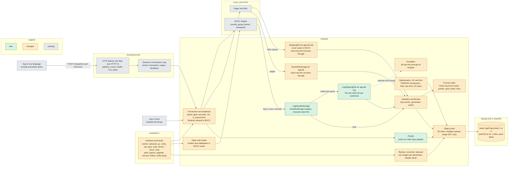
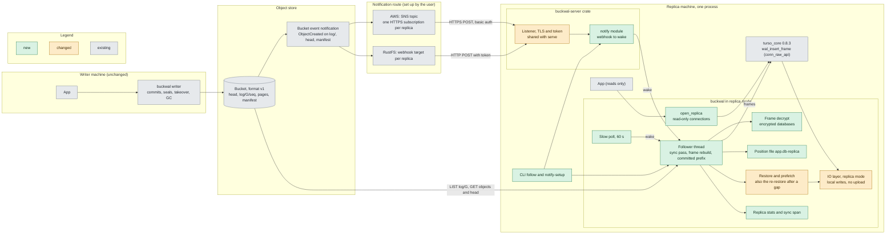
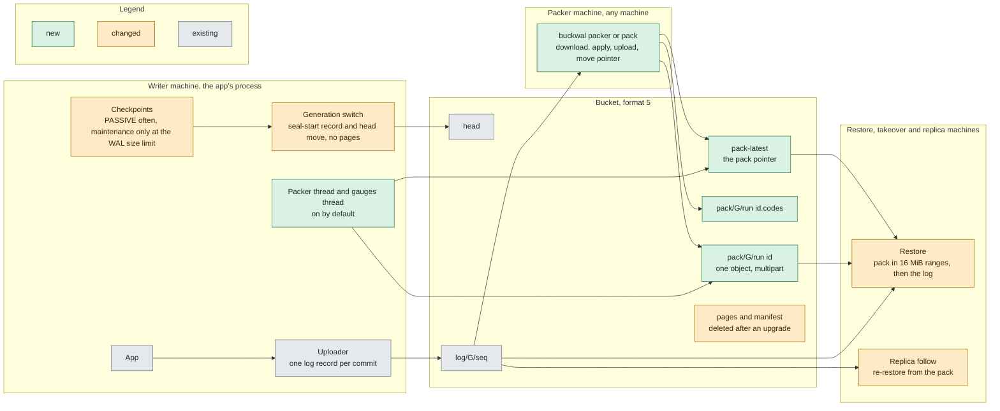

# Architecture: buckwal

What this product is made of and how its parts talk. Kept true by the product's pod. This
file was started by the `mvcc-durability` work (2026-10-22), so "new", "changed" and "existing"
in the diagram mean: new, changed or unchanged by that work. `durable-hardening` (2026-10-23) changed the head, the takeover and the seal, and added integrity codes: see "Takeover, generations and integrity codes" below. `read-replicas` (2026-10-23) added the replica IO mode, the follower and the notification listener: see "Replicas" below, whose diagram marks new, changed and existing by that work. `packer` (2026-10-26) replaced the seal with a generation switch and whole-file packs: see "Packs and the packer" below, whose diagram marks new, changed and existing by that work ([ADR 0010](adr/0010-packs-replace-seals.md)). The README is the full contract
and `docs/glossary.md` defines the terms.

## Purpose

buckwal makes a tursodb (turso_core 0.8.3) database durable in an S3 bucket for
the app that owns it. A commit returns `Ok` only when it is in the bucket (except a background commit, which returns after the local fsync and is acked when it lands), so a new machine can
restore every acknowledged commit from the bucket alone. One writer process owns a database at
a time (fenced by an epoch and a lease, with manual takeover), either embedded as a Rust library
or behind `buckwal serve`, which speaks tursodb's SQL over HTTP v3 to any language. A
database is either a WAL database (the default) or, since `mvcc-durability`, one created new in
MVCC mode with concurrent writers (`BEGIN CONCURRENT`). A second machine can keep a read-only **replica** of a WAL database, fed from the bucket alone (`open_replica`, `buckwal follow`). Since `packer`, the bucket (format 5) holds the log plus a **pack**, one object with the whole database file, which a **packer** makes from the log; a restore reads the pack in 16 MiB ranges, then the log since it.

## Components

| Component | Responsibility | Code |
|---|---|---|
| Public API | `open`, `takeover`, `restore`, `gc`, `is_claimed`, `pack`, `run_packer`, `upgrade`, `vacuum`, `Config`, `JournalMode`, `Database`, `Connection`, `Batching`, `UploadStats`, `Error` | `crates/buckwal/src/lib.rs`, `config.rs`, `error.rs`, `stats.rs` |
| Connection and Database | One engine connection per `Connection`: the SQL guard, the maintenance gate, the ack wait, `run`, `describe`, `is_autocommit`, `transaction`, `checkpoint` | `crates/buckwal/src/conn.rs`, `guard.rs`, `batching.rs`, `db.rs` |
| Open and create | The directory cases of `open`, the claim, the mode checks, page 1 of a fresh database, and the creation of a new MVCC database (built locally, then published as its first pack, `pack/2/<run id>`). A create that finds no head removes a leftover pack pointer first. A read-only open of an empty directory restores again when the restore ends as `Error::Stale` (3 restores at most) | `crates/buckwal/src/db.rs`, `create.rs`, `engine.rs`, `pack/first.rs`, `bucket/first_pack.rs` |
| Restore, reconcile, takeover | Rebuild `app.db`, `app.db-wal` and `app.db-log` from the bucket: in format 5 from the pack pointer, the pack codes and the log of every generation in the chain from the pack generation, each ended generation applied with a local checkpoint, at most 3 restarts when GC deleted the pack or a log object. Level a local directory with the bucket (Level, Behind, Ahead, NewGeneration; an unclaimed copy behind a generation switch is `Error::Stale`), take a database over with a head write and a fence record | `crates/buckwal/src/restore.rs`, `reconcile.rs`, `takeover.rs` |
| Maintenance, GC and trim | The format 5 writer's PASSIVE checkpoint (4 MiB, at most once a second), the maintenance checkpoint at the WAL size limit (a generation switch in format 5, a seal in formats 1 to 4, which also seal at 1,000 log objects), and GC: in format 5 packs and log below the GC base, orphan packs and old multipart uploads; in formats 1 to 4 what the head no longer reaches | `crates/buckwal/src/maintenance.rs`, `gc.rs`, `trim.rs` |
| DurableIo | The engine's IO: the platform IO with `app.db-wal` wrapped, and `app.db-log` refused outside its wrapper | `crates/buckwal/src/io/durable_io.rs` |
| ShippingFile | `app.db-wal`: uploads the bytes written since the last fsync as a kind 1 record before the fsync. At a WAL restart it runs the generation switch (format 5) or the seal (formats 1 to 4). Only the sync on the thread that wrote the last pending operation ships them. A sync on another thread (a checkpoint's) fsyncs the local file and leaves them pending. A failed upload then fails the commit that owns them. In MVCC mode it never seals and carries no commits | `crates/buckwal/src/io/wal_file.rs` |
| BucketDbStorage | `app.db`: in format 5 the block store of a restored copy (a page read whose 1 MiB block is not local fetches the block, a background fetch completes the file in 16 MiB ranges, `app.db-blocks` and `app.db-pack`); in formats 1 to 4 dirty pages, lazy page fetch and the seal | `crates/buckwal/src/io/db_storage.rs`, `io/block_store.rs` |
| LogShippingFile | `app.db-log` (MVCC): records every write as an op, and at `sync` uploads the unconfirmed ops as one kind 3 record before the local fsync (the confirmed-sync rule) | `crates/buckwal/src/io/log_file.rs` |
| LogDurableStorage | The `DurableStorage` wrapper given to the engine: delegates to the engine's own `Storage`, ends the generation in `truncate` before the engine cuts the log (a generation switch in format 5, a seal in formats 2 and 4), poisons on a checkpoint failure after it | `crates/buckwal/src/io/log_storage.rs` |
| Uploader and Bucket | The one upload at a time per database: log records, the resolution of in-doubt records, the generation switch (seal-start record naming the next generation, then the head; span `buckwal.generation_switch`), the legacy seal of formats 1 to 4 (`bucket/legacy.rs`), the lease and the fence checks. The uploader also keeps the durable position and the background commits behind it (`uploader/durable.rs`); the Bucket calls a fence report hook when its writer is fenced, so the `writer fenced` record names the dropped background commits. The thread that wrote a commit's last `-wal` op must run that commit's sync. The reason is that `take_own_pending` ships only on that thread (`last_writer`). Earlier ops of the commit, for example a spill, may come from another thread. The tests in `db/tests/one_thread.rs` and the server's pipeline test pin this rule | `crates/buckwal/src/uploader.rs`, `uploader/batch.rs`, `uploader/durable.rs`, `bucket.rs`, `clock.rs` |
| Format codec | Bytes of the head (its fields, formats 3 to 5 with `key_check` and the integrity code when encrypted, formats 4 and 5 with `database_id`, format 5 with no `manifest`), local state, log records (kinds 1 to 4; kind 4 is the format 5 seal-start record that names the next generation), manifests, the pack pointer (keys relative to the prefix) and keys, and the integrity codes of an encrypted bucket's objects | `crates/buckwal/src/format/`, `pack/pointer.rs`, `pack/codes.rs` |
| Object store | The S3 client (SigV4, conditional PUTs, HTTPS), retry, and the in-memory and fault stores the tests use. `packer` adds `put_multipart` (16 MiB parts, 8 at once), `get_range`, `abort_incomplete`, `delete_if_match`, `get_aged` and `list_sized`/`list_sized_after` (each object's size and Last-Modified time from `ListObjectsV2`); the S3 store logs only an error's `Code` and request id, never the body. `ObjectStore::list_after(prefix, start_after)` lists the keys strictly after a key: S3 sends `start-after` on `ListObjectsV2`, the in-memory and fault stores use a default method that filters the sorted list. The replica's sync pass uses it | `crates/buckwal/src/store/` (`mod.rs`, `s3.rs`, `mem.rs`, `fault.rs`) |
| Encryption and telemetry | The key file, the integrity key and page-1 checks, and OTLP export through `tracing` | `crates/buckwal/src/encryption.rs`, `telemetry/` |
| CLI | The `buckwal` binary, its argument parsing, `soak`, `bench`, `serve` (`--pack on\|off`), the whole-bucket `scan` (packs in 16 MiB ranges), `verify` (also every block of the pack against its codes), `pack`, `packer`, `upgrade`, `vacuum`, `follow` (a replica with status lines and the notification listener) and `notify-setup` (prints the AWS commands and the RustFS curl commands with their XML, runs nothing) | `crates/buckwal-cli/src/main.rs`, `args.rs`, `soak.rs`, `bench.rs`, `serve.rs`, `scan.rs`, `packer.rs`, `follow.rs`, `notify_setup.rs` |
| Packer | One pack run (`pack`): read the pointer and the head, follow the chain of terminal records, take the kept copy or download the pack, apply the ended generations, check the file with `quick_check`, upload the pack and its codes, check them, move the pointer. The loop (`run_packer`) and the writer's two threads `buckwal-packer` and `buckwal-pack-gauges` (span `buckwal.pack.gauges` every 5 minutes, also with `BUCKWAL_PACK=0`) | `crates/buckwal/src/pack/` (`run.rs`, `thread.rs`, `kept.rs`, `first.rs`, `check.rs`, `codes.rs`, `pointer.rs`) |
| Upgrade and vacuum | `upgrade`: a takeover of a format 1 to 4 bucket, then its first pack from the pages, manifest and log, the pointer, and the head at format 5. `vacuum`: the in-place `VACUUM` on the writer's own file; the SQL guard refuses the copy form on an encrypted database | `crates/buckwal/src/upgrade.rs`, `vacuum.rs`, `guard.rs` |
| CLI tests | The system tests against RustFS, including the crash matrix, the MVCC tests, the pack, upgrade and vacuum tests, the replica system tests, the gauges span test and the timed packer test (ignored, never in `test.sh`) | `crates/buckwal-cli/tests/system.rs`, `server.rs`, `replica.rs`, `telemetry.rs`, `timed.rs` |
| Server | SQL over HTTP v3 (pipeline, cursor, describe, batons), health, TLS and token, streams, shutdown | `crates/buckwal-server/src/lib.rs`, `http.rs`, `proto.rs`, `exec.rs`, `streams.rs`, `listener.rs`, `config.rs`, `notify.rs` (the replica's webhook) |
| Replica (open and follower) | `open_replica`, the `Replica` handle (`connect`, `stats`, `waker`, `close`), the follower thread with its two wake-ups, and the re-restore into a fresh sibling copy | `crates/buckwal/src/replica/open.rs`, `waker.rs`, `stats.rs` |
| Replica sync pass | One pass: `list_after` on the generation's log, fetch, rebuild frames, apply the committed prefix, check the head, handle seals and the fence rule | `crates/buckwal/src/replica/sync.rs`, `image.rs`, `fence.rs` |
| Replica frame applier and position file | `wal_insert_begin`, `wal_insert_frame`, `wal_insert_end` through turso_core's `conn_raw_api`, decrypting encrypted frames first; the position file and its steps | `crates/buckwal/src/replica/apply.rs`, `position.rs` |
| Replica read connections | Read-only connections over the current copy, which refuse every write | `crates/buckwal/src/replica/connection.rs` |
| Notification listener | `POST /notify`: a bucket event (or an SNS message) wakes the follower. It reuses the server's listener, bind check and token and adds basic authentication for SNS | `crates/buckwal-server/src/notify.rs` |
| Test client | A minimal SQL over HTTP v3 client for the tests (`publish = false`, name is historical) | `crates/buckwal-hrana-client/src/lib.rs` |
| Scripts | `test.sh` (two passes plus the plaintext scan and the telemetry check), `rustfs.sh` (local S3), `tls-material.sh`, `s3-gate.sh`, `otel-check.sh` | `scripts/` |
| Bucket | One prefix per database. Format 5: `head`, `log/…`, `pack/…`, `pack-latest`. Formats 1 to 4: `head`, `log/…`, `pages/…`, `manifest/…` | formats in README, Bucket format v1, v2, v3 and v5 |

## Replicas

Added by `read-replicas` ([ADR 0006](adr/0006-a-third-io-mode-for-replicas.md), [ADR 0007](adr/0007-the-notification-listener-reuses-the-server-crates-listener.md)); the README, Replicas, is the contract.

Green is new, amber is changed, grey is existing and unchanged.

**The replica IO mode.** A third mode of the library's IO layer, beside writer and read-only. Local WAL and `app.db` writes are allowed (the follower's frame inserts and checkpoints), pages are read lazily from the bucket until the prefetch has them, and nothing is uploaded, sealed, claimed or deleted. A replica sends GET, HEAD and LIST requests only. Neither existing mode is relaxed.

**The follower.** One thread per replica, woken by a notification (through `Replica::waker()`) or by the slow poll (`BUCKWAL_REPLICA_POLL_MS`, 60 s). Either starts the same sync pass, which treats a notification as a hint only and reads the log by seq: `list_after` on `log/<G>/` after the last record seen, then each new record in order, rebuilt into WAL frames, cut to the committed prefix, decrypted first when the database is encrypted, and inserted one committed transaction at a time. On restart it re-reads the current generation's log from seq 1 and skips what it holds (about 1,000 objects at most with the writer's maintenance defaults); at resume only a seal's `ckpt_pending` (new offset 0) reruns the checkpoint, and a deferred checkpoint's (negative new offset) resumes as `applying` with the old offset, `k` recounted from the local WAL. A seal or a takeover moves it to the generation the head names, with a local checkpoint that readers can hold off (then it numbers on and retries). A log object the follower needs being gone makes it re-restore into a fresh sibling copy.

**The shared notify listener.** `buckwal_server::notify::serve` runs in `buckwal-server`, on the crate's own listener, bind check and token, so the library gains no async runtime and no server code. `buckwal follow` runs it when `BUCKWAL_REPLICA_NOTIFY_LISTEN` is set.

**The object store's start-after list.** `ObjectStore::list_after(prefix, start_after)` is new. Its default method (used by the in-memory and fault stores) filters the sorted `list`; the S3 store sends `start-after` on `ListObjectsV2`. A pass thus lists only the new keys however long the generation's log is. (It is part of this change, not a decision of its own, so it has no ADR.)

**Local files of a replica**, beside the usual `app.db`, `app.db-wal`, `app.db-durable` and `durable.lock`:

| File | What it is |
|---|---|
| `app.db-replica` | The position file: generation, stage (`applying` or `ckpt_pending`), frame offset and the replica's random id. Written as a temp file, fsynced, renamed, then the directory is fsynced. |
| `app.db-replica-at` | Present only after a re-restore: names the sibling directory that holds the current copy. Written atomically after the new copy is open, so it is the durable switch; a reopen follows it and removes what an earlier copy or an interrupted re-restore left. |
| `app.db-replica-seen` | When the follower last finished a successful pass (unix milliseconds, as text). A restarted replica reads it to tell how far behind it is. |

## Interfaces

**Library (Rust).** `buckwal::{open, takeover, restore, gc, is_claimed, pack, run_packer, upgrade, vacuum, Config, JournalMode, Database, Connection, Transaction, Batching, CheckpointMode, StmtOutput, Column, Description, UploadStats, GcReport, GcOutcome, RestoreReport, TakeoverReport, PackReport, PackOutcome, PackSource, DownloadReason, UpgradeReport, VacuumReport, Error, Value}`.
- `Error::Stale` (new with `packer`): a copy that was restored and never claimed is behind the head, because the writer switched the generation since the restore. Only a read-only open returns it. A read-only open of an empty directory removes the copy and restores again, 3 restores at most. A writer open and a takeover of such a copy return `Fenced` ("… restore again") from their claim. `buckwal serve` maps `Stale` to `CORRUPT`.
- Packs: `Config` gains `pack` (`BUCKWAL_PACK`), `pack_log_percent`, `pack_max_age`, `pack_orphan_grace`, `pack_keep` and `pack_dir`; `RestoreReport` gains `pack_key` and `bytes_fetched`; `GcReport` gains `packs_deleted`, `orphan_packs_deleted` and `uploads_aborted`, and `GcOutcome` gains `PackMissing`. `BUCKWAL_MAINTENANCE_LOG_OBJECTS` and `BUCKWAL_GC_AFTER_SEAL` are gone (a set one logs a WARN).
- `Connection::execute`, `execute_batch`, `query`, `run` (columns, rows, changes, last rowid), `describe`, `is_autocommit`, `transaction`, `transaction_with`, `set_batching`, `checkpoint`, `close`.
- `Config.journal_mode` (`JournalMode::Wal` by default, `Mvcc`) creates a new database in that mode and must name the mode of an existing one. `BUCKWAL_JOURNAL_MODE` sets it from the environment.
- Replicas: `open_replica(Config) -> Replica`, with `Replica::connect() -> ReadConnection`, `stats() -> ReplicaStats`, `waker() -> ReplicaWaker` and `close()`; `Config.replica_poll_interval` (`BUCKWAL_REPLICA_POLL_MS`); the error `Unsupported("replica: MVCC")`. `buckwal_server::notify::serve` is the listener.
- Contract: README, Use (the API table) and Errors, MVCC mode, and Replicas.

**CLI.** `buckwal restore | takeover | gc | verify | sql | stats | soak | bench | serve | scan | pack | packer | upgrade | vacuum | follow | notify-setup`. `serve --pack on|off`, `soak --head-put-delay-ms N`. `--journal-mode wal|mvcc` on `sql`, `stats`, `soak`, `bench`, `serve` and `takeover` (without it, an existing database's own mode), `soak --concurrent [all|mixed]`. `restore` and `verify` follow the bucket head. Exit codes 0, 1 and 2. Contract: README, CLI, and the usage text in `crates/buckwal-cli/src/args.rs`.

**Server (HTTP).** `buckwal serve` speaks tursodb's SQL over HTTP v3 (`serverless/PROTOCOL.md` in the turso repository at 0b2bec917, not in this repository): `GET /health`, `GET /v2`, `GET /v3`, `POST /v3/pipeline`, `POST /v3/cursor`, `POST /v2/pipeline`. Requests `execute`, `batch`, `sequence`, `describe`, `store_sql`, `close_sql`, `close`, `get_autocommit`. Settings `BUCKWAL_SERVE_*`. Contract: README, Server, and the protocol file above.

**Notification webhook.** `POST /notify` on the replica's listener (`BUCKWAL_REPLICA_NOTIFY_*`): an S3 event or an SNS message, with the token as a bearer header or as basic authentication (user `sns`). Contract: README, Replicas.

**Bucket.** Everything under `<prefix>/`.
- Format v1 (WAL databases): `head` (`format` 1, generation, manifest, writer id, epoch), `log/<generation:010>/<seq:020>` (kind 1 WAL extents, kind 2 fence), `pages/<generation:010>/<page:010>`, `manifest/<generation:010>`.
- Format v2 (MVCC databases only): the same keys, the head also carries `"format":2` and `"journal_mode":"mvcc"`, and a log record of kind 3 holds `app.db-log` extents. WAL buckets stay byte-identical v1, and a v1 build refuses a v2 head.
- Format v3 (encrypted databases made before v4, WAL or MVCC): the same keys, the head has `"format":3`, `journal_mode`, `key_check` and an `integrity` code, and page objects, log records and manifests carry a 32-byte integrity code under the integrity key. An older build refuses it.
- Format v4 (encrypted databases made before v5, WAL or MVCC): the format 3 head plus `database_id`, and every integrity code (pages, log records, manifests, the head) made under the database integrity key, derived from the integrity key and the id ([ADR 0009](adr/0009-integrity-codes-bound-to-a-database-id.md)). An older build refuses it.
- Format v5 (every database this build makes, WAL or MVCC, plaintext or encrypted; [ADR 0010](adr/0010-packs-replace-seals.md)): `head` (`"format":5`, `journal_mode`, `database_id`, no `manifest`; `key_check` and the code when encrypted), `log/…` (kinds 1 to 4), `pack/<G>/<run id>`, `pack/<G>/<run id>.codes`, `pack-latest`. No `pages/` or `manifest/`. Formats 1 to 4 change only with `buckwal upgrade`. An older build refuses it.
- Head fields added by `durable-hardening`, in every format when set: `lease_ms`, `request_timeout_ms` (the writer's own, for the takeover quiet) and `next_generation_floor` (see below).
- Contract: README, Bucket format v1, v2, v3 and v5; codec in `crates/buckwal/src/format/` and `crates/buckwal/src/pack/`.

**Local files** in the database directory. Contract: README, Use (the files table), and Bucket format v1 (local state).

| File | What it is |
|---|---|
| `app.db` | The database. After a restore it fills in lazily from the bucket. |
| `app.db-wal` | The engine's WAL. In MVCC mode it only carries checkpoint frames and is near empty. |
| `app.db-log` | MVCC databases only: the engine's logical log, the commit point. |
| `app.db-durable` | Local state as JSON: writer id, generation, completeness, claim, epoch, takeover quiet, next generation floor. `"format":2` for an MVCC directory. |
| `app.db-dirty` | Formats 1 to 4 only: page numbers checkpointed since the last seal. |
| `app.db-blocks`, `app.db-pack` | Format 5, while a restored copy's pack is not all local: which 1 MiB blocks are local, and the pointer and codes of the pack. `app.db-blocks` is removed once every block is local. |
| `pack-copy/` (`app.db`, `state.json`, `lock`), `pack-work-<run id>` | The pack directory's files: the kept copy, its state file and lock, and a run's working file. In the writer's directory unless `BUCKWAL_PACK_DIR` names another. |
| `app.db-restoring` | Present only while a restore moves its files in. |
| `durable.lock` | The exclusive lock of the process that has the directory open. |
| `app.db-replica`, `app.db-replica-at`, `app.db-replica-seen` | A replica's position file, the pointer to its current copy after a re-restore, and the time of its last successful pass (see Replicas). |

**Settings and telemetry.** `BUCKWAL_*` environment variables (README, Settings), `BUCKWAL_OTEL*` and the span names (README, Telemetry, a contract the HyperDX searches depend on), including the replica spans `buckwal.replica.sync` and `buckwal.replica.re_restore`, and the spans of `packer`: `buckwal.generation_switch`, `buckwal.pack`, `buckwal.pack.gauges` and `buckwal.vacuum`. The spans `buckwal.pack`, `buckwal.pack.gauges` and `buckwal.restore` carry the attribute `buckwal.prefix`, the database prefix, so the alerts group per database. A `buckwal.pack` span with outcome `failed` ends with status Error, except at the step `closed`. Also `buckwal.prefetch`, the resource attributes (`host.name`, `service.instance.id`, and `deployment.environment.name = test` for a test run) and the rule that a span whose `buckwal.outcome` is `error`, `integrity`, `fenced`, `failed` (except a `buckwal.pack` at the step `closed`), `upload_failed` or `corrupt` ends with status Error (README, Telemetry).

## Packs and the packer

Added by `packer` ([ADR 0010](adr/0010-packs-replace-seals.md)); the README, How it works, Packs and Bucket format v5, is the contract.

Green is new, amber is changed, grey is existing and unchanged.

**The generation switch.** At a WAL restart a format 5 writer uploads the seal-start record of the old generation (kind 4, which names the next generation), then moves the head with `If-Match`. It uploads no page and no manifest. A takeover still keeps the generation: the new writer appends after its fence, and only a switch ends a generation. A checkpoint's fsync fsyncs the local file only and never ships another connection's operations.

**The held header.** The engine writes the new WAL header (32 bytes, new salts) at a WAL restart, before the commit's frames. The ShippingFile fsyncs it locally and does not ship it. It keeps it as the held header, apart from the pending operations, so the first record of the new generation carries the header and the commit's frames together. A commit that restarts the WAL with batching Off or Window then needs three requests: the seal-start record, the head move and one record. Before this change it needed four, because the header had its own record.
- Only a confirmed record clears the held header. The record is confirmed when its PUT succeeds (Off), or when `Uploader::durable_commit` reaches the commit number of the newest Window record that carries it. A failed or doubtful PUT leaves the header held, and the next record carries it again. A restore then finds every acked commit.
- A sync on another thread (a passive checkpoint's) does not ship the held header.
- The truncate to 32 bytes at the restart is not recorded while only the held header is pending. The engine's `prepare_wal_start` (turso_core 0.8.3) sends it. Check this rule again on a turso_core upgrade, with the probes of `docs/read-replicas-recon.md`. A pending truncate to 0 is shipped first, and the header goes after it.
- The background exception: a background commit does not wait for its upload. If a header is held, the commit ships it as its own blocking record first, then queues its own record. This keeps the safety of the old path, and goal 1c of the timed test is unchanged.
- A record that starts a fresh generation without the header fails the commit with `Corrupt` and logs the ERROR record `log record without WAL header` with `generation` (README, Telemetry).

**The chain of terminal records.** A generation has ended when the head names a later generation and its last record is a seal-start record (the terminal record). That record names the next generation, and every number between is a skipped generation. The packer, a restore and a replica follow this chain from the pack generation to the head's generation. A broken chain ends a pack run as `failed` with `log_incomplete`, and moves no pointer.

**A pack run** reads the pointer and the head, and lists the log from the pack generation. It takes its kept copy (checked against the pack codes) or downloads the pack in 16 MiB ranges. It applies each ended generation with a local checkpoint (the restore's code). It checks the file with `PRAGMA quick_check`; a bad result ends the run as `failed` at the step `quick_check`, with no upload and no pointer move. Then it uploads the file as `pack/<G>/<run id>` in 16 MiB parts, 8 at once, with its codes, and checks the size and the part checksums. Then it sends one more HEAD for both, and moves the pointer with `If-Match`. A 412 or an unknown result reads the pointer again: the run ends as `packed`, `superseded` (another pack of an equal or higher pack generation) or tries again within its time limit, half the orphan grace. It never deletes the pack the pointer names, and it never writes the head or the log.

**The writer's threads.** `buckwal-packer` checks once a minute (2 GETs, and one LIST when a generation ended). It starts a run when a generation has ended and the log since the newest pack passes `BUCKWAL_PACK_LOG_PERCENT` (10%) of the pack's size, the pack is older than `BUCKWAL_PACK_MAX_AGE_SECS` (1 hour), or there is no pack yet. After a failed run it waits 60 s, then doubles the wait up to `pack_max_age`. A run checks the free disk before it downloads: the pack's size plus 10%, where a held kept copy counts as free. A close stops a run between two parts and aborts its upload (`failed` at `closed`). `buckwal-pack-gauges` sends `buckwal.pack.gauges` every 5 minutes (behind bytes, age seconds, size bytes), also with `BUCKWAL_PACK=0` and with no pack. Its first listing comes with the first span, 5 minutes after the open.

**The kept copy and the pack directory.** A run keeps the file it made, `pack-copy/app.db` with `state.json`, under an exclusive `fcntl` lock (`pack-copy/lock`). The next run uses it only when the state file names the pointer's pack, the `applying` flag is off and every 1 MiB block matches the codes; else it deletes it and downloads. A run that cannot take the lock works in its own `pack-work-<run id>` file and keeps nothing. The pack directory is the writer's directory, or `BUCKWAL_PACK_DIR`. One pack directory serves one database.

**Integrity of a pack.** A block code covers the database id, the pack key relative to the prefix, the pack generation, the total size and the block number: SHA-256 in a plaintext bucket, an integrity code under the database integrity key in an encrypted bucket. The pointer's code covers every field of the pointer. The prefix and the bucket name are in no code, so a database copied with its head, pointer, pack, codes and log to another prefix still opens and restores.

**Creates and the pointer.** Every format 5 head and pointer carry the `database_id`, and a reader treats a pointer with another one as no pointer. A create that finds no head removes a leftover pointer with `If-Match`; the creator whose head lands writes its pointer again with a new `write_id`. An MVCC create that stops between its head landing and that rewrite leaves a bucket that restores with `Corrupt`; nothing was committed, and the way out is to delete `head` and create again.

**GC.** The GC base is the newest pack, at or below the pointer's pack generation, whose codes object is older than the pack keep time. GC deletes packs and log only below it, and deletes log only after a HEAD shows the GC base, the pointer's pack and both codes objects. It deletes orphan packs after the orphan grace (6 hours), multipart uploads under `pack/` older than the orphan grace, and, after an upgrade, every `pages/` and `manifest/` object. The writer's GC never deletes the pack its own background fetch reads.

**Formats 1 to 4.** A build with packs still opens, writes, seals, restores and follows a bucket of formats 1 to 4, with a fixed seal at 1,000 log objects. `buckwal upgrade` converts one to format 5 in place.

## Takeover, generations and integrity codes

Added by `durable-hardening` ([ADR 0005](adr/0005-takeover-generation-floor-quiet-and-integrity-codes.md)); the README, Guarantees and Bucket format are the contract.

**The skipped generation.** A seal of generation G writes `pages/G/…` and `manifest/G` and moves the head to G+1 naming manifest G. A takeover's head write carries `next_generation_floor = max(G + 1, replaced floor) + 1`, also kept in `app.db-durable`. A seal now moves the head to `T = max(G + 1, floor)` and writes its pages and manifest under `T - 1`, so the new writer's first seal writes under G+1 and moves the head to G+2 naming manifest G+1, while the fenced writer can only write seal keys under G. The seal-start record and the log stay on `log/<head.generation>`; nothing is ever written to `log/<G+1>`. The WAL seal, the maintenance seal and the MVCC seal in `LogDurableStorage::truncate` (with its adoption of a head whose write had an unknown result) share the rule. Heads and manifests are therefore not consecutive: nothing may assume `G + 1`, a manifest generation can be missing, and restore, verify, GC, reconcile and a later takeover accept a head that went up by two.

**The GC floor rule.** The skip seal's head keeps `next_generation_floor = T` and every later head carries it. While the field is present, GC ignores manifests below `floor - 1`, so it never trims against the fenced writer's leftover `manifest/G`. Between a takeover and the skip seal every manifest is below `floor - 1`, so GC trims nothing. A head without the field keeps the old rule.

**The takeover quiet.** Every head carries the writer's `lease_ms` and `request_timeout_ms`. A takeover's quiet is the larger of the replaced head's sum and its own, capped at `MAX_SEAL_QUIET`. In a chain of takeovers C sizes its quiet from B's head and its own; a writer two takeovers back is kept off C's keys by the floor.

**Integrity codes (encrypted buckets only).** The integrity key is HKDF-SHA256 over the key file's key (written over `hmac` and `sha2`, `encryption.rs`); a format 4 database's codes are made under a database integrity key derived from it and the database id. A 32-byte HMAC-SHA256 integrity code ends each page object (over page number, generation, ciphertext), replaces the SHA-256 trailer of each log record (generation, seq, bytes), and covers each manifest (generation, bytes) and the head (its fields). Every fetch checks it, and a failure is `Corrupt("integrity: <key>")` plus the `integrity check failed` record. The codes bind generation, page and seq and, in format 4, the database id (the codes are made under the database integrity key); they do not bind the prefix, so a whole database moved to another prefix or bucket still opens. In a format 3 database an object copied from another database with the same key file verifies. The codes do not catch a rollback of the whole bucket to an earlier consistent point.

**`key_check` and the open rule.** A format 3 or 4 head carries `key_check`, compared at every open of an encrypted bucket (writer open, restore, takeover, verify, GC on its own store) before any integrity code. At open, a different or missing `key_check`, a format 1 or 2 head under a key, are `Encryption` errors with no record and no alert. After a good open (`key_check` matched once in the process), any later head read that decodes the head (the writer's GC pass) and finds a bad head code, a different or missing `key_check`, or a format 1 or 2 head (a downgrade) is `Corrupt` plus the record and the alert. A running writer that meets such a head is fenced by its byte-comparing head check and stops without a record.

## Restart on the writer's own disk (D9)

At a writer open of a directory that has a local state, buckwal does three things in this order. First it checks the file record (`file_record.rs`): it compares `app.db`, the `-wal` and (MVCC) the `-log` with the local state, and refuses with `Corrupt` when another tool changed them. The check uploads nothing and changes no file. Then it turns the `clean_close` mark off. Then it reconciles the local WAL with the bucket.

Every writer of `app.db` follows two rules through one helper (`DbFiles`): before the first write after a record, it sets `db_write_open` on and fsyncs the local state. After the fsync of `app.db`, it writes the new `app.db` part and sets `db_write_open` off. The writers are the engine's page writes and truncates (`io/db_storage.rs`), the block fetch of a restored pack (`io/block_store.rs`) and the seed of a never-sealed database (`reconcile.rs`). A clean close writes the whole record in `Shared::finish`, after the packer stopped and before the directory lock goes. Replicas keep no record.

## Decisions

Newest last. "Spec" is the id of the work that made it: `durable-library` stages 1 to 4, `durable-server`, `mvcc-durability`, `durable-hardening`, `read-replicas`, `background-commit`, `bind-objects-to-database`, `packer`. The earlier stages' spec files are not in this repository, so they are named by id. Evidence for D1 to D29 is in README, Decisions. ADRs 0001 to 0010 in `docs/adr/` (index: `docs/adr/README.md`) record the decisions of `mvcc-durability`, `durable-hardening`, `read-replicas`, `background-commit`, `bind-objects-to-database` and `packer` that most shape the design, in Nygard's form; the earlier stages' decisions are not back-filled.

- 2026-10-16, `durable-library` stage 1: use turso_core `=0.8.3` through its public APIs only (an `IO`/`File` wrapper and `DatabaseStorage`), no fork, so the engine upgrades by version bump (D1, D2).
- 2026-10-16, `durable-library` stage 1: the commit point is the WAL's fsync, and a failed upload fails the commit synchronously, so the engine rolls it back and never reaches the fsync panic (D3). A background commit differs while the bucket is healthy: its sync fsyncs locally and queues the record (D32).
- 2026-10-16, `durable-library` stage 1: one process per directory (`durable.lock`), with no multi-process WAL, because the bucket allows one writer per prefix (D4).
- 2026-10-16, `durable-library` stage 1: MVCC was refused, with the SQL guard before the engine writes the header (D5). Superseded in part by D18 for new databases.
- 2026-10-16, `durable-library` stage 1: pages upload at a generation boundary (a seal), not at each checkpoint, to keep the bucket small and the restore bounded (D6).
- 2026-10-16, `durable-library` stage 1: `synchronous` is FULL only, because anything lower breaks the "ack means in the bucket" rule (D7). A background commit's local fsync is a FULL fsync too; only its ack comes later.
- 2026-10-16, `durable-library` stage 1: typed errors cross the engine through a thread-local stash (D8). A restart reconciles the local WAL with the bucket (D9). Trimming deletes only what the head cannot reach (D10).
- 2026-10-17, `durable-library` stage 2: batching `Off` or `Window` at runtime, a maintenance checkpoint that seals a generation the engine never restarts, and OpenTelemetry export through `tracing` (README, Batching, Maintenance checkpoint, Telemetry).
- 2026-10-18, `durable-library` stage 3: takeover and the claim of a restored copy are one mechanism with a head write first and a fence record second (D11), an epoch in the head (D12), a lease and a takeover quiet (D13), and GC on the bucket's own clock (D14). Why: a paused or restarted old writer must never be acked or publish late.
- 2026-10-18, `durable-library` stage 4: HTTPS through rustls with the ring provider only (D15), turso's own page codec for encryption with a local key file (D16), and a local TLS RustFS harness (D17). Why: no aws-lc or openssl in the dependency audit.
- 2026-10-18, `durable-server`: one process owns the database and serves SQL over HTTP v3, one `Connection` per stream plus an anchor connection, answering only after the library call returned, so a client hears success only once the commit is in the bucket (README, Server).
- 2026-10-18, `mvcc-durability` (stage 1 finding, `docs/mvcc-recon.md`): MVCC only for databases created new, with the refusals of D18, because switching an existing database is not crash safe through the IO hooks.
- 2026-10-22, `mvcc-durability`: the MVCC commit point is the `app.db-log` sync through a `LogShippingFile`, with the confirmed-sync rule (D19, [ADR 0001](adr/0001-mvcc-commit-point-is-the-db-log-sync.md)), and the seal runs in a `DurableStorage` wrapper's `truncate` before the engine cuts the log (D20, [ADR 0002](adr/0002-mvcc-seal-runs-in-the-durable-storage-truncate.md)). Why: the same "upload, then fsync" order as the WAL, with no engine change.
- 2026-10-22, `mvcc-durability`: bucket format v2 for MVCC buckets only, WAL buckets byte-identical v1 (D21, [ADR 0003](adr/0003-bucket-format-v2-for-mvcc-buckets-only.md)). Why: an older build must refuse an MVCC bucket instead of writing to it, and no migration is needed.
- 2026-10-22, `mvcc-durability`: a new MVCC database starts at generation 2 naming manifest 1 (D22, [ADR 0004](adr/0004-new-mvcc-database-starts-at-generation-2.md)). Why: a head at generation 1 would let the first real seal overwrite objects under a live head.
- 2026-10-22, `mvcc-durability`: restore and reconcile work on two images (D23), a read-only open lets recovery writes through locally (D24), and a checkpoint failure after a seal poisons the database until reopen (D25).
- 2026-10-22, `mvcc-durability`: the CLI follows the head's journal mode and the library does not (D26), maintenance measures the `.db-log` (D27), `run` and `is_autocommit` share the guard, gate and ack path (D28), and the engine's MVCC limits are accepted and pinned in tests (D29).
- 2026-10-23, `durable-hardening`: a takeover's first seal skips a generation number and the head keeps a next generation floor that GC honours, the takeover quiet is the larger of both writers' timeouts, and an encrypted bucket carries integrity codes in a format 3 head ([ADR 0005](adr/0005-takeover-generation-floor-quiet-and-integrity-codes.md)). Why: a late PUT from the fenced writer could replace a key the new writer relies on, and an encrypted page was bound to neither its number nor its version.
- 2026-10-23, `read-replicas`: a third IO mode for replicas (local writes for the follower only, nothing to the bucket), with the follower inside `buckwal` and the frame calls of turso_core's `conn_raw_api` ([ADR 0006](adr/0006-a-third-io-mode-for-replicas.md)). Why: a replica must apply frames and checkpoint locally but never write to the bucket.
- 2026-10-23, `read-replicas`: the notification listener lives in `buckwal-server` and reuses its listener, bind check and token ([ADR 0007](adr/0007-the-notification-listener-reuses-the-server-crates-listener.md)). Why: one listener and one set of security rules, and no async runtime in the library.
- 2026-10-25, `background-commit`: a commit can return after the local fsync and upload behind the call, as a batching setting with a bound, `max_behind` (D32, [ADR 0008](adr/0008-background-commits.md)). The commit path gains a background case: the WAL sync fsyncs locally and queues the record, the call waits only while more than `max_behind` such commits wait, and the uploader acks the commit when its record lands. Why: an app with its own replayable log gains nothing from the wait.
- 2026-10-25, `bind-objects-to-database`: integrity codes are bound to a database id in a format 4 head ([ADR 0009](adr/0009-integrity-codes-bound-to-a-database-id.md)). Why: two encrypted databases under one key file accepted each other's objects.
- 2026-10-26, `packer`: a generation switch replaces the seal, and a packer makes whole-file packs from the log, in bucket format 5 for both journal modes, with the pack key bound relative to the prefix, `database_id` in every head and pointer, a GC base and pack keep time, `buckwal upgrade` for older buckets and `buckwal vacuum` on request (D33, [ADR 0010](adr/0010-packs-replace-seals.md)). It replaces ADR 0002 in part (the MVCC seal in `truncate` becomes a switch), ADR 0003 in part (format 2 gives way to format 5) and ADR 0004 (the first seal becomes a first pack); ADR 0005 stays. Why: the seal's page upload paused commits for 43 s to 97 s on 1 GB, and a restore needed one request per page.
- 2026-10-27, `outside-change-detect`: the open refuses a database whose `app.db` or `-wal` another tool changed, by a file record in the local state that every `app.db` writer keeps (D9). The keys are flat with the prefix `files_`, because the state parser reads flat objects only.

## Departures from the standards

None found. The organisation's standards file is kept outside this repository. Section by section:

- **Glossary.** Followed. `docs/glossary.md` gives every term a one-line meaning and the words not to use, and lists the older text that still uses such a word under "Not yet consistent". The `mvcc-durability` work added its new terms in the same change.
- **Architecture decisions.** Followed from this work on. `docs/adr/` holds ADRs 0001 to 0010 in Nygard's form (see Decisions). The earlier stages' decisions stay in the README, Decisions (D1 to D29), and are not back-filled. `docs/architecture.md` stays alongside the ADRs, as the standard asks.
- **Telemetry.** Followed. Spans and logs leave over OTLP/gRPC, to `http://localhost:4317` by default (`Config::OTEL_ENDPOINT`, `crates/buckwal/src/config.rs`). `service.name` is set in code (`telemetry/pipeline.rs`, and the test `spans_carry_service_name_and_run_id_and_engine_spans_are_dropped`). No SQL text, row data or secret goes in a span or a log line. The replica work adds two span names, `buckwal.replica.sync` and `buckwal.replica.re_restore`, and the log records listed in the README, Telemetry (none carries a token, SQL text or row data). The `packer` work adds four span names (`buckwal.generation_switch`, `buckwal.pack`, `buckwal.pack.gauges`, `buckwal.vacuum`), the attribute `buckwal.prefix`, and log records that carry keys, steps and counts only, never a key id, an AWS key, SQL text or row data. The MVCC path adds no span names: it reuses `buckwal.commit`, `buckwal.upload`, `buckwal.ack_wait` and `buckwal.local_fsync`, with their existing attributes (counts, bytes, generation, seq, retries, status, outcome). `git diff 332b45f..HEAD -- crates` adds two log lines: `log upload failed` (warn, the bucket error) and `database poisoned` (error, a text naming the failed checkpoint step). Neither carries SQL text. The stage's fixes show their logged problem and the passing lines in `results/mvcc-durability.txt`. Observability for the work is in the README, Telemetry.
- **APIs and messaging.** Nothing to follow. The product has no gRPC interface and no web app; its HTTP server speaks tursodb's SQL over HTTP v3, a protocol set by turso, not a REST API behind pages.
- **Stacks.** Followed: Rust. It is not a web app, so the axum, askama and Datastar stack does not apply.
- **Data.** No standard yet.
- **Dependencies.** Followed. The `packer` work added no crate and did not change `Cargo.toml` or `Cargo.lock`; its multipart upload and range GET use the HTTP client buckwal had. The MVCC work added no crate and changed no version or feature: `Cargo.lock` and every `Cargo.toml` are unchanged against 332b45f (`git diff --stat 332b45f..HEAD -- Cargo.lock` is empty). Builds use `--locked`, and the audit table is in the README, Dependency audits.
- **Security.** Followed. `buckwal serve` binds `127.0.0.1:9295` by default, and a non-loopback address is refused with exit 2 unless both TLS and a token file are set (`crates/buckwal-server/src/config.rs`; unchanged by this work). Credentials are not in the repository: the only key-like strings in tracked files are dummy values in unit tests (`AKIAEXAMPLEACCESS`, a fake PEM header), and the token and the encryption key are read from files and never printed. The channel rule about phones does not apply.
- **Testing.** Followed. `./scripts/test.sh` is the product's test command, with `fmt` and `clippy -D warnings` clean (`./scripts/test.sh unit`). The cloud service is tested against a local RustFS, plain HTTP and HTTPS with encryption, and real S3 is set aside. The README has a section "Not tested until real use".

Not verified here: the stack that stores and shows telemetry (ClickHouse, HyperDX) is outside this repository, so the claim that the spans reach it rests on `scripts/otel-check.sh` in the full test run (it prints SKIPPED and passes when the stack is down), not on a check made for this document. Likewise "`fmt` and `clippy` clean" and "the test command passes" are the results recorded at the last full run (README, Test command), not re-run for this docs-only change.
