# Architecture: turso-durable

What this product is made of and how its parts talk. Kept true by the product's pod. This
file was started by the `mvcc-durability` work (2026-10-22), so "new", "changed" and "existing"
in the diagram mean: new, changed or unchanged by that work. The README is the full contract
and `docs/glossary.md` defines the terms.

## Purpose

turso-durable makes a tursodb (turso_core 0.8.3) database durable in an S3 bucket for
the app that owns it. A commit returns `Ok` only when it is in the bucket, so a new machine can
restore every acknowledged commit from the bucket alone. One writer process owns a database at
a time (fenced by an epoch and a lease, with manual takeover), either embedded as a Rust library
or behind `turso-durable serve`, which speaks tursodb's SQL over HTTP v3 to any language. A
database is either a WAL database (the default) or, since `mvcc-durability`, one created new in
MVCC mode with concurrent writers (`BEGIN CONCURRENT`).

## Components

```mermaid
flowchart LR
  app["App in Rust<br/>embeds the library"]:::existing
  drv["App in any language<br/>tursodb serverless driver"]:::existing
  subgraph cli["turso-durable-cli"]
    cmds["turso-durable commands<br/>restore, takeover, gc, verify, sql, stats, soak, bench, serve, scan<br/>--journal-mode, soak --concurrent"]:::changed
  end
  subgraph srv["turso-durable-server"]
    http["HTTP listener and SQL over HTTP v3<br/>pipeline, cursor, health, TLS, token"]:::existing
    streams["Stream to Connection map<br/>anchor connection, reaper, shutdown"]:::existing
  end
  subgraph lib["turso_durable"]
    conn["Connection and Database<br/>guard, gate, ack path, run, is_autocommit<br/>Window refused in MVCC"]:::changed
    open["Open and create<br/>creates new databases in MVCC mode"]:::changed
    rest["Restore, reconcile, takeover<br/>two images per generation, header repair"]:::changed
    maint["Maintenance, GC and trim<br/>measures the .db-log in MVCC"]:::existing
    dio["DurableIo<br/>.db-log only through its wrapper"]:::changed
    walship["ShippingFile for app.db-wal<br/>never seals in MVCC<br/>read-only lets recovery through"]:::changed
    dbs["BucketDbStorage for app.db<br/>read-only lets recovery through"]:::changed
    logship["LogShippingFile for app.db-log<br/>Ok only when all ops confirmed"]:::new
    ds["LogDurableStorage<br/>DurableStorage wrapper, truncate seals first"]:::new
    up["Uploader and Bucket<br/>kind 3 records, format v2 head"]:::changed
    fmt["Format codec<br/>head, log record, manifest, keys"]:::changed
    store["Object store<br/>S3 client, retry, memory and fault stores"]:::existing
  end
  subgraph core["turso_core 0.8.3"]
    mv["MVCC engine<br/>commit, group commit, checkpoint"]:::existing
    pager["Pager and WAL"]:::existing
  end
  subgraph bucket["Bucket (S3 or RustFS)"]
    objs[("head, log/G/seq kinds 1 2 3,<br/>pages/G/n, manifest/G")]:::changed
  end
  app --> conn
  drv -- "POST /v3/pipeline and /v3/cursor" --> http --> streams --> conn
  cmds --> conn
  cmds --> open
  cmds --> rest
  open --> mv
  conn --> mv
  conn --> pager
  mv -- "log_tx, sync, truncate" --> ds
  ds -- "writes and syncs" --> logship
  logship -. "opened only through" .-> dio
  pager -- "WAL frames" --> walship
  pager -- "pages" --> dbs
  ds -- "seal" --> up
  logship --> up
  walship --> up
  dbs --> up
  up --> fmt
  up --> store
  rest --> store
  maint --> store
  store --> objs
  subgraph legend["Legend"]
    l1["new"]:::new
    l2["changed"]:::changed
    l3["existing"]:::existing
  end
  classDef new fill:#d9f2e3,stroke:#1f7a4a,color:#10301f
  classDef changed fill:#fdebc8,stroke:#a86b00,color:#3d2700
  classDef existing fill:#e6e9ec,stroke:#6b7480,color:#22272e
```

| Component | Responsibility | Code |
|---|---|---|
| Public API | `open`, `takeover`, `restore`, `gc`, `is_claimed`, `Config`, `JournalMode`, `Database`, `Connection`, `Batching`, `UploadStats`, `Error` | `crates/turso_durable/src/lib.rs`, `config.rs`, `error.rs`, `stats.rs` |
| Connection and Database | One engine connection per `Connection`: the SQL guard, the maintenance gate, the ack wait, `run`, `describe`, `is_autocommit`, `transaction`, `checkpoint` | `crates/turso_durable/src/conn.rs`, `guard.rs`, `batching.rs`, `db.rs` |
| Open and create | The directory cases of `open`, the claim, the mode checks, and the creation of a new MVCC database (built locally, then published as a seal) | `crates/turso_durable/src/db.rs`, `create.rs`, `engine.rs` |
| Restore, reconcile, takeover | Rebuild `app.db-wal` and `app.db-log` from the bucket, level a local directory with the bucket (Level, Behind, Ahead, NewGeneration), take a database over with a head write and a fence record | `crates/turso_durable/src/restore.rs`, `reconcile.rs`, `takeover.rs` |
| Maintenance, GC and trim | The background checkpoint that seals a generation the engine never restarts, and the deletion of what the head no longer reaches | `crates/turso_durable/src/maintenance.rs`, `gc.rs`, `trim.rs` |
| DurableIo | The engine's IO: the platform IO with `app.db-wal` wrapped, and `app.db-log` refused outside its wrapper | `crates/turso_durable/src/io/durable_io.rs` |
| ShippingFile | `app.db-wal`: uploads the bytes written since the last fsync as a kind 1 record before the fsync. In MVCC mode it never seals and carries no commits | `crates/turso_durable/src/io/wal_file.rs` |
| BucketDbStorage | `app.db`: tracks dirty pages, lazy page fetch, and the seal | `crates/turso_durable/src/io/db_storage.rs` |
| LogShippingFile | `app.db-log` (MVCC): records every write as an op, and at `sync` uploads the unconfirmed ops as one kind 3 record before the local fsync (the confirmed-sync rule) | `crates/turso_durable/src/io/log_file.rs` |
| LogDurableStorage | The `DurableStorage` wrapper given to the engine: delegates to the engine's own `Storage`, seals in `truncate`, poisons on a checkpoint failure after a seal | `crates/turso_durable/src/io/log_storage.rs` |
| Uploader and Bucket | The one upload at a time per database: log records, in-doubt settling, the seal (seal-start, pages, manifest, head), the lease and the fence checks | `crates/turso_durable/src/uploader.rs`, `uploader/batch.rs`, `bucket.rs`, `clock.rs` |
| Format codec | Bytes of the head, local state, log records (kinds 1 to 3), manifests and keys | `crates/turso_durable/src/format/` |
| Object store | The S3 client (SigV4, conditional PUTs, HTTPS), retry, and the in-memory and fault stores the tests use | `crates/turso_durable/src/store/` |
| Encryption and telemetry | The key file and page-1 checks, and OTLP export through `tracing` | `crates/turso_durable/src/encryption.rs`, `telemetry/` |
| CLI | The `turso-durable` binary, its argument parsing, `soak`, `bench`, `serve` and the whole-bucket `scan` | `crates/turso-durable-cli/src/main.rs`, `args.rs`, `soak.rs`, `bench.rs`, `serve.rs`, `scan.rs` |
| CLI tests | The system tests against RustFS, including the crash matrix and the MVCC tests | `crates/turso-durable-cli/tests/system.rs`, `server.rs` |
| Server | SQL over HTTP v3 (pipeline, cursor, describe, batons), health, TLS and token, streams, shutdown | `crates/turso-durable-server/src/lib.rs`, `http.rs`, `proto.rs`, `exec.rs`, `streams.rs`, `listener.rs`, `config.rs` |
| Test client | A minimal SQL over HTTP v3 client for the tests (`publish = false`, name is historical) | `crates/turso-durable-hrana-client/src/lib.rs` |
| Scripts | `test.sh` (two passes plus the plaintext scan and the telemetry check), `rustfs.sh` (local S3), `tls-material.sh`, `s3-gate.sh`, `otel-check.sh` | `scripts/` |
| Bucket | One prefix per database: `head`, `log/…`, `pages/…`, `manifest/…` | formats in README, Bucket format v1 and v2 |

## Interfaces

**Library (Rust).** `turso_durable::{open, takeover, restore, gc, is_claimed, Config, JournalMode, Database, Connection, Transaction, Batching, CheckpointMode, StmtOutput, Column, Description, UploadStats, GcReport, RestoreReport, TakeoverReport, Error, Value}`.
- `Connection::execute`, `execute_batch`, `query`, `run` (columns, rows, changes, last rowid), `describe`, `is_autocommit`, `transaction`, `transaction_with`, `set_batching`, `checkpoint`, `close`.
- `Config.journal_mode` (`JournalMode::Wal` by default, `Mvcc`) creates a new database in that mode and must name the mode of an existing one. `DURABLE_JOURNAL_MODE` sets it from the environment.
- Contract: README, Use (the API table) and Errors, and MVCC mode.

**CLI.** `turso-durable restore | takeover | gc | verify | sql | stats | soak | bench | serve | scan`. `--journal-mode wal|mvcc` on `sql`, `stats`, `soak`, `bench`, `serve` and `takeover` (without it, an existing database's own mode), `soak --concurrent [all|mixed]`. `restore` and `verify` follow the bucket head. Exit codes 0, 1 and 2. Contract: README, CLI, and the usage text in `crates/turso-durable-cli/src/args.rs`.

**Server (HTTP).** `turso-durable serve` speaks tursodb's SQL over HTTP v3 (`serverless/PROTOCOL.md` in the turso repository at 0b2bec917, not in this repository): `GET /health`, `GET /v2`, `GET /v3`, `POST /v3/pipeline`, `POST /v3/cursor`, `POST /v2/pipeline`. Requests `execute`, `batch`, `sequence`, `describe`, `store_sql`, `close_sql`, `close`, `get_autocommit`. Settings `DURABLE_SERVE_*`. Contract: README, Server, and the protocol file above.

**Bucket.** Everything under `<prefix>/`.
- Format v1 (WAL databases): `head` (`format` 1, generation, manifest, writer id, epoch), `log/<generation:010>/<seq:020>` (kind 1 WAL extents, kind 2 fence), `pages/<generation:010>/<page:010>`, `manifest/<generation:010>`.
- Format v2 (MVCC databases only): the same keys, the head also carries `"format":2` and `"journal_mode":"mvcc"`, and a log record of kind 3 holds `app.db-log` extents. WAL buckets stay byte-identical v1, and a v1 build refuses a v2 head.
- Contract: README, Bucket format v1 and Bucket format v2; codec in `crates/turso_durable/src/format/`.

**Local files** in the database directory. Contract: README, Use (the files table), and Bucket format v1 (local state).

| File | What it is |
|---|---|
| `app.db` | The database. After a restore it fills in lazily from the bucket. |
| `app.db-wal` | The engine's WAL. In MVCC mode it only carries checkpoint frames and is near empty. |
| `app.db-log` | MVCC databases only: the engine's logical log, the commit point. |
| `app.db-durable` | Local state as JSON: writer id, generation, completeness, claim, epoch, takeover quiet. `"format":2` for an MVCC directory. |
| `app.db-dirty` | Page numbers checkpointed since the last seal. |
| `app.db-restoring` | Present only while a restore moves its files in. |
| `durable.lock` | The exclusive lock of the process that has the directory open. |

**Settings and telemetry.** `DURABLE_*` environment variables (README, Settings), `DURABLE_OTEL*` and the span names (README, Telemetry, a contract the HyperDX searches depend on).

## Decisions

Newest last. "Spec" is the id of the work that made it: `durable-library` stages 1 to 4, `durable-server`, `mvcc-durability`. The earlier stages' spec files are not in this repository, so they are named by id. Evidence for D1 to D29 is in README, Decisions.

- 2026-10-16, `durable-library` stage 1: use turso_core `=0.8.3` through its public APIs only (an `IO`/`File` wrapper and `DatabaseStorage`), no fork, so the engine upgrades by version bump (D1, D2).
- 2026-10-16, `durable-library` stage 1: the commit point is the WAL's fsync, and a failed upload fails the commit synchronously, so the engine rolls it back and never reaches the fsync panic (D3).
- 2026-10-16, `durable-library` stage 1: one process per directory (`durable.lock`), with no multi-process WAL, because the bucket allows one writer per prefix (D4).
- 2026-10-16, `durable-library` stage 1: MVCC was refused, with the SQL guard before the engine writes the header (D5). Superseded in part by D18 for new databases.
- 2026-10-16, `durable-library` stage 1: pages upload at a generation boundary (a seal), not at each checkpoint, to keep the bucket small and the restore bounded (D6).
- 2026-10-16, `durable-library` stage 1: `synchronous` is FULL only, because anything lower breaks the "ack means in the bucket" rule (D7).
- 2026-10-16, `durable-library` stage 1: typed errors cross the engine through a thread-local stash (D8). A restart reconciles the local WAL with the bucket (D9). Trimming deletes only what the head cannot reach (D10).
- 2026-10-17, `durable-library` stage 2: batching `Off` or `Window` at runtime, a maintenance checkpoint that seals a generation the engine never restarts, and OpenTelemetry export through `tracing` (README, Batching, Maintenance checkpoint, Telemetry).
- 2026-10-18, `durable-library` stage 3: takeover and the claim of a restored copy are one mechanism with a head write first and a fence record second (D11), an epoch in the head (D12), a lease and a takeover quiet (D13), and GC on the bucket's own clock (D14). Why: a paused or restarted old writer must never be acked or publish late.
- 2026-10-18, `durable-library` stage 4: HTTPS through rustls with the ring provider only (D15), turso's own page codec for encryption with a local key file (D16), and a local TLS RustFS harness (D17). Why: no aws-lc or openssl in the dependency audit.
- 2026-10-18, `durable-server`: one process owns the database and serves SQL over HTTP v3, one `Connection` per stream plus an anchor connection, answering only after the library call returned, so a client hears success only once the commit is in the bucket (README, Server).
- 2026-10-18, `mvcc-durability` (stage 1 finding, `docs/mvcc-recon.md`): MVCC only for databases created new, with the refusals of D18, because switching an existing database is not crash safe through the IO hooks.
- 2026-10-22, `mvcc-durability`: the MVCC commit point is the `app.db-log` sync through a `LogShippingFile`, with the confirmed-sync rule (D19), and the seal runs in a `DurableStorage` wrapper's `truncate` before the engine cuts the log (D20). Why: the same "upload, then fsync" order as the WAL, with no engine change.
- 2026-10-22, `mvcc-durability`: bucket format v2 for MVCC buckets only, WAL buckets byte-identical v1 (D21). Why: an older build must refuse an MVCC bucket instead of writing to it, and no migration is needed.
- 2026-10-22, `mvcc-durability`: a new MVCC database starts at generation 2 naming manifest 1 (D22). Why: a head at generation 1 would let the first real seal overwrite objects under a live head.
- 2026-10-22, `mvcc-durability`: restore and reconcile work on two images (D23), a read-only open lets recovery writes through locally (D24), and a checkpoint failure after a seal poisons the database until reopen (D25).
- 2026-10-22, `mvcc-durability`: the CLI follows the head's journal mode and the library does not (D26), maintenance measures the `.db-log` (D27), `run` and `is_autocommit` share the guard, gate and ack path (D28), and the engine's MVCC limits are accepted and pinned in tests (D29).

## Departures from the standards

None known. The standards file (`~/Dev/p/chief-of-pods/templates/standards.md`) is an unfilled template: every section is still as the template wrote it, so there is no rule yet to depart from. The unfilled sections are Telemetry, APIs and messaging, Stacks, Data, Dependencies, Security and Testing. This product follows its own rules in these areas (OTLP spans with no SQL text, a supply-chain audit before any crate is fetched, loopback-only servers unless TLS and a token are set, tests against a local RustFS with real-use gaps listed in README, Not tested until real use), which the architect may want to propose as standards once the chief fills the sections in.
