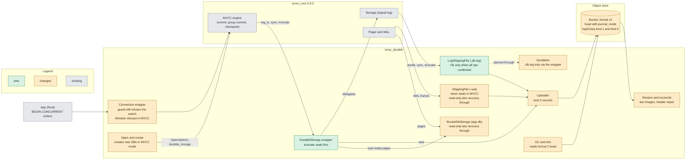
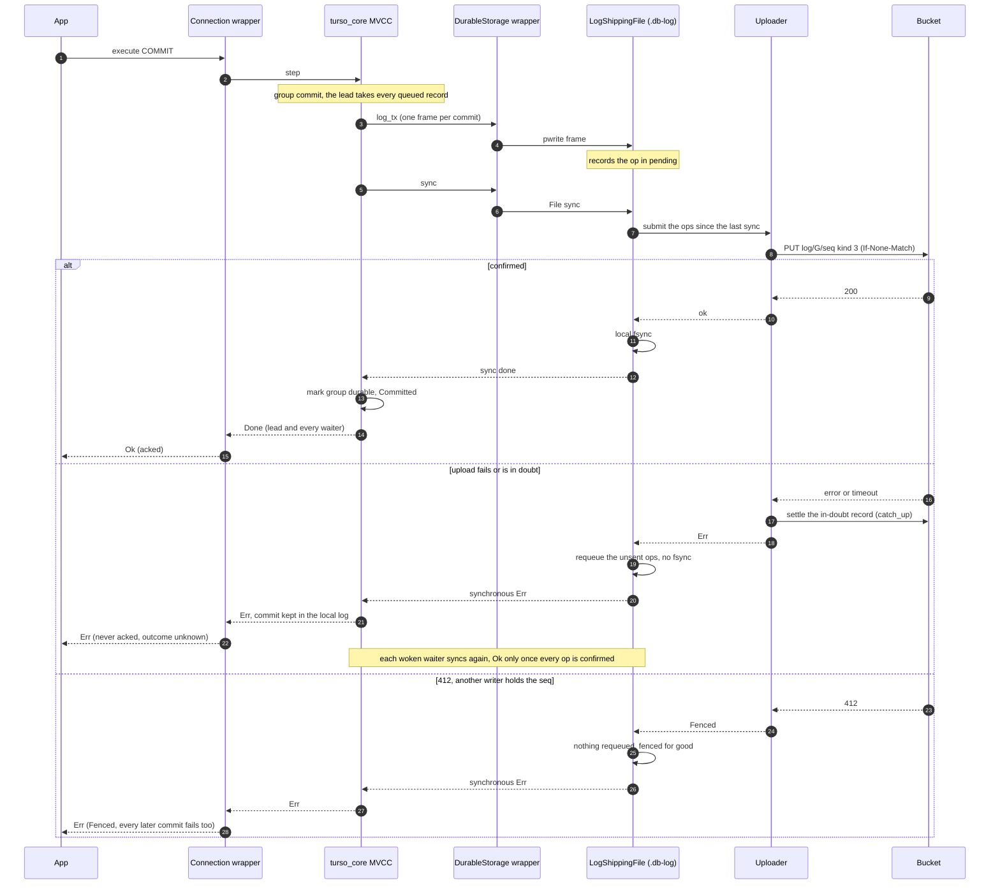
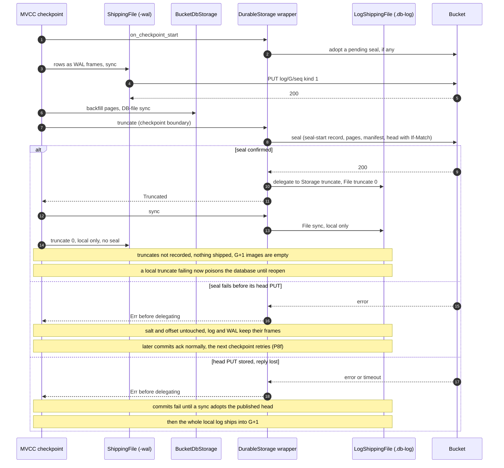

# MVCC durability, stage 1 finding (mvcc-recon)

Base `main` at 1c357f8, turso_core =0.8.3. Cites are `turso_core-0.8.3/<path>:<line>` (the
crate source in `~/.cargo/registry/src/index.crates.io-1949cf8c6b5b557f/`) and
`crates/<crate>/<path>:<line>` (this repo). Probes P1-P8g ran in a scratchpad crate
against local temp dirs, with the library's turso_core features and lock (nothing merged).
"Pn: `...`" quotes their printed output.

## Finding: Partial

MVCC databases can be made durable through turso_core 0.8.3's public APIs, **for databases
created new in MVCC mode**, with concurrent writers (`BEGIN CONCURRENT`), batching Off,
encryption, fencing, takeover, GC, trim, restore and verify. **Switching an existing WAL database
to MVCC stays refused**: it is not crash safe through the IO hooks (P7), and fixing that needs an
engine change. **Window batching stays refused**, and group commit gives one PUT per group instead
(P4). Design: the commit point stays the `.db-log` `File::sync`, and the seal moves into a public
`DurableStorage` wrapper's `truncate`, which runs before the engine cuts the log.

| Claim | Status |
|---|---|
| A commit waits for its `.db-log` sync | probed (P2) |
| A sync holds whole records, no waiter acked before a covering sync | probed (P4) |
| A failed log sync keeps the commit | probed (P3) |
| Sealing in `truncate` before it delegates loses nothing | probed (P8f) |
| A database plus the log up to any sync restores every synced row | probed (P5 a), plain files |
| The log is encrypted | probed (P6, P8e) |
| The WAL to MVCC switch is not crash safe | probed (P7) |
| A slow upload stalls other writers | probed (P8g), parked in `on_log_write_complete` |
| A sync returns Ok only when every op is confirmed | proved: `sync_ok_only_when_all_ops_confirmed` (`crates/turso_durable/tests/mvcc_fencing.rs`: 64 fault schedules, 549 acked, 27 `Err`), and the `io/log_file.rs` tests (argued from `crates/turso_durable/src/bucket.rs:57-61`) |
| Fencing and takeover | proved: `mvcc_writer_fenced_by_takeover_fails_commits_forever`, `kind3_put_on_a_seq_another_writer_holds_is_fenced`, `takeover_of_mvcc_restores_log_claims_fences_reconciles`, `takeover_after_in_doubt_kind3_record` (`tests/mvcc_fencing.rs`), system tests `mvcc_takeover_cli`, `mvcc_takeover_fences_a_running_soak` |
| GC and trim unchanged | proved: `gc_and_trim_across_mvcc_generations_keep_only_sealed_manifest_pages_and_log` (`src/gc/tests.rs`), `trim_reads_format_2_head` (`src/trim/tests.rs`), system test `mvcc_gc_across_generations` |
| Verify of a mid-checkpoint restore, after a read-only change | proved: `verify_of_mid_checkpoint_restore` (`tests/mvcc_fencing.rs`), `read_only_mvcc_open_of_mid_checkpoint_restore_succeeds_and_ships_nothing` (`src/db/tests/mvcc/readonly.rs`), system tests `verify_acked_on_mid_checkpoint_restore`, `verify_acked_on_plain_mvcc_restore` |
| Restore through the library, format v2 | proved: `restore_through_library_format_v2` (`tests/mvcc_fencing.rs`), `restore_v2_bucket_writes_wal_and_log_images` (`src/db/tests/mvcc/restore.rs`) |

Probes used plain IO and the engine's own `app.db` storage, and modelled a process crash, not
power loss. Stage 2 proved the argued rows (the table above names the tests) and corrected a few details (see Stage 2 outcome at the end).

Limits (details in the next section):

- Reads inside `BEGIN` or `BEGIN CONCURRENT`, and reads of a commit whose upload failed, can see
  it before it is acked. Autocommit reads wait out the upload, with no busy-timeout cap.
- A commit whose upload fails returns `Err` but may still be committed: "outcome unknown".
- One upload at a time. A slow upload stalls every writer: **use `BEGIN CONCURRENT` for every write,
  so writers wait rather than fail.**
- A checkpoint stops every transaction, readers included. A slow seal can fail them with `Busy`.
- Four README promises about Off do not hold in MVCC mode.

Your choice: approve stage 2 for new MVCC databases with these limits, or keep the refusal.

## Limits in detail

- **Reads before the ack.** Another connection can read a row while its commit waits for the
  upload (MVCC speculative reads). P2's streaming reader:
  `rows_seen_before_release=["Row id=1", "Row id=2"] select_done_before_release=false`.
  - The library's `query()` steps to `Done` before it returns rows
    (`crates/turso_durable/src/conn.rs:305-323`), so an autocommit read waits out the upload
    (P2: `reader id=2 (the held row): blocked>2000ms`). That wait spins on `Yield`, which the
    busy timeout does not cap (P2: `Yield steps 3544728, 2.003091417s`).
  - A read inside an explicit `BEGIN` or `BEGIN CONCURRENT` returns at once. The coordinator's
    review probe p2b_review
    (output `docs/mvcc-recon-probes/p2b_review_output.txt`, source
    `docs/mvcc-recon-probes/p2b_review.rs`): `REVIEW reader inside BEGIN: SELECT id=2 before release -> Done value=1 (169µs)`.
    Pinned in a test since: `speculative_read_inside_begin_sees_unacked_commit`
    (`crates/turso_durable/tests/mvcc_limits.rs`).
  - No transaction that read it can commit first: it waits on the dependency
    (`turso_core-0.8.3/mvcc/database/mod.rs:3316-3331`).
- **A failed upload keeps the commit.** Every connection sees it at once. P3: `failed commit: Err(Internal error: probe: log sync refused (sync Err))`,
  then `same connection: autocommit=true sees id=2: Ok([["1"]])` and `fresh connection sees id=2: Ok("1")`.
  The library ships it with the next sync or at reconcile. It is lost only if this disk is lost,
  or this writer is fenced, before its next sync confirms it, or if the process stops before any record of its
  generation is confirmed, including while a seal's head is not yet adopted (reconcile then treats it as an older generation's bytes, as
  for the WAL today, `crates/turso_durable/src/reconcile.rs:120-128`). It is never a lost ack.
- **README promises that break in MVCC mode** (line numbers are those of the README before stage 2, which has rewritten all four):
  - line 182: an Off commit that fails with `Timeout` "is rolled back locally";
  - line 231: Window's read-before-durable gap, "Off has no such gap";
  - line 241: "A failed Off commit is rolled back locally";
  - line 523: with Off, an error means "rolled back locally".
- **One upload at a time.** The group's lead holds the commit lock during its PUT
  (`turso_core-0.8.3/mvcc/database/mod.rs:2040-2066`). While a plain (autocommit or `BEGIN`) commit
  waits, `BEGIN CONCURRENT` writers fail at once, even with the 5 s busy timeout. P8g:
  `thread 1 id=1000: Err("Write-write conflict") latency=1.372333ms finished_before_release=true`.
  `BEGIN CONCURRENT` behind `BEGIN CONCURRENT` waits and succeeds
  (P8g: `thread 1 id=1000: Ok("Ok") latency=2.0014885s`).
- **Checkpoints stop the world.** During a blocking checkpoint every begin, read transactions too,
  is `Busy` (`turso_core-0.8.3/mvcc/database/mod.rs:6585`, `:6610-6612`). The seal's uploads (and any
  takeover quiet) run inside that window, so a slow seal can fail readers after the 5 s busy timeout
  (`crates/turso_durable/src/conn.rs:31`). Every explicit checkpoint mode runs as a blocking Truncate
  in MVCC (`turso_core-0.8.3/connection.rs:2392-2406`).
- **After a seal whose head reply was lost**, commits fail until one adopts the published head
  (Stage-2 design, Commit). That lasts only as long as the bucket is unreachable. No stall remains
  after it.

## Answers

### Q1. Where an MVCC commit waits: works through public APIs, here is how

- The commit state machine calls the log's `File::sync` in `SyncLogicalLog`
  (`turso_core-0.8.3/mvcc/database/mod.rs:3522-3537`, `LogicalLog::sync` at
  `turso_core-0.8.3/mvcc/persistent_storage/logical_log.rs:983-989`). The transaction becomes
  `Committed` only later, in `CommitEnd` (`turso_core-0.8.3/mvcc/database/mod.rs:3605-3633`).
- A failed sync completion aborts the statement before the next state
  (`turso_core-0.8.3/vdbe/mod.rs:2454-2476`). A synchronous `Err` from `File::sync` leaves through
  the `?` at `turso_core-0.8.3/mvcc/database/mod.rs:3530`.
- P2 (sync held): `before-release: done=false visible=false(reader blocked)`, then
  `after-release: done=true visible=true`.
- Only FULL syncs per commit (`turso_core-0.8.3/mvcc/database/mod.rs:1977-1979`). The library
  forces FULL on every connection (`crates/turso_durable/src/conn.rs:87-88`).
- **How:** upload the ops since the last sync inside the `.db-log` `File::sync`, before the local
  fsync. On failure return a synchronous `Err`, as `ShippingFile::sync` does for the WAL
  (`crates/turso_durable/src/io/wal_file.rs:324-335`).
- **Caveat, failed sync keeps the commit.** The drop cleanup marks a transaction whose record was
  written `Committed` (`turso_core-0.8.3/mvcc/database/mod.rs:7087-7124`). P3:
  `reopen crash copy: open: ok, journal_mode=mvcc, rows=4` with ids `1,2,3,4` (id 2 failed).
  So the library must never drop a failed sync's bytes (the confirmed-sync rule, below).

### Q2. What a logical-log sync covers: works through public APIs, here is how

- Each commit is one `pwrite` of one whole frame
  (`turso_core-0.8.3/mvcc/persistent_storage/logical_log.rs:889`). P1: `Pwrite { file: "app.db-log", off: 264, len: 55 }`
  then `Sync("app.db-log")` per INSERT.
- Group commit: the lead takes every queued record (`turso_core-0.8.3/mvcc/database/group_commit.rs:163-185`),
  writes each in turn, then makes one sync (`turso_core-0.8.3/mvcc/database/mod.rs:1992-1999`).
  A waiter returns only when `durable_through >= ticket` (`turso_core-0.8.3/mvcc/database/mod.rs:2032-2035`).
- P4, 8 threads `BEGIN CONCURRENT`: `commits=1600 syncs=585 (empty syncs=0)`, `split_records=0 []`,
  `acked before a completed sync covered the record: 0 []`. The mixed `BEGIN` and
  `BEGIN CONCURRENT` run gave the same zeros.
- Rewrites in place happen only at offset 0 with identical header bytes (P1:
  `same-as-first-header=Some(true)`) and over never-owned bytes past the end, after a discarded
  write (`turso_core-0.8.3/mvcc/persistent_storage/logical_log.rs:974-981`). An owned frame is
  never rewritten before a truncate. Replay by offset, in order, handles both.

### Q3. Ordering against the WAL: works through public APIs, here is how

The checkpoint, in blocking TRUNCATE mode (P1 ops 36-46, and
`turso_core-0.8.3/mvcc/database/checkpoint_state_machine.rs`):

| Step | What | Cite (`checkpoint_state_machine.rs`) |
|---|---|---|
| 3 | rows as WAL frames, WAL sync (FULL) | `:2821-2911` |
| 4-5 | backfill into the DB file, DB sync | `:2957-2987`, `:2989-3024` |
| 6 | `storage.truncate` (log cut to 0, new salt) | `:2913-2937` |
| 7 | log sync | `:2939-2955` |
| 8 | WAL truncate | `:3026-3077` |

- The log truncate cannot run before the WAL frames holding its rows are synced.
- **Problem with today's seal.** The library seals at the WAL `truncate(0)`
  (`crates/turso_durable/src/io/wal_file.rs:339-345`), that is step 8, after the log is cut. A seal
  failing there leaves "WAL frames + empty log", which does not open. P5 (d) k=8:
  `open: Err(Corrupt database: WAL has committed frames but logical log header is missing)`.
- **Refusing the log's `File::truncate` instead is worse.** The engine sets the new salt before the
  file call (`turso_core-0.8.3/mvcc/persistent_storage/logical_log.rs:1049-1068`), so later acked
  commits are lost at a crash. P5 (b2): `crash copy after the 2 commits ... (12 rows expected): open: ok, journal_mode=mvcc, rows=10`.
- **How:** seal inside a `DurableStorage` wrapper's `truncate`, before it delegates. P8f:
  `checkpoint: Err(Internal error: probe: seal failed, truncate refused)`, then
  `crash copy ... (12 rows expected): open: ok, journal_mode=mvcc, rows=12, integrity_check=ok`,
  plain and encrypted.

### Q4. Recovery: works through public APIs, here is how

- Header bytes 18/19 = 255 select MVCC (`turso_core-0.8.3/database.rs:2046-2047`). Bootstrap
  finishes an interrupted checkpoint, then replays frames with `commit_ts > persistent_tx_ts_max`
  (`turso_core-0.8.3/mvcc/database/mod.rs:5067-5076`,
  `turso_core-0.8.3/mvcc/persistent_storage/logical_log.rs:138-140`). A torn or invalid tail is
  dropped (`turso_core-0.8.3/mvcc/persistent_storage/logical_log.rs:3009-3030`).
- The log's only identity is its random salt (`turso_core-0.8.3/mvcc/persistent_storage/logical_log.rs:474`),
  so a log copied in byte for byte is accepted.
- So restore can replay shipped log ops into an empty `app.db-log`, as it replays WAL extents. P5 (a):
  `restore through sync #6 (log 361 bytes): expected rows 12 -> open: ok, journal_mode=mvcc, rows=12, integrity_check=ok`,
  and a frame cut in the middle gives the prefix (`rows=10`).
- One state is refused at open: WAL frames with an empty log
  (`turso_core-0.8.3/mvcc/database/mod.rs:8861-8869`). A fresh 56-byte header repairs it. P5 (d):
  `same files with the pre-checkpoint 56-byte log header written into the empty .db-log: open: ok, journal_mode=mvcc, rows=10, integrity_check=ok`.
  That header has the old salt. A fresh-salt header (`reset_to_fresh_header`) was not probed:
  stage 2 checks it.

### Q5. The header switch

**New databases: works through public APIs, here is how.**

- There is no open option for MVCC. The header decides (`turso_core-0.8.3/database.rs:2046-2047`),
  and the only MVCC field of `DatabaseOpts` is the passive-checkpoint flag (`turso_core-0.8.3/database.rs:71-85`).
- So the library builds the empty MVCC database itself in a local staging directory (the pragma,
  then a TRUNCATE checkpoint) and only then creates the bucket, with generation 1 as a seal of
  that image (Stage-2 design, Creation). Built: the head is generation 2 naming manifest 1,
  which is what a seal of generation 1 publishes (see Stage 2 outcome).
- A crash mid-switch can make the open panic. P7 run 0: `-> PANIC: Attempted to insert different page with same key: {key:?}`.
  So a staging directory is never opened again: the next open removes it.

**Existing WAL databases: needs an engine change: here is the smallest one.**

- The switch is a WAL checkpoint, an unsynced page-1 write to `app.db`, the log open, a log
  header and sync, then two meta-table WAL commits (`turso_core-0.8.3/vdbe/execute.rs:19119-19261`).
  No single IO hook makes that atomic.
- A crash between the meta-table commits leaves a database that does not open. P7 run 1 (50
  rows), k=14: `open: Err(Corrupt database: Missing MVCC metadata row for key persistent_tx_ts_max)`.
- Refusing the 255 page-1 write does not stop the switch. P7: `same connection: PRAGMA journal_mode -> Ok(Ok([["mvcc"]]))`,
  and after close `db file 18/19=Some([255, 255])`.
- **Smallest engine change:** a crash-safe switch (the header and the meta row in one atomic
  write), or an `OpenOptions` flag to create a database in MVCC mode. Neither is needed for
  "new databases only". The SQL guard keeps refusing the pragma
  (`crates/turso_durable/src/guard.rs:106-110`).

### Q6. Concurrency in one process: works through public APIs, here is how

- The wrapper does not serialize writers. The engine does, one log writer at a time. A
  non-exclusive commit takes `pager_commit_lock` at commit (`turso_core-0.8.3/mvcc/database/mod.rs:2040-2066`,
  `:3403-3413`). An exclusive one skips that branch (`turso_core-0.8.3/mvcc/database/mod.rs:3389`),
  having taken the lock at begin (`turso_core-0.8.3/mvcc/database/mod.rs:6488-6489`), and is refused
  while another transaction is Preparing (`turso_core-0.8.3/mvcc/database/mod.rs:7485-7487`). So the uploader's single FIFO (`crates/turso_durable/src/uploader.rs:166-185`)
  gets records in the engine's durability order, across both files.
- A group's upload runs on the lead's thread, so it lands in the lead's per-thread commit
  context (`crates/turso_durable/src/batching.rs:196-273`).
  - **Off:** safe. Waiters are woken only after the lead's sync completes
    (`turso_core-0.8.3/mvcc/database/mod.rs:3566-3573`), and the upload is inside that sync.
  - **Window:** a Window sync only queues and fsyncs locally
    (`crates/turso_durable/src/io/wal_file.rs:202-208`), so a follower is woken before the upload
    and told "ok" before its record is in the bucket. So Window is refused in MVCC mode.
- If the lead's sync fails, each woken waiter runs its own prefix sync and is then marked durable
  (`turso_core-0.8.3/mvcc/database/group_commit.rs:182`, `turso_core-0.8.3/mvcc/database/mod.rs:3552-3554`).
  Today that sync would find nothing pending and return Ok at once
  (`crates/turso_durable/src/io/wal_file.rs:181-185`), while the lead's record may still be in
  doubt (its ops are not resent, `crates/turso_durable/src/uploader.rs:500-501`). So the waiter
  could be acked with its record unconfirmed. Hence the confirmed-sync rule (Stage-2 design, Commit).
- The maintenance gate is unchanged. The engine's `blocking_checkpoint_lock` keeps commits out of a
  checkpoint (`turso_core-0.8.3/mvcc/database/mod.rs:6632-6633`).
- Checkpoints are driven by the library's maintenance, which measures `.db-log` bytes (the `-wal`
  is near 0 in MVCC). The engine's auto-checkpoint is off: the wrapper's `should_checkpoint()`
  returns false (`turso_core-0.8.3/mvcc/persistent_storage/mod.rs:96`, read at
  `turso_core-0.8.3/mvcc/database/mod.rs:3692`), whatever `mvcc_checkpoint_threshold` says. An
  auto-checkpoint's error is swallowed inside the commit (`turso_core-0.8.3/mvcc/database/mod.rs:3747-3751`),
  so a failed seal would go unseen.
- Smaller effects: stats count one commit per sync, so they need a
  per-record count. `Storage::sync` holds the log's write lock during the upload
  (`turso_core-0.8.3/mvcc/persistent_storage/mod.rs:212-214`).

### Q7. Every other guarantee

| Guarantee | Label | How, with evidence |
|---|---|---|
| Fencing, takeover | works through public APIs, here is how | `.db-log` records take the same `Uploader` to `put_if_absent` path. A 412 with other bytes is `Fenced` (`crates/turso_durable/src/bucket.rs:1224-1242`), and it sticks (`crates/turso_durable/src/bucket.rs:684-705`). A fenced lead's sync fails the commit, and each follower's own prefix sync meets the same fence. Takeover is restore (now with `app.db-log`), claim, fence, reconcile. |
| Encryption | works through public APIs, here is how | The log payload is encrypted by turso's codec (`turso_core-0.8.3/mvcc/persistent_storage/logical_log.rs:792-807`). P6: `needle in .db-log: false (385 bytes); "CREATE TABLE" in .db-log: false`, control run `needle in .db-log: true`. Frame headers stay plaintext: commit timestamps, op counts, sizes (`turso_core-0.8.3/mvcc/persistent_storage/logical_log.rs:810-841`). The wrapper must report the encryption context, or the open fails (`turso_core-0.8.3/storage/journal_mode.rs:73-83`). P8e: `Err("encrypted MVCC requires the custom DurableStorage to be configured with encryption")`. |
| GC and trim | works through public APIs, here is how | Unchanged, as long as the only seal is the wrapper's (Stage-2 design). Trim keeps only the sealed generation's manifest, pages and log (`crates/turso_durable/src/trim.rs:27-54`). At the seal every log frame is already in the pages: no commit runs during the checkpoint (`turso_core-0.8.3/mvcc/database/mod.rs:6632-6633`), and recovery skips frames at or below `persistent_tx_ts_max` (`turso_core-0.8.3/mvcc/persistent_storage/logical_log.rs:138-140`). The next generation's `.db-log` image is the local file at the seal (empty after the normal truncate, see the invariant in the Stage-2 design). |
| Verify (read-only) | works through public APIs, here is how | The library opens the engine with `OpenFlags::Create` even read-only (`crates/turso_durable/src/engine.rs:152`), so the engine's own read-only checks never run (`turso_core-0.8.3/database.rs:2631-2633`). A restore taken mid-checkpoint (WAL frames in the image) goes through the writable bootstrap: backfill, log header rewrite, WAL truncate (`DriveCheckpoint`, `RetryHeader`, `DriveFinalTruncate`: `turso_core-0.8.3/mvcc/database/mod.rs:8901-8911`, `:8963-8976`, `:9031-9032`). Today the read-only `ShippingFile` and `BucketDbStorage` refuse those writes (`crates/turso_durable/src/io/wal_file.rs:243-249`, `crates/turso_durable/src/io/db_storage.rs:376-379`), so that open would fail. Stage 2 lets them through locally, never shipped and never sealing (Stage-2 design, Verify). `integrity_check` sees only the B-tree, so verify also reads the acked rows back (`--acked`). |
| `synchronous` FULL | works through public APIs, here is how | FULL is set on every connection and the guard refuses lower values (`crates/turso_durable/src/conn.rs:87-88`, `crates/turso_durable/src/guard.rs:113-119`). Under FULL every commit syncs the log (`turso_core-0.8.3/mvcc/database/mod.rs:1977-1979`). |

## Why a hybrid design

- **A, a `File` wrapper on `.db-log` only.** The commit side works (a failed sync keeps the
  commit and its CRC chain, P3, and the confirmed-sync rule handles it). But the seal cannot gate the
  log truncate: failing `File::truncate` loses later acked commits (P5 b2: `rows=10` of 12), and
  sealing at the WAL truncate leaves "WAL frames + empty log" when the seal fails (P5 d k=8,9:
  `Corrupt`).
- **B, uploading inside `DurableStorage::on_log_write_complete`.** It rolls back cleanly on one
  connection (P8b: `fresh connection sees id=2: Ok("0")`). Under group commit an `Err`'d row
  comes back after reopen in 5 of 24 runs while invisible live (P8d:
  `ok=399 failed_ids=[3023] visible_live=["0"] present_after_reopen=["1"]`): memory and log
  disagree. It is also one PUT per record, with no batching.
- **C, the hybrid:** A's commit point, plus a `DurableStorage` wrapper whose `truncate` seals
  first. A failed seal then leaves the log and WAL whole (P8f). A crash between the log truncate and
  the WAL truncate still leaves "WAL frames + empty log" locally, so the open-time repair stays.

## Stage-2 design (hybrid C)

**Shape.** A `DurableStorage` wrapper, passed with `OpenOptions::durable_storage`
(`turso_core-0.8.3/database.rs:287-293`), delegates every method to the engine's own
`Storage::new(file, io, enc_ctx)` (`turso_core-0.8.3/mvcc/persistent_storage/mod.rs:133-150`).
`file` is `app.db-log`, opened by the wrapper through `DurableIo` (the engine does not open it
for a custom storage, `turso_core-0.8.3/storage/journal_mode.rs:85-100`), and wrapped in a new
`LogShippingFile`.

**Commit.**
- The commit point is the `.db-log` `File::sync`: upload the ops since the last sync, then
  fsync. A failure is a synchronous `Err`, never a failed completion.
- **Confirmed-sync rule:** a `.db-log` sync returns Ok only when every `.db-log` op recorded so
  far is confirmed in the bucket.
  - Ops never sent go back to the front of `pending` and ship with the next sync. The engine keeps
    the frame and chains from it (P3: `range Some(311)..Some(367) (this sync failed)`, next
    `Some(367)..Some(416)`). Dropping them loses later acked commits (P3: `restore from app.db + shipped ranges without the failed sync's bytes: ... rows=1`).
    Today's WAL rule drops them (`crates/turso_durable/src/uploader.rs:484-499`).
  - The sync settles first, with the bucket's existing `catch_up` (`crates/turso_durable/src/bucket.rs:963-967`).
    This covers ops in doubt (`unsent: None`, `crates/turso_durable/src/bucket.rs:57-61`). It returns
    Ok only once the in-doubt set is empty, not merely when `catch_up` says Ok.
  - If the bucket holds a published pending seal (`catch_up` returns Ok without settling,
    `crates/turso_durable/src/bucket.rs:986-989`), the sync adopts it before it appends, and the
    generation-change invariant applies. An unpublished one is a failed seal, and the generation
    continues. If the adopt fails, that commit fails as in any bucket outage, and the next retries.
  - The sync cannot wait for a checkpoint to adopt it: a pending seal makes the bucket degraded
    (`crates/turso_durable/src/bucket.rs:997-999`), so `bucket_failing` reports it
    (`crates/turso_durable/src/uploader.rs:219-227`) and maintenance skips every run
    (`crates/turso_durable/src/maintenance.rs:489-491`).
  - An empty sync while anything is unconfirmed does the same (no early Ok).
  - A 412 from another writer fences for good: nothing is requeued, every later sync fails.
- `on_log_write_complete` is not overridden (the default yield).

**Checkpoint and the seal.**
- `DurableStorage::truncate` runs the seal (flush, seal-start, pages, manifest, head) and only
  then delegates. A failed seal returns `Err` before the engine touches the salt or offset (P8f).
- A seal whose head PUT stored but was not confirmed leaves the head maybe published, and every
  append is refused until a seal adopts it (`crates/turso_durable/src/bucket.rs:948-955`, `:962`).
  The next commit's sync adopts it (Commit, above). The wrapper's `on_checkpoint_start` makes the
  same adopt, as a backstop, before any WAL write of the checkpoint (it runs first,
  `turso_core-0.8.3/mvcc/database/checkpoint_state_machine.rs:2222`, P8a: `-- hook: on_checkpoint_start`
  before `2 Pwrite { file: "app.db-wal", off: 0, len: 32 }`). The seal's flush runs after that adopt.
- The seal takes its pages from `BucketDbStorage::seal` (`crates/turso_durable/src/io/db_storage.rs:313-316`),
  the page source the WAL seal uses today (`crates/turso_durable/src/io/wal_file.rs:221`).
- In an MVCC database `ShippingFile` never seals: not at `truncate(0)`
  (`crates/turso_durable/src/io/wal_file.rs:339-345`), and not at a WAL header epoch change
  (`crates/turso_durable/src/io/wal_file.rs:227-237`). A checkpoint retried after a failed seal
  restarts the WAL header (`turso_core-0.8.3/storage/wal.rs:6024-6030`, P8f retry:
  `0 Pwrite { file: "app.db-wal", off: 0, len: 32 }`), which would otherwise seal first.
- **Invariant:** at every generation change (a seal, or an adopt or redo of a pending seal), the
  new generation's `.db-log` image is the local file as it then stands.
  - After the normal seal path the local file is truncated, so the image is empty and nothing is
    shipped (the `.db-log` and WAL truncates are local only).
  - After an adopt or redo without a truncate, the whole local `.db-log`, from offset 0 with its
    header, counts as unconfirmed ops of the new generation and ships before any sync returns Ok
    (the confirmed-sync rule), as reconcile's Ahead does at open. Otherwise a restore would lack the
    log header and fail closed (`turso_core-0.8.3/mvcc/database/mod.rs:8871-8877`).
  - The new generation's `-wal` image is empty. At the wrapper's seal the local `-wal` still holds
    the checkpoint's frames, but all of them are backfilled into the sealed pages (steps 4-5 run
    before step 6). Their local truncate (step 8, or the engine's reconciliation at the next open)
    is never shipped.
  - After a crash between the seal and the WAL truncate, reconcile finds the new generation's
    `-wal` image empty and the local `-wal` not, so `holds_older_generation`
    (`crates/turso_durable/src/reconcile.rs:128`, used at `:75`) makes it `NewGeneration`: the local
    `-wal` is replaced with the empty image and nothing reaches the new generation. That is safe:
    those frames were backfilled, synced and are covered by the sealed manifest.
  - **Choice for the `.db-log` in the same crash:** the same rule. A new-generation `.db-log` image
    that is empty next to a non-empty local `.db-log` is `NewGeneration`, and the local file is
    replaced with the empty image. It cannot hold an acked commit: no sync returns Ok before its
    ops are in that image (even after an adopt, which ships the whole file first). Both files
    empty then open (P5 d k=10: `open: ok, journal_mode=mvcc, rows=10, integrity_check=ok`).
    A non-empty image is compared as today: Level, Behind or Ahead.
  - Today `ShippingFile` records every truncate as an op (`crates/turso_durable/src/io/wal_file.rs:339-352`).
    In MVCC mode the `-wal` and `.db-log` wrappers do not record the truncates of a generation
    change. One recorded anyway would be harmless: a truncate to 0 of an image already empty.
- A local truncate, or the step-7 local fsync, that fails after a successful seal poisons the
  database until reopen. The poison refuses at `pwrite`, so a poisoned commit rolls back cleanly
  (P3 variant C: `fresh connection sees id=2: Ok("0")`). It refuses checkpoints and seals too. The
  open runs the "WAL frames + empty log" repair and reconcile. A failed step-7 fsync poisons
  harmlessly.
- Never return `Retained` from `truncate` in TRUNCATE mode: the checkpoint asserts `Truncated`
  (`turso_core-0.8.3/mvcc/database/checkpoint_state_machine.rs:1521-1526`), which panics.
- Keep `DurableIo` refusing a `.db-log` opened by anything but the wrapper (the backstop,
  `crates/turso_durable/src/io/durable_io.rs:66-68`). Match the canonicalized path: the engine
  canonicalizes the database path (`turso_core-0.8.3/database.rs:2293-2304`).

**Bucket format v2.**
- Record kind 3 = `.db-log` extents, with kind 1's body. Head `"format":2` plus
  `"journal_mode":"mvcc"`. Local state `format: 2`. Manifest unchanged.
- WAL buckets stay byte-identical v1. A v1 binary refuses a v2 head at decode
  (`crates/turso_durable/src/format/head.rs:17-23`), so it never appends to, seals, restores or
  trims one.
- A journal-mode mismatch between the bucket and the local database is refused (`Unsupported`).

**Restore and reconcile.**
- One pass over `log/G` in seq order: kind 1 to `app.db-wal`, kind 3 to `app.db-log` (today all
  extents go to the WAL, `crates/turso_durable/src/restore.rs:258-260`). `app.db-log` joins the
  restored-file lists and the "already holds a database" checks.
- The MVCC refusal on page 1 becomes a mode check against the head.
- If the WAL image has frames and the log image is under 56 bytes, write a fresh log header
  (Q4). Prefer the engine's own `DurableStorage::reset_to_fresh_header`
  (`turso_core-0.8.3/mvcc/persistent_storage/mod.rs:93`, body at
  `turso_core-0.8.3/mvcc/persistent_storage/logical_log.rs:1095-1116`) on a standalone `Storage`. Stage 2 checks it works
  outside an open engine. If not, the library writes the header itself, a copied engine format
  pinned by a test.
- Reconcile runs Level, Behind, Ahead per file. An Ahead `.db-log` uploads as kind 3, as the WAL
  does today (`crates/turso_durable/src/reconcile.rs:8-9`). The same "WAL frames + empty log"
  repair runs on a local directory before the engine opens it (a crash between steps 6 and 8).
- A crash between the seal and the log truncate leaves the old frames locally. The new
  generation's `.db-log` image is still empty, so reconcile replaces them (`NewGeneration`, the
  choice above). Every one of them is in the sealed pages: recovery would skip them anyway, as
  frames at or below `persistent_tx_ts_max`
  (`turso_core-0.8.3/mvcc/persistent_storage/logical_log.rs:138-140`).

**Creation (new MVCC databases).** `Config` names the journal mode. No bucket I/O happens until
the database is whole:
- The library builds the empty MVCC database in a local staging directory with plain local IO:
  the switch, then a TRUNCATE checkpoint.
- It then creates the bucket with generation 1 as a seal of that image: pages and manifest first,
  the head last (the head is the commit point, as for every seal). As built, "generation 1 as a
  seal" means the head says generation 2 and names manifest 1, as every seal does (head G+1,
  manifest G). A head at generation 1 naming manifest 1 would let the first real seal overwrite
  `pages/1/*` and `manifest/1` under a live head.
- A crash before the head leaves a staging directory, which the next open removes, and maybe
  objects of the never-headed creation. Trim cannot remove those (it needs a head,
  `crates/turso_durable/src/trim.rs:27-54`). They stay until the retry overwrites them: a retried
  creation writes `pages/1/*` and `manifest/1` with plain PUTs, and never reuses a `put_if_absent`
  key the crashed attempt may hold (such as a seal-start record).
- Two racing creators: the head's If-None-Match decides, and the loser's pages may be overwritten.
  That is low risk for an empty database. Stage 2 tests it.
- Today `Bucket::create` writes a head with no manifest (`crates/turso_durable/src/bucket.rs:446-452`),
  so `create_new` (`crates/turso_durable/src/db.rs:425-454`) and `Bucket::create` change in stage 2.

**Batching.** Off only. Group commit gives one PUT per group (P4: `frames per sync (frames: syncs): {1: 111, 2: 143, 3: 175, 4: 107, 5: 44, 6: 5}`).
A later real Window would need a per-file confirmed-op watermark that `Connection::call` waits on.

**Encryption.** The wrapper builds its `EncryptionContext` from the same cipher and key as the
library's `EncryptionOpts` (`crates/turso_durable/src/engine.rs:150-161`) and returns it from
`encryption_ctx()`.

**Takeover and fencing.** No change of their own beyond restore and reconcile learning
`app.db-log` and kind 3. The fence path learns that another writer's kind-3 record occupies a seq.

**GC and trim.** Only decoding a format-2 head, and the single seal above. Checkpoint modes need
no change: `Connection::checkpoint` already runs every mode as Truncate in MVCC
(`turso_core-0.8.3/connection.rs:2392-2406`), and `PRAGMA wal_checkpoint(PASSIVE)` returns an error
(`turso_core-0.8.3/translate/pragma.rs:943-948`).

**Guard.** In MVCC mode also refuse `PRAGMA journal_mode = wal`, which passes today
(`crates/turso_durable/src/guard.rs:106-110`). `mvcc_checkpoint_threshold` need not be refused or
set: the wrapper's `should_checkpoint()` returns false (Q6).

**Verify.** In a read-only open the bootstrap's recovery writes (backfill, log header rewrite, WAL
truncate) go through locally, and are never shipped and never seal. The wrapper's
`on_checkpoint_start` and `truncate` seal do nothing in read-only mode. That is a stage-2 change to
the read-only `ShippingFile` (`crates/turso_durable/src/io/wal_file.rs:243-249`), `BucketDbStorage`
(`crates/turso_durable/src/io/db_storage.rs:376-379`) and the new `LogShippingFile`. Verify then
reads the acked rows back (Q7).
- Verify now changes the local directory (the bootstrap's writes), so stage 2 updates the README's
  "Verify never claims, never seals and never writes to the bucket" (README, CLI, `verify`: still
  true for the bucket, now with the local writes, done), the `open_read_only` doc comment
  (`crates/turso_durable/src/db.rs:256-258`) and the reconcile comment
  (`crates/turso_durable/src/reconcile.rs:81-86`, which says a read-only directory never checkpointed).
- The early WAL truncate probably runs on every MVCC open with no WAL frames (`DriveEarlyTruncate`,
  `turso_core-0.8.3/mvcc/database/mod.rs:8890-8894`), so verify writes locally even on a plain
  restore.

**What stays refused.**

| Case | Why | Error |
|---|---|---|
| Switching an existing WAL database to MVCC (pragma on a database with data, or a WAL bucket opened in MVCC mode) | not crash safe (P7) | `Unsupported("MVCC: switching an existing WAL database")` |
| Window batching in MVCC mode | followers acked before upload (Q6) | `Unsupported("MVCC: Window batching")` |
| Switching back from MVCC to WAL | not examined | `Unsupported("MVCC: switching back to WAL")` |
| The experimental passive MVCC checkpoint flag | it keeps log frames across a seal | never set (the library builds `DatabaseOpts`, `crates/turso_durable/src/engine.rs:150-161`) |

**Test plan** (in `./scripts/test.sh`, both passes: plain, and HTTPS with encryption):
- MVCC crash matrix: kill at every op boundary of a commit, a group commit and a checkpoint
  (including between the seal and the log truncate, and between the log truncate and the WAL
  truncate). Delete the local disk, restore: every acked commit present, `integrity_check` ok.
  `verify --acked` (`crates/turso-durable-cli/tests/system.rs:727-731`) runs on every restore,
  mid-checkpoint ones included, and must pass. Also `verify --acked` on a plain restore (no WAL
  frames), which still meets the early WAL truncate. 8 writer threads, all `BEGIN CONCURRENT`, and mixed.
- One failed PUT under group commit: no ack lost. The `Err`'d commit is present or absent, but
  local equals restored after reopen.
- A PUT that stores and then fails under group commit, then a takeover before the next commit:
  the follower is not acked unless its record is in the bucket.
- Seal failure at a checkpoint: checkpoint `Err`, later commits acked and restorable (P8f's shape).
  Then the checkpoint retried, a crash, and a restore.
- A seal head PUT that stores and then fails, then commits, then a checkpoint: no stall past that
  next checkpoint, no ack lost. Then the pending seal adopted, that checkpoint's WAL upload
  failing, more commits, the local disk deleted and a restore: every acked commit present.
- No explicit checkpoint: a seal head PUT stores and its reply is lost, then commits only. The
  next commit adopts the head and is acked. Delete the local disk, restore: every acked commit present.
- A crash at each step of creation, then an open here and a restore elsewhere.
- Refusals: the switch (SQL guard and open), Window in MVCC, the passive flag.
- Fencing and takeover with an MVCC writer. GC and trim across MVCC generations. Verify.
- The plaintext scan with encryption on (pass 2).
- A slow upload against other writers: re-run P8g's shape with the upload parked in `File::sync`
  (P8g parked in `on_log_write_complete`), and pin "use `BEGIN CONCURRENT`".
- Speculative reads: a test that pins today's behaviour, and README text.
- WAL-mode tests unchanged. v1 buckets byte-identical.

## Diagrams

**Components.** Green is new, amber is changed, grey is existing and unchanged.

**An MVCC commit, and its failure path.** The ack waits for the record to be in the bucket. A
failed upload fails the statement. Unsent ops are requeued, in-doubt ones settled first.

**An MVCC checkpoint.** The rows reach the B-tree through the WAL, which is already shipped. The
seal runs in the wrapper's `truncate`, before the engine cuts the log. After it, both truncates
are local only, and the new generation's `.db-log` image is the truncated local file.

## Engine issues worth reporting upstream (no action needed)

- A failed log sync keeps the commit while the statement returns `Err` (P3).
- Under group commit, a failed `on_log_write_complete` can leave the `Err`'d row in the log
  while it is invisible live (P8d, 5 of 24 runs).
- A WAL sync completion error at the checkpoint's pager commit panics. P5 (c2):
  `fsync error (data_sync_retry=off)` at `turso_core-0.8.3/storage/pager.rs:4730`. The library already
  avoids it by failing synchronously (`crates/turso_durable/src/io/wal_file.rs:324-335`).

## Probes

| Probe | What it showed |
|---|---|
| P1 | One `pwrite` and one `Sync("app.db-log")` per commit. Checkpoint order: WAL write and sync, DB write and sync, log truncate, log sync, WAL truncate. |
| P2 | A held log sync holds the commit (`before-release: done=false`), but a streaming reader on another connection sees the row. |
| P3 | A failed log sync returns `Err` but the row is committed (`fresh connection rows: Ok("1,2,3,4")`). Dropping its bytes loses later commits (`rows=1`). A refused `pwrite` rolls back. |
| P4 | 1600 commits in 585 syncs, `split_records=0`, no ack before a covering sync, also mixed with `BEGIN`. |
| P5 | Restore through any sync gives exactly the synced rows. Refusing the log `File::truncate` loses 2 acked commits (`rows=10`). A crash between log and WAL truncate is `Corrupt` until the pre-checkpoint (old-salt) header is written back. A WAL-sync completion error panics. |
| P6 | Encrypted: `needle in .db-log: false`, also `.db-wal` and `.db`. Control: `true`. |
| P7 | The switch is not crash safe (`Missing MVCC metadata row`), and refusing the page-1 write does not stop it. A new database can panic the open if creation crashes. |
| P8a-e | A `DurableStorage` wrapper compiles and delegates to `Storage::new`. `on_log_write_complete` failure rolls back on one connection, diverges under group commit. Encryption needs the wrapper's context. |
| P8f | `truncate` refused before delegating: checkpoint `Err`, `rows=12` kept, plain and encrypted. |
| P8g | A parked commit stalls every writer. `BEGIN CONCURRENT` fails at once behind a plain commit (`Write-write conflict`), and waits and succeeds behind `BEGIN CONCURRENT`. |

## Stage 2 outcome

What the build found and changed against the design above. The tests are in
`crates/turso_durable/` unless a path says otherwise, and the logs are in
`results/mvcc-durability.txt`. Where the engine matched this document (tasks 9 and 11 found no
difference), nothing is listed.

| Design said | Built | Evidence |
|---|---|---|
| A new database's bucket is "generation 1 as a seal" | The head is generation 2 naming manifest 1: head G+1, manifest G, as every seal. Generation 1 with manifest 1 would let the first seal overwrite `pages/1/*` and `manifest/1` under a live head. | `create_mvcc_makes_head_manifest_pages_and_local_files` (4 PUTs for the empty image, `trim_once` deletes 0) |
| The staging build leaves `app.db-log` as the engine writes it | The engine's TRUNCATE checkpoint cuts the log to 0 bytes. The build writes the switch's 56-byte header back after it, locally. The bucket's image has an empty log. | the same test (`app.db-log` is exactly 56 bytes, magic `LML2`), `create_crash_at_each_step` |
| Restore writes `app.db-log` (header repair "if not, the library writes the header itself") | A restore of a creation-made bucket writes an empty `app.db-log` and opens fine. `reset_to_fresh_header` works standalone, so the library writes no header of its own. The repair runs when `-wal` frames sit next to a log shorter than 56 bytes, on restore and on a local directory. | `restore_of_created_mvcc_bucket_opens`, `reset_to_fresh_header_works_standalone`, `wal_frames_with_empty_log_is_repaired_and_opens` (`src/db/tests/mvcc/restore.rs`) |
| The first reopen of a created database is Level | It reports NewGeneration (header-only local log against an empty image) and sets `complete=false` on an unclaimed directory. Harmless but noisy. | `log_only_new_generation_keeps_the_dirty_file` |
| A failed local log truncate after the seal poisons the database | Any checkpoint failure after a successful seal poisons it until reopen: the log truncate, its fsync, or the WAL truncate (the engine's `on_checkpoint_end` runs on every checkpoint error path). Broader than the design's diagram. | `local_truncate_failure_after_seal_poisons_until_reopen` (`src/db/tests/mvcc.rs`) |
| Stats under group commit are not mentioned | Commits were counted per sync and only the lead acked. Now counted and acked per engine frame: `commits_acked == commits_uploaded`, fewer log PUTs than commits. | `stats_count_one_commit_per_record_in_group_commit` (8 threads, 161 commits) |
| "Verify now changes the local directory", and the early WAL truncate "probably runs on every MVCC open" | On a plain restore the early WAL truncate is a no-op (the WAL is already empty). The only local change is `app.db` (0 to 8192 bytes, the bootstrap's backfill). On a mid-checkpoint restore the bootstrap empties a non-empty `-wal`. A read-only open never creates `app.db-log`, and a directory with no log and an empty log image fails with `<path> is missing: restore the database again`. WAL read-only still refuses writes. | `read_only_plain_restore_runs_early_wal_truncate_locally`, `read_only_mvcc_open_of_mid_checkpoint_restore_succeeds_and_ships_nothing`, `read_only_mvcc_does_not_create_the_log_when_absent`, `read_only_wal_database_still_refuses_writes` (`src/db/tests/mvcc/readonly.rs`) |
| Reconcile makes the first sync's whole-file ship unnecessary (implied) | `ship_whole_file_next` stays: the "WAL frames + empty log" repair and a NewGeneration that empties the log write local bytes the image lacks. Cost: one extra PUT per open, and a peak memory of about 2 to 3 times the log's size (the log is read into one buffer). | `crates/turso_durable/src/io/log_file.rs` tests, Task 6 and 8 reports |
| The CLI needs `--journal-mode` (not specified) | `--journal-mode wal\|mvcc` on `sql`, `stats`, `soak`, `bench`, `serve`, `takeover`. Without a flag or `DURABLE_JOURNAL_MODE` the CLI follows an existing head (one GET), and `restore` and `verify` always follow the head. The library does not: `Config.journal_mode` must name the mode of an existing MVCC database. `soak --concurrent [all\|mixed]`. | `mvcc_refusals_cli`, `mvcc_takeover_cli`, `head_journal_mode_reads_the_head` |
| Takeover and fencing "no change of their own" | Correct for the library, but a takeover of an MVCC writer committing flat out (4 connections, no pause) hits the 64 fence-probe limit in 5 of 5 runs. The head's epoch is raised, the old writer is fenced at its next head check, and every ack it printed restores. Retry the takeover or pause the writer. | `mvcc_takeover_fences_a_running_soak`, `takeover_of_mvcc_restores_log_claims_fences_reconciles` |
| Maintenance "measures" the log (Q6) | The `LogShippingFile` shares the engine's `wal_bytes` counter (high-water mark: the file's size at open, the highest offset + length written, 0 after `truncate(0)`). The MVCC `-wal` gets a private counter. A pending seal does not starve maintenance. | `maintenance_checkpoints_mvcc_when_log_bytes_exceed_threshold`, `log_high_water_is_the_file_size_at_open`, `pending_seal_does_not_starve_maintenance` |
| Test plan: failed PUT under group commit, a put that stores then fails before a takeover, a seal failure then retry then crash, as system tests | The CLI cannot inject faults, so these are library tests (fault stores): `seal_failure_retry_crash_restore` (`src/db/tests/mvcc.rs`), `takeover_after_in_doubt_kind3_record`, `sync_ok_only_when_all_ops_confirmed` (`tests/mvcc_fencing.rs`). The system tests kill at `seal-started` and `seal-finished`, which is near the seal boundaries, not on them. | the files named |
| The four limits stand | Pinned in `tests/mvcc_limits.rs`: P2, P3, P8g and the stop-the-world checkpoint all behaved as quoted above (a reader got `database is busy (locked)` after 5.39 s behind a parked seal PUT). The fifth limit (four README promises) is rewritten in the README. | `speculative_read_inside_begin_sees_unacked_commit`, `autocommit_read_waits_out_the_upload`, `failed_upload_keeps_the_commit_locally_outcome_unknown`, `slow_upload_stalls_writers_and_begin_concurrent_waits`, `checkpoint_stops_readers_with_busy_after_timeout_on_slow_seal` |

The design's other statements held when tested. No `turso_core` change was needed, and
`Cargo.lock` is unchanged from the stage-1 base.
