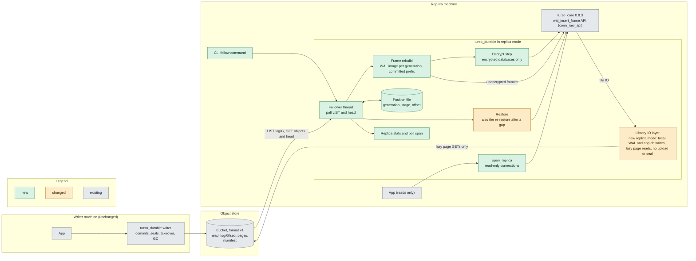
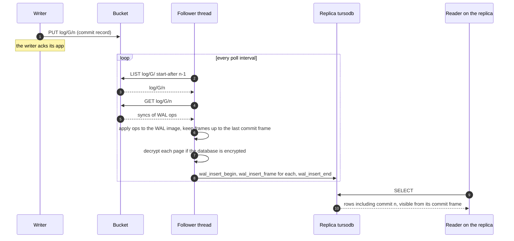
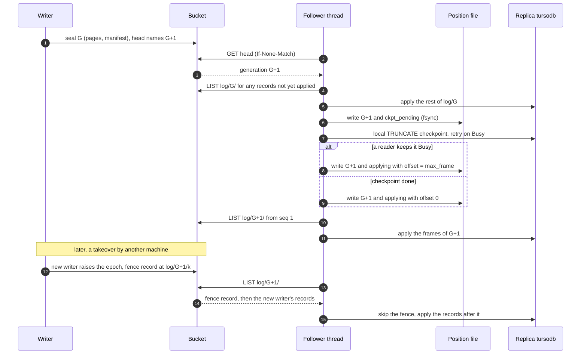
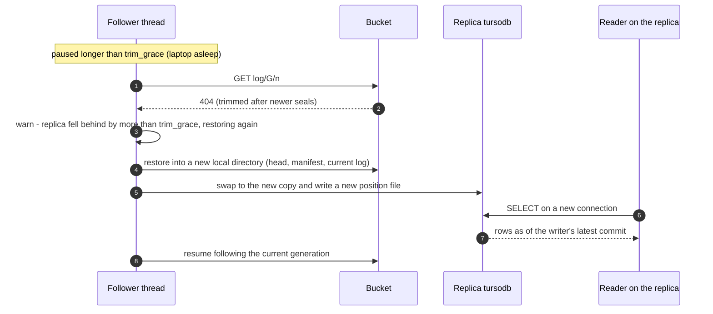

# Read replicas, stage 1: can a replica follow the bucket through turso_core's frame API?

Spec: `.superpowers/specs/read-replicas.md` (approved 2026-10-18). Base: `main` at 0aaabcd.
turso_core 0.8.3 (`~/.cargo/registry/src/*/turso_core-0.8.3`, read only). Probe sources and
outputs are in `docs/read-replicas-recon/` and are cited by file name below.

## Finding: go, with seven conditions

A replica can follow the bucket by turning the writer's log records into WAL frames and applying
them with `wal_insert_begin`, `wal_insert_frame` and `wal_insert_end`. Probes against a real writer
showed this works across commits, a seal, a takeover that fenced a still-running writer, and
`kill -9` of the follower between and inside the steps. Encrypted databases work too, but only if
the follower decrypts each log frame before inserting it, because the API encrypts on the way in.

The spec's plan needs seven corrections, found by probes (1 to 4) or by reading the code (5 to 7),
and all in the stage-2 design below:

1. The follower must apply only the **committed prefix** of what the log rebuilds (a rolled-back
   large transaction leaves uncommitted frames in the log, 5,119 of them and a 21 MB WAL image in
   the probe, with no upper limit).
2. The follower's position can't be read back from its own WAL. It needs a small **position file**.
3. The follower's TRUNCATE checkpoint answers `Busy` while any reader is open (probed with a
   reader on the empty WAL and with one on a later snapshot), so it must **retry, and fall back to
   not restarting** its WAL.
4. Encrypted frames must be **decrypted before insert** (stored ciphertext panics a debug build and
   is argued to corrupt a release build).
5. The follower can only reach the frame API from **inside `turso_durable`** (the library's engine
   type is crate-private), and its page reads go through the library's lazy page storage.
6. `conn_raw_api` is **not a public or documented API**. It is pinned by the `=0.8.3` version.
7. The library's IO layer has two modes, writer and read-only, and the follower needs a **third,
   replica mode**: the writer's would upload to the bucket on every frame commit and local
   checkpoint, and the read-only one would refuse them.

## Claim table

"Probed" means a probe in `docs/read-replicas-recon/probe/` ran and its output is in this folder.
"Argued" means read from turso_core 0.8.3 or this repo and not run.

| # | Claim | How | Evidence |
|---|---|---|---|
| 1 | Every sync (commit) in the log ends on a whole-frame boundary, and every write is one whole frame | Probed | `q1-extents.txt` |
| 1 | A sync that carries frames ends on a commit frame in ordinary use | Probed | `q1-extents.txt` |
| 1 | After a rolled-back large transaction the log holds uncommitted frames, and later writes rewind below the end of the image but never below a commit frame | Probed | `q1b-rollback.txt` |
| 1 | The frame header (page number, db_size) is plaintext in an encrypted database's log | Probed | `q5-encrypted.txt` |
| 2 | Rebuilt frames apply through the frame API into a copy of the writer's database | Probed | `q2-apply.txt` |
| 2 | Another connection sees a commit only when its commit frame is inserted | Probed | `q2-apply.txt` |
| 2 | An applied frame again: same content is `Ok`, different content is `Conflict`. A gap is `InvalidArgument`. Uncommitted frames vanish on `wal_insert_end(false)` | Probed, and `wal.rs:4010-4065`, `connection.rs:2315-2316` | `q2-apply.txt` |
| 3 | Apply rest of G, local TRUNCATE checkpoint, apply G+1 from frame 1, survives `kill -9` at 15 points (and a run with no kill) when the position is a file | Probed | `q3-seal.txt` |
| 3 | The same plan with the position taken from the WAL alone steps readers backward | Probed | `q3-seal.txt` |
| 3 | A kill when the local checkpoint is not yet run or not finished (WAL still full, position `ckpt_pending`) resumes correctly by running the checkpoint again | Probed (1 of 8 timed kills landed there, 7 landed after it) | `q3-seal.txt` |
| 3 | The position file's base-frame offset, and resume after the follower kept numbering frames on or deferred a checkpoint | Argued, not probed with kills (the probe's file held only generation and stage) | below |
| 3 | The TRUNCATE checkpoint answers `Busy` while a reader is open | Probed (reader at read mark 0, and at a later snapshot) | `q3-seal-before-busy-retry.txt`, `q6-reader.txt` |
| 1 | Only the committed prefix is applied: a 5,119-frame uncommitted tail is held back, later commits overwrite it, the replica ends with the writer's row count and `integrity_check` ok | Probed | `q1c-committed-prefix.txt` |
| 4 | The fence record is skipped and records either side apply in log order, every acked commit visible, the refused commit absent | Probed (Off and Window) | `q4-takeover.txt` |
| 5 | Ciphertext frames as stored are not accepted | Probed (debug build panic), release build argued | `q5-encrypted.txt`, `encryption.rs:744-750` |
| 5 | Decrypting each frame page with the key, then inserting, works and a wrong key is refused (when the connection is made) | Probed | `q5-encrypted.txt` |
| 6 | Frame inserts never block or fail while a reader holds a snapshot, and the reader keeps its snapshot | Probed | `q6-reader.txt` |
| 6 | TRUNCATE returns `Busy` at once while a reader is open and never waits. PASSIVE returns `Busy` with a reader on the empty WAL (read mark 0) and backfills only up to the reader's snapshot with a reader on a later one | Probed, and `wal.rs:1118-1165`, `1197-1221` | `q6-reader.txt` |
| 6 | After a seal with a reader open, the follower can keep numbering frames on and truncate later | Probed | `q6-reader.txt` |
| 7 | `conn_raw_api = []` has no dependencies and no documentation. tursodb's sync engine enables it | Argued | `Cargo.toml:36`, below |
| - | Frame API with the library's lazy page storage (restored `app.db` fetches pages from the bucket) | Argued, not probed | below |
| - | The library's writer-mode IO wrappers upload and seal on the follower's inserts and checkpoints, and read-only mode refuses them, so a third replica mode is needed | Argued from `io/wal_file.rs` and `io/db_storage.rs`, not probed (the probes used turso_core's plain IO) | below |
| - | Re-restore after GC trimmed the log | Not probed (the spec's design, unchanged) | - |
| - | Behaviour in a release build, and after power loss (probes kill the process, not the machine) | Not probed | - |

## Limits you need to know

- **Unsupported API.** `conn_raw_api` has no documentation or stability statement. It is stable
  only in the sense that this repo pins `turso_core =0.8.3`. Any upgrade means re-running these
  probes. The same feature is used by tursodb's own sync engine (question 7), so it is unlikely to
  vanish, but it can change.
- **Probed on plain local files, through turso_core's own IO, not through the library's IO and
  lazy storage.** A restore leaves `app.db` empty and fetches pages from the bucket on first
  read. The probes used a complete copy of the writer's `app.db`. The frame API itself doesn't
  read old pages (it writes frames), so this should hold, but stage 2 must prove it with the
  library's storage layer. A replica that reads an old page after the writer's GC deleted it
  needs a re-restore (the spec's lag bound).
- **The library's IO layer has no mode for a replica.** In writer mode the WAL wrapper uploads on
  every WAL `fsync` and seals on `truncate(0)` or a changed header (`io/wal_file.rs:324-345`,
  `226-239`), so the follower's `wal_insert_end` and its local TRUNCATE checkpoint would PUT to
  the bucket and could fence or seal the real writer. In read-only mode every WAL and `app.db`
  write is refused (`io/wal_file.rs:291, 307, 340`, `io/db_storage.rs:418, 430, 446`), so frame
  inserts and checkpoints would fail. Stage 2 adds a third **replica mode**: local WAL and
  `app.db` writes, lazy page reads from the bucket, no upload, no seal, no claim. Argued from
  those lines, not probed.
- **Position file.** The replica must keep a small file (`generation`, a stage, a frame offset),
  written and fsynced at fixed points. A replica directory copied without it can't resume
  safely and must re-restore. The probe fsyncs the temp file and renames it. Stage 2 should also
  fsync the directory, which the probe did not test (it kills the process, not the machine).
- **Cost of a resume.** After a restart the follower re-reads the current generation's log from
  seq 1 to rebuild frames, skipping what it already holds. That is about
  `DURABLE_MAINTENANCE_LOG_OBJECTS` (default 1000) objects, as the writer's maintenance
  checkpoint keeps the log near that size. Set to 0, that measure is off and the bound is the
  WAL-size one (`config.rs`), or none if both are 0.
- **Big rolled-back transactions.** The writer ships the spilled frames of a transaction it later
  rolls back. In the probe the rolled-back transaction left 5,119 junk frames and a 21,106,792-byte
  WAL image (`q1b-rollback.txt`, which prints image sizes, so the log object's size is inferred
  to be of that order). There is no cap: it grows with the transaction. Replicas download it and
  drop the junk. This is the writer's existing behaviour, not a replica cost
  that can be avoided without changing the writer.
- **Long readers delay checkpoints, not data.** While a reader is open the follower can't
  truncate its WAL, so the local WAL grows until readers finish. Reads of new data are never
  blocked.
- **Encryption costs a decrypt and an encrypt per frame** (the log holds AEGIS ciphertext and the
  API re-encrypts with a fresh nonce, so the replica's WAL bytes differ from the writer's).
- **Not covered here:** MVCC (refused, as in the spec), GC and re-restore, polling against
  RustFS, release builds, power loss.

## Answers to the seven questions

### 1. Extents to frames: works, here is how

The log record format is in `crates/turso_durable/src/format/record.rs`: a kind byte (1 extents,
2 fence), a writer id, then for extents a list of syncs, each a list of ops: `Write{off,bytes}` of
the `-wal` file or `Truncate{len}`. A record holds whole syncs, and a sync is what the writer ships
at one WAL `fsync` (`io/wal_file.rs:324-350`, `uploader/batch.rs:64-84`). The record has no
generation or seq inside it. Those are in the object key `log/<gen>/<seq>` (`format/keys.rs:44`).

How to rebuild: keep an in-memory WAL image per generation. Apply each sync's ops to it with file
semantics (a write past the end zero-fills, a truncate resizes), the same as `apply_ops` in
`record.rs:164-184`. Frames are 24 bytes of header plus one page, starting at offset 32.
The 32-byte WAL header and `Truncate(0)` are applied to the image and not sent to the frame API.

What the probes found:

- In ordinary use every op is exactly one frame (4,120 bytes at a 4 KiB page), every sync ends on
  a whole frame and the last frame of a sync that has frames is a commit frame
  (`q1-extents.txt`: 19 syncs, 0 writes off the frame grid, 0 syncs ending mid-frame or on a
  non-commit frame, in both Off and Window batching).
- **A commit frame is one whose header `db_size` field (bytes 4-8, big endian) is not zero.** That
  is also how turso decides (`storage/wal.rs:4092-4093`). The follower knows a transaction is
  complete when it has rebuilt a frame with `db_size != 0`. A header-only sync (the 32-byte WAL
  header) and a `Truncate` carry no frames.
- A seal's start record is an empty extents record (`bucket.rs:1417-1435`). It carries nothing and
  is skipped. A new generation starts either with a `Truncate(0)` then the 32-byte header (what
  the probes saw), or, when the engine restarts the WAL by rewriting the header with new salts
  and no truncate, with the header write alone (`io/wal_file.rs:224-239`, read, not probed).
  The per-generation image handles both.
- **Exception, found by the follow-up probe** (`q1b-rollback.txt`): a transaction big enough to
  spill dirty pages into the WAL and then roll back leaves its frames in the shipped image
  (5,119 uncommitted frames in a 21 MB image). They are not committed. The writer's next commit
  rewinds to the last commit point and overwrites them. So syncs can end on a non-commit frame, and later writes
  land below the end of the image (3 of them in the probe). None landed below a commit frame
  (0 of 3). **So the follower applies only the committed prefix of the image: frames up to the
  last one with `db_size != 0`, and nothing after it.** Frames past that point are held back and
  dropped when a later write rewinds below them.

### 2. Applying through `wal_insert_frame`: works, here is how

Signatures (`connection.rs`, all behind `fs` plus `conn_raw_api`):
`wal_insert_begin(&self) -> Result<()>` (2292), `wal_insert_frame(&self, frame_no: u64, frame:
&[u8]) -> Result<WalFrameInfo>` (2285), `wal_insert_end(self: &Arc<Connection>, force_commit: bool)
-> Result<()>` (2318). `begin` starts a read and a write transaction and turns off the automatic WAL
restart for the session (2293-2301).

What the probe showed (`q2-apply.txt`, a real writer, a copy of its `app.db`, a second connection
in the same process as the reader):

- All frames applied. The replica ended with the writer's 52 rows, `integrity_check` ok.
- **A reader on another connection sees a commit at the commit frame, not before.** Through the
  transaction (frames 2 to 44, 43 frames) the reader saw 11 rows up to frame 43. At the commit frame (frame 44, before
  `wal_insert_end`) it saw 51. This follows `wal.rs:4092-4093`, which publishes the commit
  at that frame. Frames after the last commit frame are never published.
- **An applied frame again** (`wal.rs:4017-4065`): same page content returns `Ok` with no write,
  different content returns `Conflict("frame content differs from the WAL")`. Only the page body is
  compared, not the header. So a re-delivered record is harmless.
- **A gap** (`wal.rs:4010-4016`): `InvalidArgument("frame_id is beyond next frame in the WAL")`.
- **Uncommitted frames** inserted and then `wal_insert_end(false)`: rolled back, `wal_state` back to
  the last commit (`connection.rs:2315-2316`).
- The input frame's salts and checksum are ignored. The WAL stamps its own salts and recomputes
  the checksum chain (`wal.rs:3230-3258`, read, not isolated by a probe). So the writer's salts
  never matter to the replica.
- Needs: the database file the apply connection opens must be complete, or opened through the
  library's lazy page storage (limit above).

### 3. Across a seal's WAL restart: works, with two additions

The plan holds (apply the rest of G, local TRUNCATE checkpoint, apply G+1 from its first frame)
but the probe found two things the spec didn't have. `q3_seal.rs` builds three generations from a
real writer and runs the follower with a real `kill -9` of the child process at 15 points
(inside an uncommitted transaction, after the last frame of a generation, after the checkpoint
before any new frame, and at eight timed delays after the checkpoint starts), then resumes. Plus a
run with no kill. Every resume ends with the writer's rows and `integrity_check` ok
(`q3-seal.txt`). Honest limit: the timed kills are a few milliseconds late (starting `kill`
takes that long), and only the first (1 ms, against a 1,509-frame WAL) landed with the local WAL
still full, before the checkpoint had finished. The other seven landed after it. A kill in the
middle of the checkpoint's own backfill is turso's recovery to handle, and isn't isolated here.

**Addition 1: the position must be a file.** The first idea was to read the position from the
replica's own WAL (`wal_state`: `checkpoint_seq_no` and `max_frame`). It fails: a completed
TRUNCATE checkpoint leaves a zero-byte WAL, and `checkpoint_seq_no` reads back as 0, the same as at
the start. After a kill there the follower believes it is still in the first generation and
re-applies old pages over newer ones. Final data is right only because it then replays everything,
but readers see rows step back (up to 1,521 rows in `q3-seal.txt`, 9 of the 16 stages). A tiny
position file, written before and after the checkpoint, has 0 failures in the same 16 stages.
The probe's file held only the generation and the stage:

| Step | Written to the position file (write temp, fsync, rename) |
|---|---|
| Before applying generation g | `g`, `applying` |
| All of g applied and the head names g+1 | `g+1`, `ckpt_pending` |
| Checkpoint done (or WAL already empty) | `g+1`, `applying` |

On resume, `ckpt_pending` with a non-empty local WAL means the checkpoint didn't finish, so run it
again (probed: the 1 ms kill). Frames of the generation already in the local WAL are `max_frame`.

That is the whole protocol when every seal's checkpoint succeeds. It isn't enough once a reader
can keep the checkpoint from running (question 6), because then local frame numbers no longer
restart where the writer's did. The extended protocol is **argued, not probed with kills**:
the file also holds an `offset`, meaning local frame number = generation frame number + offset.
Frames of the generation already applied are `max_frame - offset`.

| Event | Written first (write temp, fsync, rename) | Then |
|---|---|---|
| Seal, checkpoint succeeds | `g+1`, `ckpt_pending`, new offset 0 | checkpoint, then `g+1`, `applying`, offset 0 |
| Seal, readers keep it `Busy` past the budget | `g+1`, `applying`, offset = local `max_frame` | apply g+1 numbering on |
| Deferred checkpoint later, `k` frames of g+1 applied | `g+1`, `ckpt_pending`, old offset and new offset `-k` | checkpoint, then `g+1`, `applying`, offset `-k` |

On resume with `ckpt_pending`: local `max_frame` 0 means the checkpoint is done, use the new
offset. Anything else means it isn't, use the old offset. This is unambiguous because nothing is
applied between the checkpoint returning and the final write. Stage 2 must add the matching kill
matrix to its tests.

**Addition 2: the checkpoint answers `Busy`.** `q3-seal-before-busy-retry.txt` is the first run,
where three of the 24 resumes ("RESUME FAILED", all in the position-from-the-WAL policy) panicked
with `Busy` from the follower's TRUNCATE checkpoint, because the probe's reader was mid-transaction
at that instant (turso's checkpoint only ever `try`s its locks, it never waits:
`wal.rs:1118-1165`). The position-file policy would have hit the same `Busy` and was only luckier
in that run. The follower must retry. See question 6 for what to do when readers
don't go away. After adding a bounded retry, no resume in `q3-seal.txt` failed with `Busy` (it
shows 40 checkpoints that answered `Busy` before they ran, 168 `Busy` answers in all, absorbed by
the retry), and the position-file policy has 0 failures. The
position-from-the-WAL policy still shows its 9 step-backs there, which is Addition 1.

### 4. Across a takeover: works, here is how

`q4_takeover.rs`: writer A commits in a loop while B takes over from another directory, then B
writes, then a follower applies the whole log (`q4-takeover.txt`). The log gains a fence record at
`log/<G>/<n>` (kind 2, an epoch, no frames), then B's records in the same generation.

- The follower skips the fence and applies the records on both sides in order. Frame numbers ran
  on with no gap error.
- Every commit A was acked (1,315 under Off, 55 under Window) and all of B's is on the replica,
  nothing missing and nothing extra, `integrity_check` ok. The commit A was refused (id 2315 under
  Off, 1055 under Window: "fenced by a newer writer") is not on the replica.
- One of the two runs also had a seal while A was running, so a seal and a takeover were followed in
  one pass (log generations 2 and 3, a checkpoint between them).

### 5. Encrypted frames: doesn't work as stored. Works if the follower decrypts first

The log holds what turso wrote: ciphertext pages with a plaintext 24-byte frame header
(page number and `db_size` readable, which also gives commit detection on encrypted databases).
`wal_insert_frame` expects **plaintext** and encrypts it itself: it calls `codec.encode_page(...,
PageLocation::Wal)` (`storage/wal.rs:3246-3253`), and `wal_get_frame` returns plaintext
(`wal.rs:3912-3975`). So the log's ciphertext is encrypted a second time.

`q5-encrypted.txt`:

- **A. Inserting the log's frames as stored:** panics inside turso, `storage/encryption.rs:748`,
  "last reserved bytes must be empty/zero". That assertion is under `#[cfg(debug_assertions)]`
  (`encryption.rs:744-750`), so a **release build is argued, not probed, to skip the check and
  store double-encrypted pages**, which would be unreadable. Either way, as stored doesn't work.
- **B. Decrypt each frame's page, insert the plaintext frame:** works. The page is decrypted with
  `EncryptionContext::new(CipherMode::Aegis256, &key, page_size)` and `decrypt_page(body, page_no)`,
  the header is kept as is (`q5_encrypted.rs`). The replica, opened with the same key, ended with the
  writer's 31 rows and `integrity_check` ok. The replica's stored frame bytes differ from the log's
  (a fresh nonce), as expected.
- A wrong key is refused: `Database::open` succeeds and the refusal comes when the connection
  is made, `DecryptionError { page_idx: 1 }`.

What encrypted replicas take: the key the library already loads (`encryption.rs::load`), a
context per replica built with the page size from the WAL header, and one decrypt per frame.
Nothing else changes. Unencrypted replicas need none of it.

### 6. Read-only connections while frames arrive: works, here is how

`q6_reader.rs` (`q6-reader.txt`). A reader opens a transaction on the replica and holds it:

- Applying 4 transactions (46 frames) took about 1 ms, with no `Busy` and no wait. The reader's own
  transaction kept seeing 10 rows, a new connection saw 53.
- PASSIVE and TRUNCATE checkpoints with that reader open returned `Busy` at once (17 us and 15 us).
  Retrying for 2 s (168 tries) was still `Busy`. They never block and never break the reader.
  That reader began on the empty WAL, so it held read mark 0, which is the case
  `acquire_checkpoint_guard` refuses outright (`wal.rs:1118-1165`).
- **A reader on a later snapshot** (second scenario in `q6-reader.txt`, began after 3 frames):
  PASSIVE returned `Ok` and backfilled 3 of the 46 frames, the most it can without passing the
  reader (`wal.rs:1197-1221`, `determine_max_safe_checkpoint_frame`). TRUNCATE still answered `Busy`
  in about 10 us, and the WAL stayed at 46 frames until the reader's `COMMIT`. Two places in the
  code give that answer: a TRUNCATE that did not backfill everything returns `Busy`
  (`wal.rs:5168-5169`), and `begin_restart` takes read marks 1 to 4 exclusively and returns
  `Busy` if any is held (`wal.rs:1227-1233`). So "any open reader
  blocks the truncate" holds for both read marks probed. Other read marks are argued from the same
  lines.
  `integrity_check` from another connection was ok throughout.
- **At a seal with the reader still open** the follower can't restart its WAL. It applied the next
  generation by numbering frames on (local `max_frame` 46 to 59, no restart), the reader still saw
  10 rows and new connections saw all 73. The local WAL need not restart where the writer's did.
- After the reader's `COMMIT`, the TRUNCATE checkpoint succeeded at once and the old reader
  connection saw the new rows in its next transaction.

Design consequence: bound the retries (for example for a few poll intervals), then give up on
restarting for now and apply the next generation numbering on, recording the offset in the
position file (the extended protocol above, argued, not probed with kills). Try the checkpoint again on later polls. Readers are never
refused, and the cost is a local WAL that grows while a reader is open.

### 7. What `conn_raw_api` switches on: argued from code

- `Cargo.toml:36`: `conn_raw_api = []`. No dependencies, no documentation or stability note in
  `Cargo.toml` or `lib.rs`. The `rust-supply-chain-auditor` approved enabling it on
  `turso_core =0.8.3`: it adds no crate and changes no version in `Cargo.lock`.
- Besides the three `wal_insert_*` calls (`connection.rs:2285-2365`) it enables: `wal_state`
  (2265), `wal_get_frame` (2270), `wal_changed_pages_after` (2259), the `try_wal_watermark_read_*`
  group (2173-2242), schema-version access (`read_schema_version` 2131, `write_schema_version`
  2144), several MVCC and external-restore helpers (2520-2635), `Database::do_open` (`database.rs:1368`)
  and a `table_names_by_root_page` map in `schema.rs`. The frame API itself needs `fs` too.
- Used by tursodb's own sync engine: `turso_sync_engine-0.8.3` enables the feature
  (`Cargo.toml:73`, `features = ["conn_raw_api"]`) and applies pulled frames with exactly this
  sequence: `src/wal_session.rs:27` (`wal_insert_begin`), `:33` (`wal_insert_frame`), `:43`
  (`wal_insert_end`), and `src/database_tape.rs:402`. `turso_sdk_kit-0.8.3` enables it too
  (`Cargo.toml:65`). The sync engine also checkpoints with
  `CheckpointMode::Truncate { upper_bound_inclusive: Some(max_frame) }`
  (`src/database_sync_engine.rs`, for example 1465, 1593), a conditional TRUNCATE that is only
  done if the WAL still ends where the engine expects.
- Is it stable at 0.8.3? It isn't declared stable. The signatures are the same ones the sync
  engine builds on, so they won't change without that engine changing. This repo
  stays on `=0.8.3` and the probes must be re-run on an upgrade.

## Stage-2 design (the spec's "How it works", confirmed and corrected)

Unchanged from the spec: start from today's restore, then follow the bucket from its own thread;
poll `LIST log/<G>/ start-after` once per interval; check the head at most once per poll; never
write to the bucket; fences and seal-start records are skipped; a replica behind GC re-restores
into a fresh directory and swaps; replicas refuse writes and MVCC; promotion is takeover into a
fresh directory.

Corrections and additions:

1. **Apply path, in-crate.** `turso_durable::Database` hides its `turso_core::Database` in a
   crate-private engine type, so the follower and the replica's read-only connections are new code
   inside `crates/turso_durable`. The follower owns one internal apply connection, never handed
   out. `Cargo.toml` gains `conn_raw_api` on `turso_core` (own audit row, already done for the
   feature in stage 1).
2. **Replica IO mode** (limits above): a third mode in the library's IO layer
   (`io/wal_file.rs`, `io/db_storage.rs`). It allows local WAL and `app.db` writes (the follower's
   frame inserts and local checkpoints), reads pages lazily from the bucket, and does not upload,
   seal, claim or delete. A replica never PUTs to or DELETEs from the bucket. Stage-2 test: a
   replica run against the store's request counts shows zero PUTs and zero DELETEs, and the
   bucket's objects are unchanged by it (the spec already lists the request-count check, this ties
   it to the IO mode).
3. **Frame rebuild** (question 1): per generation, an in-memory WAL image fed sync by sync, a
   frame emitted once it is whole, and only the committed prefix applied (probed in
   `q1c-committed-prefix.txt`). Frames after the last commit frame are held until later commits
   overwrite them, as the probe's rolled-back transaction showed.
4. **One insert session per committed transaction**: `wal_insert_begin`, a `wal_insert_frame` for
   each frame, `wal_insert_end(true)`. The frame number is the **generation frame number plus the
   position file's offset** (the protocol under question 3), never local `max_frame` + 1. Per frame,
   with `n` = generation frame number + offset:
   - `n` is 0 or below: skip it. After a deferred checkpoint the offset is `-k`, so on a resume
     the generation's first `k` frames land here. They are already in `app.db`, and the API can't
     take them: frame 0 trips a "Frame ID must be 1-based" assertion (`wal.rs:4889-4890`, reached
     through the compare branch) and the argument is a `u64`.
   - `n` is from 1 to local `max_frame`: compare, don't append. It returns `Ok` for identical
     content and `Conflict` otherwise (`wal.rs:4017-4065`, probed in `q2-apply.txt`).
   - `n` is `max_frame` + 1: append.
   - `n` is beyond that: a gap, which the API refuses (`wal.rs:4010-4016`).

   That is what makes re-delivery harmless. Numbering from `max_frame` + 1 would append a
   re-delivered older frame after newer ones and put an old page version on top.
5. **Position file** (question 3): `generation`, `stage`, `offset`, with the extended protocol
   above, and resume by re-reading the current generation from seq 1.
6. **Seal handling** (questions 3 and 6): apply all of G, write `ckpt_pending`, TRUNCATE checkpoint
   with a bounded retry on `Busy`, write `applying` with offset 0 after a successful truncate or
   the local `max_frame` if readers prevented it, then apply G+1. Retry the checkpoint on later
   polls, with the deferred-checkpoint rows of the protocol table.
7. **Encrypted replicas supported** (question 5): decrypt each frame page before insert. The stage-2
   test already planned for pass 2 (HTTPS with encryption) then tests a working replica instead of a
   refusal, and checks the plaintext scan still passes (the replica writes only its own files).
8. **Open items for stage 2** (not answered here): the frame API on top of the library's lazy
   page storage, the re-restore swap, the kill matrix for the deferred checkpoint, and a rolled-back large
   transaction under real polling (its log object is as large as the spilled range).

## Diagrams

**Components.** Green is new, amber is changed, grey is existing and unchanged.

**Following a commit.**

**Following across a seal, and across a takeover.**

**The failure path that matters most: a replica that lagged past GC.** Unchanged from the spec.

## Probe files

All in `docs/read-replicas-recon/`. The probe crate (`probe/`) depends on `turso_core =0.8.3`
(features `fs, json, uuid, encryption, conn_raw_api`) and this workspace's `turso_durable` by path.
It was built offline against the audited `Cargo.lock`, outside this repo.

**Audit record.** The `rust-supply-chain-auditor` approved enabling `conn_raw_api` on
`turso_core =0.8.3` on 2026-10-18, before any probe was built: the feature is `conn_raw_api = []`,
adds no crate and no feature beyond itself, changes no version against `Cargo.lock`, and breaks
none of the repo's rules (no aws-lc, openssl or native-tls, no `--cfg antithesis`). Its
conditions: the probe uses the repo's `Cargo.lock`, `--offline`, only `turso_core` and
`turso_durable` as dependencies, stays out of the repo's workspace, and is never built with
`--cfg antithesis`.

**To re-run a probe safely.** Copy `probe/` to a directory outside this repo, change the
`turso_durable` path in its `Cargo.toml` to the absolute path of `crates/turso_durable`, copy this
repo's `Cargo.lock` into it, set `CARGO_TARGET_DIR` to a directory of your own, and run
`cargo run --offline --bin q3_seal` (and so on). Do not pass `--locked` the first time: the probe
is its own root package, so cargo has to rewrite the copied lock. Then diff that lock against the
repo's. Only three entries may differ: `probe 0.0.0` added, and `turso-durable-cli 0.1.0` and
`tokio-macros 2.7.2` dropped, with no version changes (the auditor's check). Any other difference
voids the audit. After that, `--locked` works. Do not add a dependency either. The probes write scratch files under `<probe dir>/work/` (`fresh_dir` in `lib.rs` uses
`CARGO_MANIFEST_DIR/work`), and `docs/read-replicas-recon/.gitignore` ignores `work/` and
`target/` in case someone runs one in place. Probes use no RustFS and no container.

The compiler warning that printed at the top of the first capture of `q3-seal.txt` was removed
from the file (it was not probe output). Nothing else in the outputs was edited.

| Question | Source (`probe/src/bin/`) | Output |
|---|---|---|
| 1 | `q1_extents.rs` | `q1-extents.txt` |
| 1 (rollback) | `q1b_rollback.rs` | `q1b-rollback.txt` |
| 1 (committed prefix applied) | `q1c_committed_prefix.rs` | `q1c-committed-prefix.txt` |
| 2 | `q2_apply.rs` | `q2-apply.txt` |
| 3 | `q3_seal.rs` | `q3-seal.txt`, and `q3-seal-before-busy-retry.txt` (first run, before the retry) |
| 4 | `q4_takeover.rs` | `q4-takeover.txt` |
| 5 | `q5_encrypted.rs` | `q5-encrypted.txt` |
| 6 | `q6_reader.rs` | `q6-reader.txt` |

Shared helpers are in `probe/src/lib.rs`.
